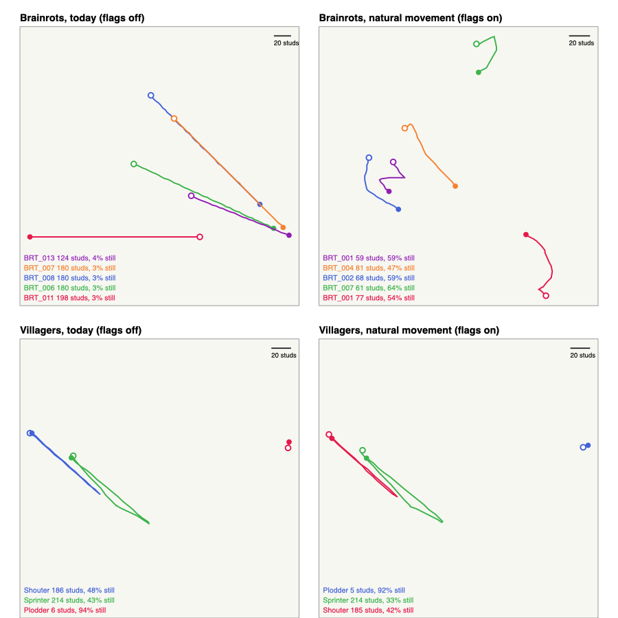

# Rig + animation brief v5: report

Started 13 November 2026. Branch `feature/camp-rework`, base commit `4e5ce25`, build stamp `P14_VILLAGER_OUTFITS_20261110_R1`, DEV place 91958083796436. Nothing published. Nothing committed yet.

**Status: Part A, the villager body, BRT_019, BRT_011, BRT_013 and BRT_001 are approved (13 November 2026). Their 68 animations are built as upload files but not uploaded: `assets/animations` needs approving as an upload folder in Studio. BRT_002 is drafted and waiting for review: `review/BRT_002/REVIEW.md`.**

## 0. Reconcile and snapshots

- Checkout, branch and Rojo: canonical root, Rojo 7.7.0 serving `default.project.json` live into Studio. The 17 scripts checked (every one Part A touches) were byte-identical in Studio and on disk before any edit.
- Source snapshot: `.checkpoints/animation_20261113/source_pre_partA.tgz` (plus the working-tree diff and HEAD).
- Place snapshot: saved to Roblox as place version 1272 (save only, not published).
- Template snapshot: `ServerStorage._Backups_Animation_20261113` holds the 45 villager templates, the 35 `CodeAssets.CreaturesV4` models and the 35 `Phase13CreatureAssets.Brainrots` models.
- A second session ("Playtest Fixes v1") is editing this checkout at the same time. It added `PlaytestFixesV1Enabled` to `FeatureFlags.lua` while Part A was being written; the two edits were merged by hand. No other file overlaps so far.

## 1. Part A root cause: why the behaviours "don't show"

Measured in one Play run with a read-only QA hook on the live roaming system.

**The behaviours fire correctly on the server.** None of the suspected wiring faults is present: every nearby creature was observed, `Phase12InteractionReady`, unpaused, and ticking at 10 Hz. A Sprinter (BRT_019) approached to 14 studs locked on, burst to about 15 studs/s for 1.2 s and dropped into recovery. A Reactive Runner (BRT_011) locked on and fled.

They are invisible for four presentation and tuning reasons:

| # | Finding | Kind |
|---|---|---|
| 1 | Calm creatures are almost never calm. They are stationary about 3% of the time and march at full speed (400 to 485 studs per minute) in dead-straight lines, mostly straight to a burrow exit (34 of 42 creatures were in `ApproachBurrow`). A fleeing creature therefore looks the same as a normal one. | Fixed by Part A |
| 2 | There is no telegraph: no turn toward the player, no "!", no pose change. | Fixed by Part A (server state) and Part D (client) |
| 3 | A Reactive Runner flees at its normal walking speed (`ResolvedSpeed = NormalSpeed`, 6.6 studs/s), and a Sprinter's burst is 1.2 s. A player walks at 16 and a cart drives at 48, so the flee never opens a gap. | Tuning. Not changed. See section 7. |
| 4 | Only 20 of the 35 species have a behaviour, and the ten Forest Commons are all Wanderers, so a new player mostly meets creatures that are designed not to react. | Tuning. Not changed. |

No wiring fix was needed.

## 2. What Part A changes (all behind flags, default off)

Flags in `Shared.Config.FeatureFlags`: `CreatureAnimationEnabled`, `VillagerAnimationEnabled`, `VillagerLifeEnabled`, all `false`. Studio-only preview without touching the flags: set `ReplicatedStorage.CreatureAnimationPreview` / `VillagerAnimationPreview` to `true` before Play. Tuning lives in `Shared.Config.CharacterMotion`.

**Brainrots** (`BurrowRouteMotor`, `DevelopmentBrainrotRoaming`, `CreatureReplicationService`):

- Goal picking, exits, burrow journeys and every segment check are untouched. Only the travel between points changed.
- Heading turns at most 140 degrees per second toward the goal plus a small wander offset (circle distance 4, radius 1.5). Turns over 100 degrees stop and turn on the spot (0.25 s). Intermediate route points are rounded inside 2 studs.
- Speed eases in over 0.3 s and out over the last 2 studs. `NORMAL_MOVE_SPEED` and the rarity speeds are still the top speed.
- Height follows the projected ground, smoothed over 0.15 s.
- Each step is still validated with the existing `ValidateSegment`. If a curved step fails, the old straight step is tried; if that fails, the existing blocked handling runs.
- Rhythm with a seeded phase per creature: walk 2 to 5 s, pause 1.5 to 4 s, a Signature pause every 3rd or 4th pause (every 2nd for Legendary and above).
- Notice beat: a player crossing 1.2 x `AwarenessRadius` (28 studs for a Wanderer) in front of a calm creature makes it stop and face them for 0.4 s. From behind it is skipped. A reactive creature then shows `Alert` at the moment its existing behaviour locks on; the behaviour is not delayed or changed.
- Motion state: `Motion`, `MotionAt` and `MotionSeed` on the existing creature row, sent only on change. No new remote.

**Villagers** (`VillagerGuardService`, `VillagerGuardRuntime`):

- Turn-rate-limited facing (270 degrees per second chasing, 180 otherwise), ease in 0.25 s, ease out 0.3 s, 0.2 s burst out of the wind-up, ground height smoothed over 0.15 s.
- Chase aims at the cart's predicted position (lead capped at 0.6 s) and chasers keep 3 studs apart. Top speeds, tag reach, ring, timers and cooldowns are untouched; tags are still judged against the cart's real position.
- Every `tryMove` check is kept. If a steered step fails a check, the old straight step is judged before a villager gives up, so the give-up rules are the same.
- `Motion`, `MotionAt` and `Seed` attributes on the villager root, set in the same tick as the state.

Not in Part A: client smoothing and animation playback (Part D), the Suspicious look-around (C.5), village life (C.6). The legacy non-motor roaming branch (`pickTarget` → `moveToward`) was left as it is; every live creature observed had a route motor.

## 3. Checkpoint A measurements

Same 30 s script in both runs: stand in the Forest, a synthetic hit near two villagers at 2 s, a chase at 9 s, drive the cart at 30 studs/s from 10 s. Raw samples and the plot are in `checkpointA/`.

| Measure | Flags off (today) | Flags on | Target | Result |
|---|---|---|---|---|
| Brainrot stationary share (mean of creatures tracked 15 s or more) | 5.6% | 57.7% (47 to 64% per creature) | 55 to 65% | Pass |
| Brainrot distance per minute | 401 studs | 216 studs | within ±15% of flags off | **Fail, by design conflict (below)** |
| Creature row bytes sent (estimate, about 27 s) | 7.05 MB, 7,437 row updates | 2.14 MB, 2,121 row updates | at most +10% | Pass (about 70% less) |
| Villager chase beats, Sprinter | "?" 2.0 s, "!" 9.3, chase 10.2, tag 12.1, home 24.0 | "?" 2.1, "!" 9.3, chase 10.3, tag 12.0, home 26.1 | unchanged | Pass |
| Villager chase beats, Shouter | chase 10.2, give up 16.8, return 18.5 | chase 10.3, give up 16.8, return 18.8 | unchanged | Pass |
| Notice beat (Wanderer, approached from the front at 24 studs) | none | stops and faces the player for about 0.45 s, then eases off | 0.4 s | Pass |
| Reactive creature | flees with no cue | `Alert` at lock-on, then `Run` | "!" then flee | Pass (server state only) |
| New errors or warnings | - | none | none | Pass |
| Specs, flags off (`run-villager-tests.sh`) | - | 33 of 33 pass | - | Pass |

Not verified:

- **How it looks on the client.** The client still lerps linearly between 10 Hz poses and has no animations until Part D; the curves and pauses were measured on the server, not judged by eye.
- "From behind skips the turn" was only confirmed by reading the code. The Play probe for it hit the 6 s notice cooldown from the previous probe, so it proves nothing.
- The last small change (publishing `Idle` at once during the notice beat) was linted but not run in Play.
- There are no unit specs for the steering code yet. Flags-off behaviour is covered by the existing 20 villager specs.
- Villager fairness checks V1 to V11 with the flags on (R13) have not been re-run.

### The R11 conflict: an owner decision

R11 asks for 55 to 65% stationary **and** distance per minute within ±15% of today. Today creatures move at top speed 95% of the time, so the two halves cannot both pass while the speed cap is untouchable. Part A meets the stationary share and travels 46% less distance. Side effect: a burrow journey (3 to 5 legs and 14 to 24 s, then walk to an exit) takes longer in real time, so each creature stays in the world longer. Spawn caps and weights are unchanged.

Also inside the brief: uniform walk 2 to 5 s and pause 1.5 to 4 s gives about 44% stationary, not 55 to 65%. The durations are kept inside those ranges but skewed (short walks and long pauses are likelier) to reach the share. `WalkSkew` and `PauseSkew` in `CharacterMotion` control it.

## 4. Planned order (owner may reorder)

1. Part A checkpoint: approved 13 November 2026.
2. The villager body and its 24 animations, on a neutral skin and on Nonna Pina: approved 13 November 2026; upload pending.
3. Trenostruzzo Turbo 3000 (BRT_019), the brainrot reference: approved 13 November 2026; upload pending.
4. Regions in unlock order. Brainrots by spawn share, first region they appear in; then that region's villager skins.

| Region | Brainrots (most common first) | Villager skins |
|---|---|---|
| Forest | BRT_011, BRT_013 (13% each), BRT_001 to BRT_010 (6.8% each) | Taglialegna Tito, Nonna Pina, Gufo Gelato, Funghetto Franco, Zia Castagna, Picchio Pepe |
| Beach | BRT_020, BRT_012, BRT_014, BRT_015 | Bagnino Bruno, Zio Sabbia, Granchio Megafono, Surfista Sara, Nonno Conchiglia |
| Swamp | BRT_021, BRT_022, BRT_026, BRT_028, BRT_030, BRT_016, BRT_017, BRT_018 | Rana Rapida, Pescatore Pozzo, Lumaca Lampione, Rospo Rocco, Zia Palude |
| Jungle | BRT_027, BRT_023, BRT_024, BRT_025 | Scimmia Spaghetti, Tucano Totò, Pappagallo Pazzo, Scimmietta Sofia, Tucana Tina |
| Arctic | BRT_029 | Pinguino Pattino, Pinguina Pia, Orso Brodo, Orsetta Olga, Foca Fischietto |
| Volcano | BRT_031 | Lavoratore Lava, Mamma Magma, Campana Cenere, Minatore Mimmo, Nonna Brace |
| Glitch Zone | BRT_032 | Pixel Pino, Errore 404, Bip Bop, Pixel Pina, Errore 500 |
| Teased, never spawn | BRT_033, BRT_034, BRT_035 | - |

That is 35 brainrots, 1 villager body and 36 roster villagers (45 templates including outfit variants), each with its own review stop.

## 4b. Archetype map and approved items

| Species | Archetype | Joints | Rounds | Approved | Asset ids |
|---|---|---|---|---|---|
| Villager body | VillagerBody | 17 (12 body + 5 attachment bones) | 1 | 13 Nov 2026 | not uploaded |
| BRT_019 Trenostruzzo Turbo 3000 | Vehicle-hybrid | 6: Torso, Neck, Head, RightLeg, LeftLeg, ToiletLid | 1 | 13 Nov 2026 | not uploaded |
| BRT_011 Glorbo Fruttodrillo | Quadruped | 7: Torso, Head, four legs, Tail (existing V4 rig, unchanged) | 1 | 13 Nov 2026 | not uploaded |
| BRT_013 Cavallo Virtuoso | Biped | 6: Torso, Neck (new), Head, RightLeg, LeftLeg, Tail | 1 | 13 Nov 2026 | not uploaded |
| BRT_001 Bingus Baguette | Quadruped | 7 (existing V4 rig, unchanged) | 1 | 13 Nov 2026 | not uploaded |
| BRT_002 Tralalero Toad | Hopper | 6: Torso, Head, two hind legs, two front limbs (existing V4 rig, unchanged) | 1 | 13 Nov 2026 | not uploaded |

The Voxel V4 models already carried a basic Motor6D rig from the 7 November pass (`tools/voxel_v4/rig.js`). Species are rigged by extending that data through the existing export pipeline, not by a separate rig builder. Quadrupeds share `ServerAssets.AnimationAuthoring.Archetypes.Quadruped` as a starting point.

Uploads: all approved animation files are in `assets/animations/`. Studio refuses the upload until that folder is added under Assistant Settings → MCP Permissions.

## 5. Open questions before Part B

1. **Which brainrot models get rigged?** Play shows the Voxel V4 models (`CodeAssets.CreaturesV4`, about 300 parts each) through the Studio preview, but `VoxelCreaturesV4Enabled` is `false` live, where the 25-part sculptures in `Phase13CreatureAssets` still load. The brief reads as V4.
2. **Where do rigged templates live?** `CodeAssets.CreaturesV4` is Rojo-mapped from `src/assets/CreaturesV4/*.model.json`, and `Phase13CreatureAssets` from an October `.rbxm`. A rig baked in Edit mode would be reverted on the next Rojo connect (the 12 November map incident). The rigged templates need to be written to disk as files, or built by a script from the V4 data.
3. **GIFs:** neither ffmpeg nor ImageMagick is installed, so review packages will have contact sheets and the review pen but no GIFs unless one is installed.
4. **Studio HTTP is blocked** for the assistant, so Open Cloud animation uploads may need the owner's *Save to Roblox* step. To be tested at the first approval.

## 6. Scorecard R1 to R20

Only the rows Part A can answer are filled.

| ID | State |
|---|---|
| R1 | Partly: flags-off server code paths are the old ones and the villager specs pass; a full flags-off packet diff has not been run. |
| R9 | Root cause reported (section 1). "!" + `Alert` → `Run` is published by the server; client playback is Part D. |
| R10 | Curved paths and ground follow measured on the server for brainrots and villagers. |
| R11 | Stationary share passes; distance fails by design conflict (owner decision). |
| R13 | Not run yet. |
| R17 | Hit proxies and tag distance untouched; the authoritative brainrot pose now curves and pauses, which is the point of Part A. |
| R20 | Bandwidth passes. No new remote, no new per-frame connection, no server animator. |
| Others | Not started. |

## 7. Recommended tuning (not applied)

- Give Reactive Runners a flee speed above their walk speed (for example 1.5 x for 2 s). At walking speed the flee is not readable even with animation.
- Lengthen the Sprinter burst or raise its multiplier; 1.2 s at 1.8 x covers about 14 studs.
- Consider giving two or three Forest Commons the Reactive Runner behaviour so new players meet a skittish creature early.
- If distance per minute matters more than pauses, the alternative is a lower stationary share (about 30%) rather than a higher speed.
