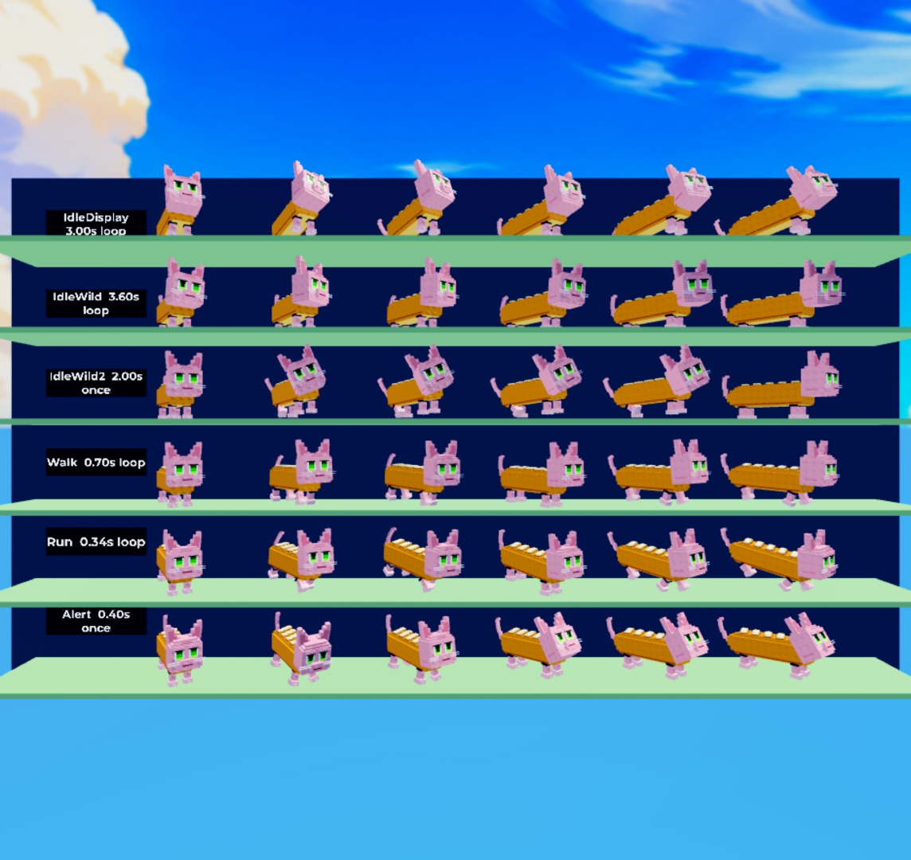
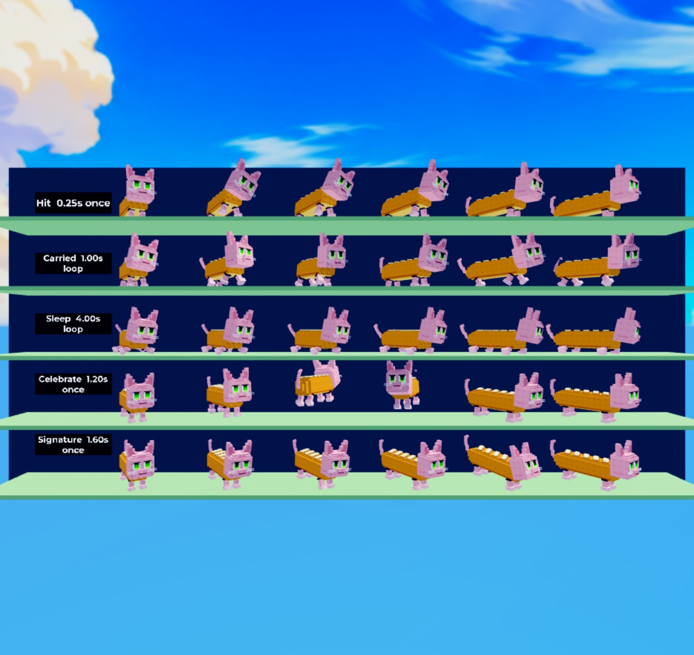

# Review package: BRT_001 Bingus Baguette (round 1)

13 November 2026. Drafts only: nothing uploaded, nothing live, not committed.

## Rig

- **Archetype: Quadruped**, started from the approved Glorbo base.
- **7 Motor6D joints, unchanged:** Root→Torso (the loaf), Torso→Head, Torso→four legs, Torso→Tail. This is the rig the V4 model already had. No model data or template changed, so the bind pose is the current model by definition.
- **Face:** eyes, lids, muzzle, whiskers, wrinkles and the big ears all move as one rigid group on the head.

## Animations (11)

| Sheet | Rows, top to bottom |
|---|---|
|  | IdleDisplay, IdleWild, IdleWild2 (hind-leg scratch), Walk, Run, Alert |
|  | Hit, Carried, Sleep, Celebrate, Signature |

The idea: Bingus is long, low and unbothered. The difference from Glorbo is the **upright tail**, which sways side to side and leans back instead of lifting, and the **Signature, "making biscuits"**: six kneading presses with the front paws and a happy head bob, then the long cat stretch with the chest down and the head up.

The top row of each sheet is seen from below, which exaggerates the tilt.

## Review pen

Set `AnimationReviewPen = true` on `ReplicatedStorage`, press Play, and cross the bridge behind the villager demo. Bingus is the fourth creature row. The pen floor now grows with the number of species.

Checked in Play: 15 Bingus models, tracks load, no errors, every creature in the pen has floor under it. I did not watch each animation play.

## Self-check

| Check | Result |
|---|---|
| Loops seamless | Pass |
| Nothing under the floor | Pass |
| Face rigid | Pass |
| Clipping | Not checked animation by animation. Watch the head against the front of the loaf when it turns, and the tail base. |
| Foot sliding | Not measured |

## Concerns

1. **Mostly the shared quadruped set.** Ten of the eleven clips are the approved Glorbo motions re-fitted to Bingus's proportions; only the tail behaviour and the Signature are new. If you want more cat in the walk or idles, say which.
2. **Sleep keeps the eyes open.** The face is rigid, so there are no closed lids. This applies to every species.
3. **Run is authored for 10.8 studs/s** (the Sprinter burst speed for a Common).
