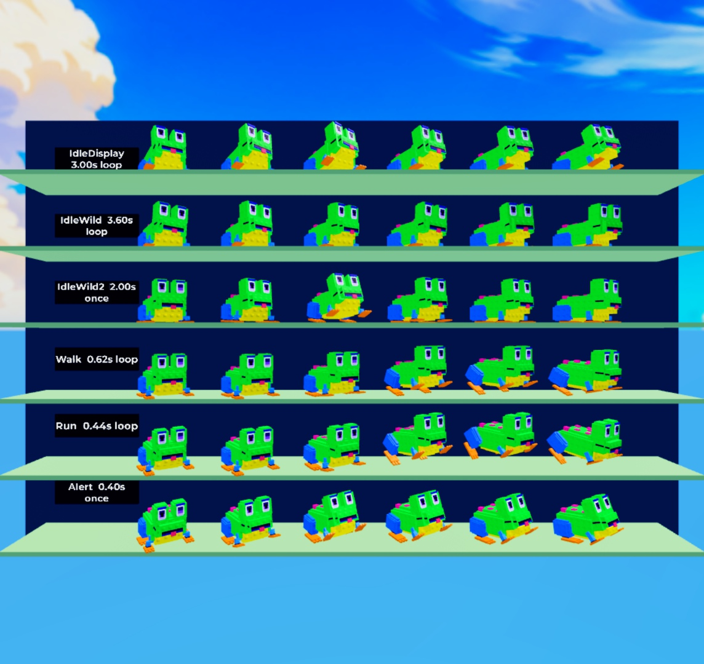
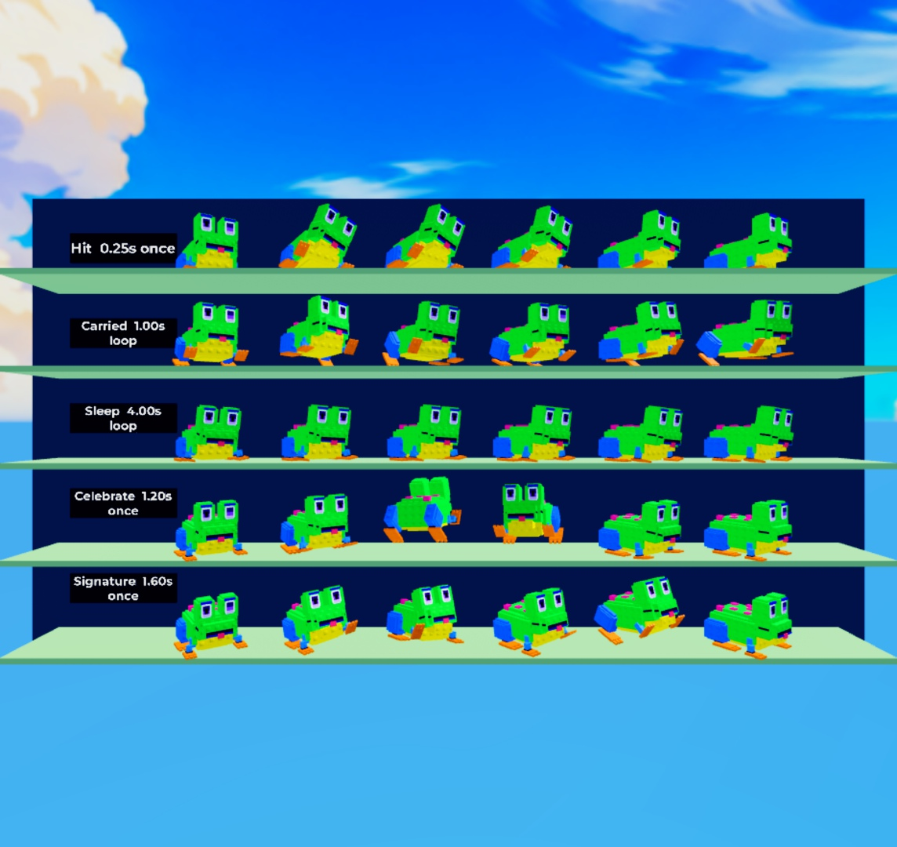

# Review package: BRT_002 Tralalero Toad (round 1)

13 November 2026. Drafts only: nothing uploaded, nothing live, not committed.

## Rig

- **Archetype: Hopper.** The first one, so it sets the base for other squat creatures that travel by hopping (`ServerAssets.AnimationAuthoring.Archetypes.Hopper`).
- **6 Motor6D joints, unchanged:** Root→Torso, Torso→Head, Torso→two hind legs, Torso→two front limbs. This is the rig the V4 model already had. No model data or template changed, so the bind pose is the current model by definition.
- **Face:** eye domes, eyes, brows, mouth, lip and tongue move as one rigid group on the head.

## Animations (11)

| Sheet | Rows, top to bottom |
|---|---|
|  | IdleDisplay, IdleWild, IdleWild2 (lunge at a fly), Walk, Run, Alert |
|  | Hit, Carried, Sleep, Celebrate, Signature |

The idea: a squat, grinning toad who cannot stop singing. He travels in hops: Walk is a small hop with the hind legs kicking back, Run is a higher, longer leap. The **Signature is the tra-la-le-ro**: four croaks on the beat, rocking side to side with the head thrown back and the front feet conducting, then one big finishing hop.

The top row of each sheet is seen from below, which exaggerates the tilt.

## Review pen

Set `AnimationReviewPen = true` on `ReplicatedStorage`, press Play, and cross the bridge behind the villager demo. The Toad is the fifth creature row.

Checked in Play: 15 Toad models, tracks load, no errors. I did not watch each animation play.

## Self-check

| Check | Result |
|---|---|
| Loops seamless | Pass |
| Nothing under the floor | Pass. The toad's belly rests on the ground, so 7 of the 11 clips dipped under it as authored; the baker's new floor clamp lifts each frame by exactly what it would sink, and all 11 pass after it. |
| Face rigid | Pass |
| Clipping | Not checked animation by animation. Watch the head against the body when it turns (IdleWild) and the hind legs against the belly in the kick. |
| Foot sliding | See concern 1 |

## Concerns

1. **Hops slide on the ground.** The server moves the toad at a steady speed, so during the 30% of each hop spent on the ground the feet slide. A true stop-and-go hop would need the server to move in bursts, which is a movement change, not an animation one. Say if you want that.
2. **The throat sac does not puff.** It is one box; animating it would need part rescaling, which the brief rules out.
3. **Run is authored for 10 studs/s, which is my assumption.** The Toad is a Wanderer today and never flees.
