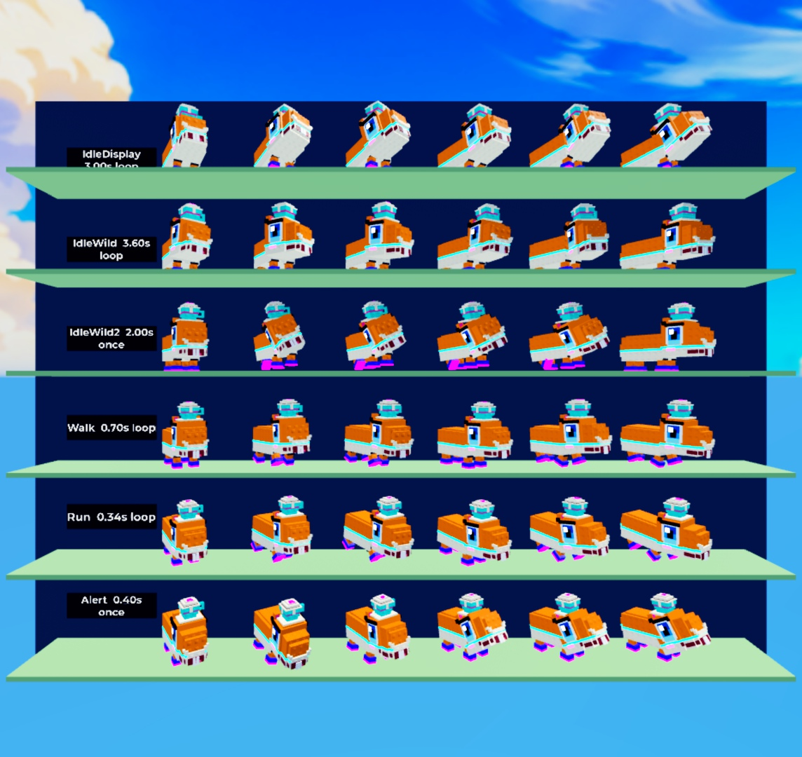
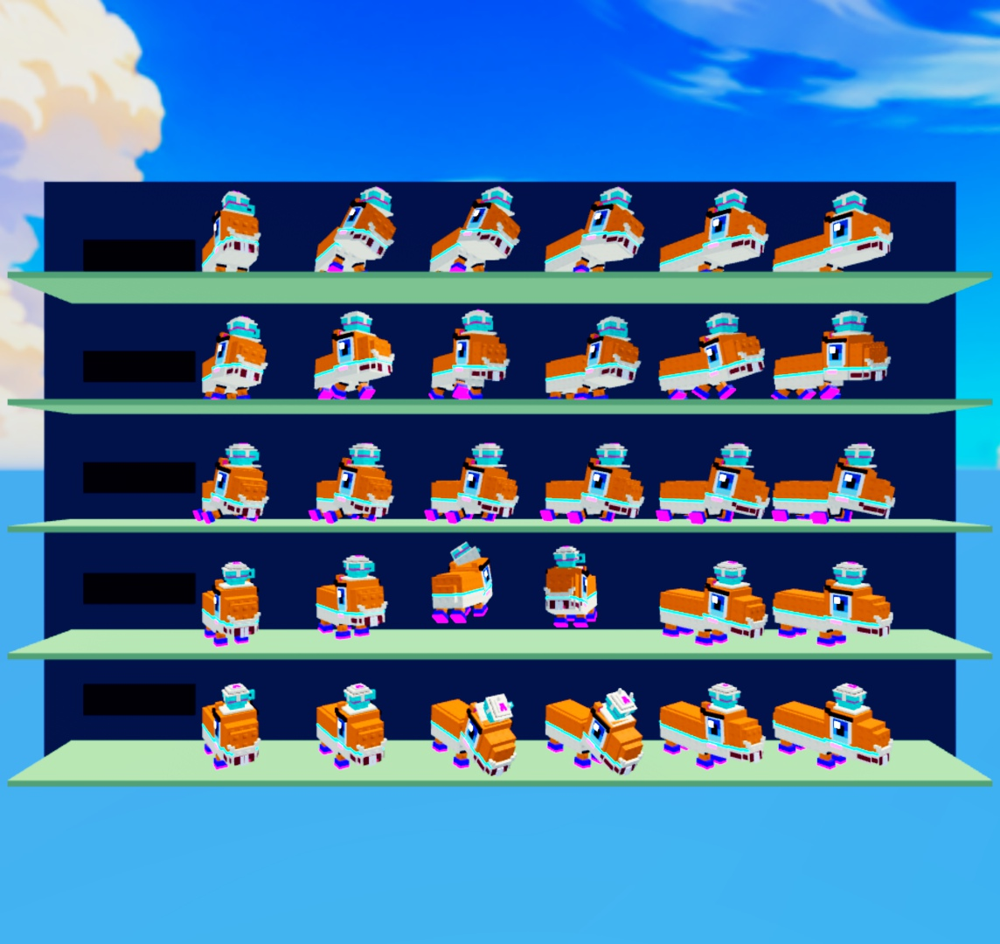

# Review package: BRT_003 Cappuccino Capybara (round 1)

13 November 2026. Drafts only: nothing uploaded, nothing live, not committed.

## Rig

- **Archetype: Quadruped** (no tail), started from the approved Glorbo base.
- **7 Motor6D joints:** Root→Torso, Torso→Head, Torso→four legs, and one new joint, **Head→Cup**, for the signature prop. The cappuccino (saucer, cup, band, rim, coffee, foam, drips, latte heart, handle) moved from the head to the Cup bone. The four steam boxes were on the torso, so they would have stayed behind when the head moved; they now ride on the cup.
- **Bind pose:** all 119 boxes are exactly where they were, with the same colours (scripted comparison with the installed template, zero difference). Only the `rig` list and 24 `bone` tags changed in `Config/VoxelCreatures/BRT_003.lua`.
- **Face:** eyes, lashes, blush, moustache, buck teeth, mouth and ears move as one rigid group on the head.

## Animations (11)

| Sheet | Rows, top to bottom |
|---|---|
|  | IdleDisplay, IdleWild, IdleWild2 (hind-leg scratch), Walk, Run, Alert |
|  | Hit, Carried, Sleep, Celebrate, Signature (labels did not render in this capture) |

The idea: the chillest animal alive, on its tenth cappuccino. **In every clip the cup is being balanced**: it takes about three quarters of the head's and body's tilt back out and trembles slightly, so the head can scratch, flinch or sleep while the cup stays level. The **Signature is the near-spill**: a caffeinated shiver, the head dips and the cup tips forward almost over, then it snaps back level with a relieved wobble.

The top row of each sheet is seen from below, which exaggerates the tilt.

## Review pen

Set `AnimationReviewPen = true` on `ReplicatedStorage`, press Play, and cross the bridge behind the villager demo. The Capybara is the sixth creature row.

Checked in Play: 15 Capybara models, tracks load, the Cup bone is present and moving, no errors. I did not watch each animation play.

## Self-check

| Check | Result |
|---|---|
| Loops seamless | Pass |
| Nothing under the floor | Pass |
| Face rigid | Pass |
| Clipping | Not checked animation by animation. Watch the saucer against the ears and the top of the head when the cup counter-tilts, and during the spill. |
| Foot sliding | Not measured |

## Concerns

1. **A mistake I caught and fixed.** My first re-export dropped this species' two mutation colour overrides (Glitched and Astral `prop` colours), because the exporter needs a per-species overrides file that I had not passed. I re-exported with it and the data is now identical apart from the rig. I added `tools/animation/reexport_species.sh`, which always passes that file, and I checked that the two species I re-exported earlier (Trenostruzzo, Cavallo) have no overrides file, so they were not affected.
2. **The installed template is out of date** until approval, as with the others. I will regenerate it then.
3. **Coffee never actually spills.** There are no particles or liquid; the near-spill is the cup tipping only.
4. **Run is authored for 10 studs/s, which is my assumption.** The Capybara is a Wanderer today and never flees.
