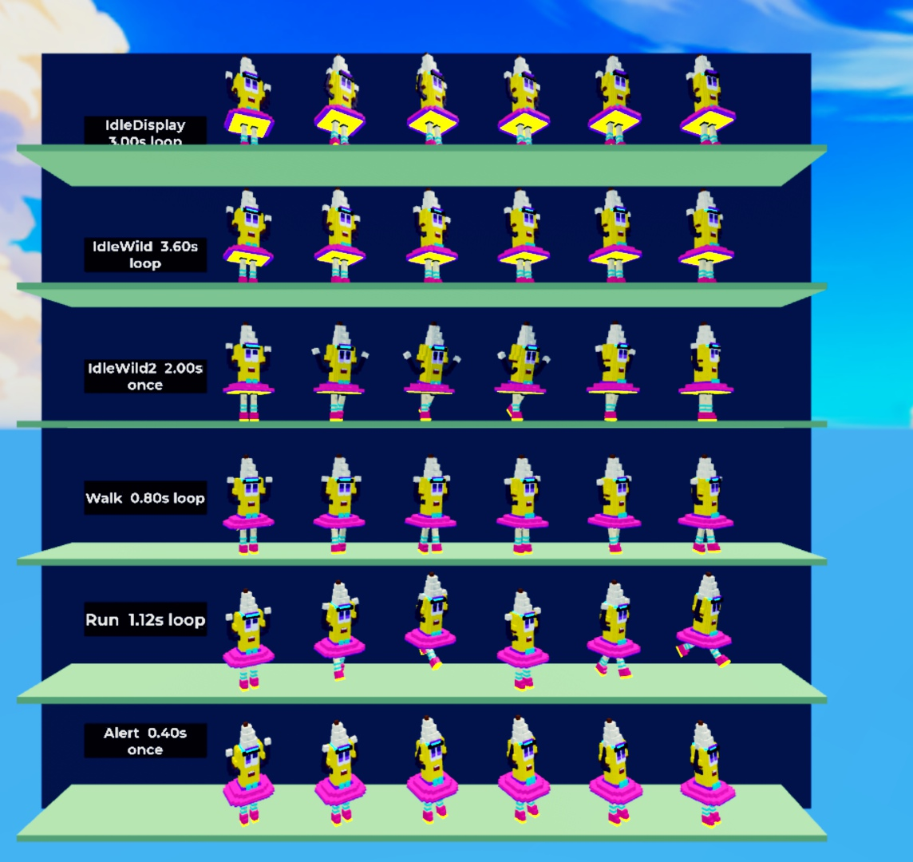
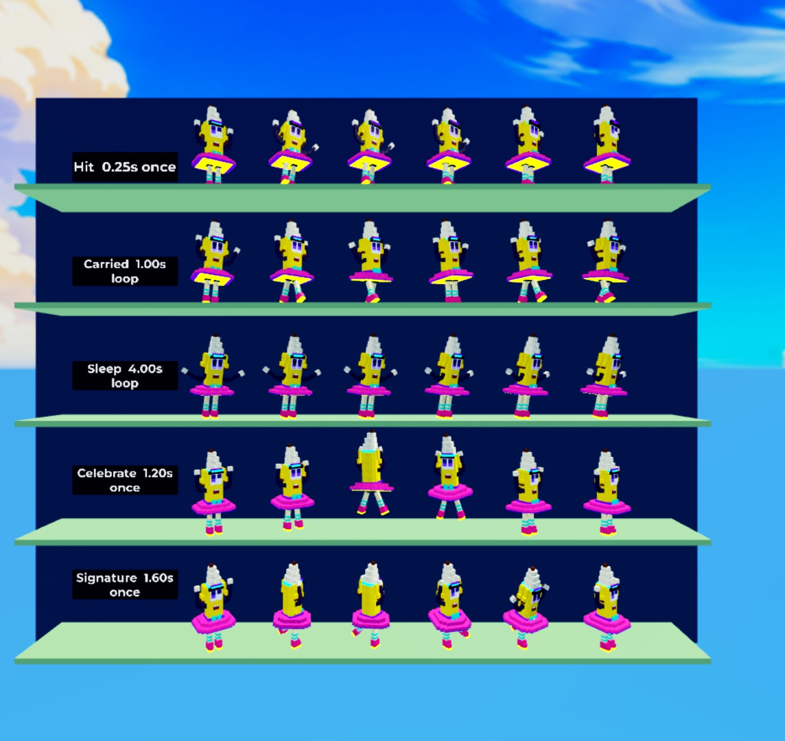

# Review package: BRT_004 Ballerina Banana (round 1)

13 November 2026. Drafts only: nothing uploaded, nothing live, not committed.

## Rig

- **Archetype: Biped with the face on the body.** There is no head or neck joint: the eyes and mouth are part of the banana.
- **6 Motor6D joints:** Root→Torso, Torso→two legs, Torso→two arms, and one new joint, **Torso→Tutu**, for the signature prop. The tutu, its rim and its hem moved from the body to the Tutu bone so the skirt can lag and swish. The waistband and bow stay on the body.
- **Bind pose:** all 100 boxes are exactly where they were, with the same colours (scripted comparison with the installed template, zero difference). Re-exported with her mutation overrides file; only the `rig` list and 10 `bone` tags changed.
- **Face:** eyes, lashes, brows, blush and mouth are on the body and never move relative to it.

## Animations (11)

| Sheet | Rows, top to bottom |
|---|---|
|  | IdleDisplay, IdleWild, IdleWild2 (a deep curtsy), Walk, Run, Alert |
|  | Hit, Carried, Sleep, Celebrate, Signature |

The idea: a banana who is, entirely seriously, a prima ballerina. This set is written for her rather than taken from a shared base:

- **Walk** is a bourrée: tiny quick steps on pointe with the body gliding.
- **Run** is a chain of grand jetés, leading with each leg in turn, legs split in the air.
- **IdleWild2** is a deep curtsy with the arms lowered.
- **Sleep** is asleep on her feet, drooping forward with the arms down.
- **Signature** is the pirouette: up on one pointe with the other leg lifted out, two full turns with the tutu trailing, then an arabesque held for a beat.

The top row of each sheet is seen from below, which exaggerates the tilt.

## Review pen

Set `AnimationReviewPen = true` on `ReplicatedStorage`, press Play, and cross the bridge behind the villager demo. She is the seventh creature row.

Checked in Play: 15 Ballerina Banana models, tracks load, no errors. I did not watch each animation play.

## Self-check

| Check | Result |
|---|---|
| Loops seamless | Pass, after lengthening Walk to two steps (the arm and tutu sway did not close on one) |
| Nothing under the floor | Pass |
| Face rigid | Pass |
| Clipping | Not checked animation by animation. Watch the tutu against the legs when a leg lifts high (Run, Signature) and the arms against the peels. |
| Foot sliding | Not measured. The bourrée steps are deliberately tiny, so the feet will skate at 6 studs/s; that is close to how the real step reads. |

## Concerns

1. **The arms are rigid sticks, already raised and bent.** They can lift, lower and sway from the shoulder but cannot round or cross.
2. **The body cannot bend.** A real curtsy or arabesque bends at the waist; here the whole banana tips.
3. **The pen is getting heavy:** 105 creatures and 54 villagers at once. It still ran without errors. If it becomes slow to review in, I can add a way to show one species at a time.
4. **The installed template is out of date** until approval, as with the others.
5. **Run is authored for 10 studs/s, which is my assumption.** She is a Wanderer today and never flees.
