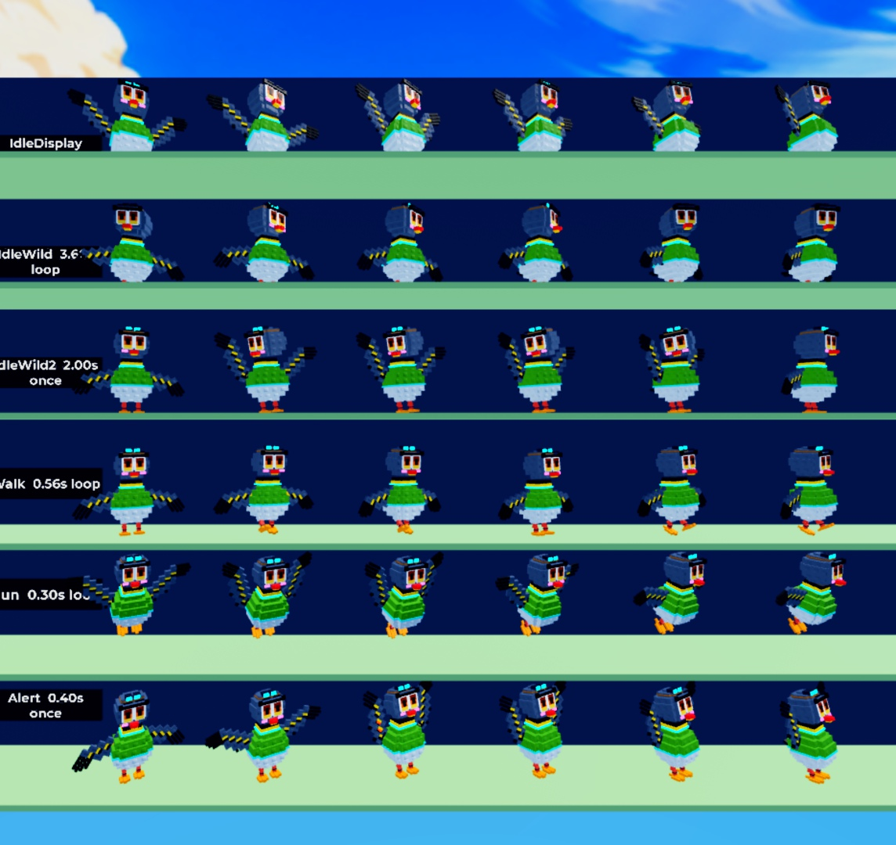
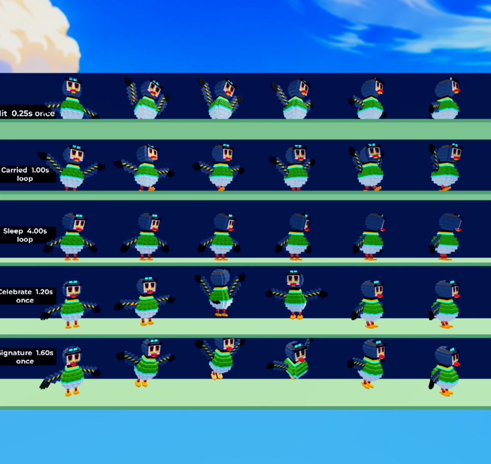

# Review package: BRT_005 Bombardiro Pigeon (round 1)

13 November 2026. Drafts only: nothing uploaded, nothing live, not committed.

## Rig

- **Archetype: Flyer.** The first one, so it sets the base for other winged species (`ServerAssets.AnimationAuthoring.Archetypes.Flyer`).
- **7 Motor6D joints, unchanged:** Root→Torso, Torso→Head, Torso→two wings, Torso→Tail (with the afterburner), Torso→two legs. This is the rig the V4 model already had. No model data or template changed, so the bind pose is the current model by definition.
- **Face:** eyes, lashes, brows, blush, beak and goggles move as one rigid group on the head.

## Animations (11)

| Sheet | Rows, top to bottom |
|---|---|
|  | IdleDisplay, IdleWild, IdleWild2 (preening under a wing), Walk, Run, Alert |
|  | Hit, Carried, Sleep, Celebrate, Signature |

The idea: a plump city pigeon in bomber-jet colours who believes he is military aviation. He struts like a pigeon and flies like a sortie.

- **Walk** is the pigeon strut: chest out, head bobbing forward and back with each step, wings held down.
- **Run** is flight: he leaves the ground, pitches forward, beats his wings and tucks his legs back.
- **IdleWild** uses quick bird head turns: hold, then snap to the other side.
- **Sleep** is roosting: wings hanging, head tucked to one side.
- **Signature** is the bombing run: scramble into the air, bank hard one way and then the other with the wings locked out like a jet, nose down into the dive, then pull up and land.

The top row of each sheet is seen from below, which exaggerates the tilt.

## Review pen

Set `AnimationReviewPen = true` on `ReplicatedStorage`, press Play, and cross the bridge behind the villager demo. He is the eighth creature row.

Checked in Play: 15 Pigeon models, tracks load, no errors. I did not watch each animation play.

## Self-check

| Check | Result |
|---|---|
| Loops seamless | Pass |
| Nothing under the floor | Pass (4 clips needed the floor clamp) |
| Face rigid | Pass |
| Clipping | Not checked animation by animation. Watch the wings against the body when they hang (Sleep, IdleWild) and the head against the wing in the preen. |
| Foot sliding | Not measured |

## Concerns

1. **The wings cannot fold.** Each wing is one rigid spread plate, so "wings down" means the whole wing hangs at an angle rather than tucking against the body. After the first capture they sat level like a glider at rest, so I lowered the calm angle from 26 to 58 degrees below the spread pose.
2. **Flying while fleeing is a presentation choice.** The server still moves him along the ground at ground speed; only the visual lifts 1.3 units. His hitbox does not move. Say if you would rather he ran.
3. **Run is authored for 10 studs/s, which is my assumption.** He is a Wanderer today and never flees.
4. **Rojo was not connected** after the last Studio restart, so I applied the wing-angle edit to the Studio copy of this one file by hand, with the identical edit on disk. Please click Connect in the Rojo plugin; until then, source edits on disk will not reach Studio.
