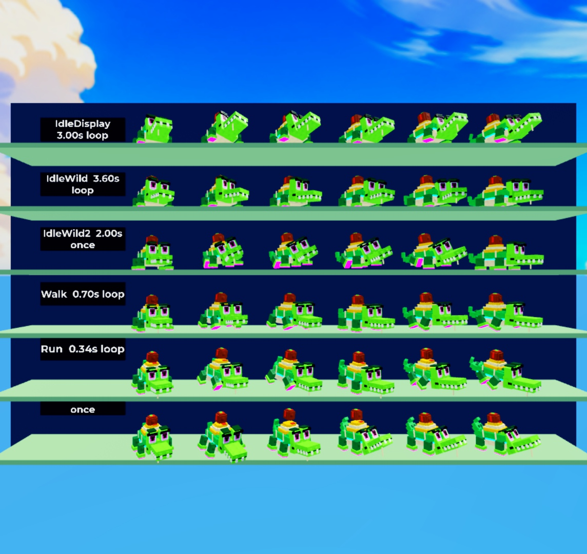
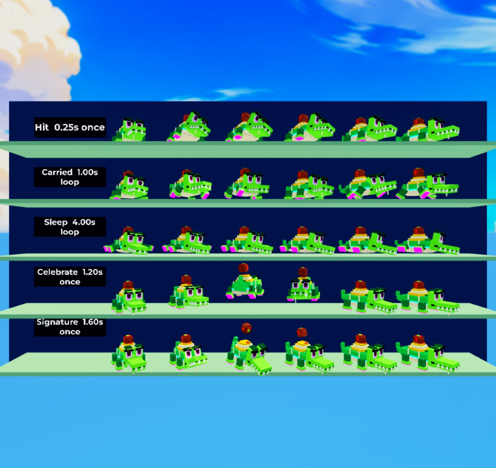

# Review package: BRT_006 Spaghetti Crocodilo (round 1)

13 November 2026. Drafts only: nothing uploaded, nothing live, not committed.

## Rig

- **Archetype: Quadruped**, started from the approved Glorbo base.
- **8 Motor6D joints:** Root→Torso, Torso→Head, Torso→four legs, Torso→Tail, and one new joint, **Torso→Meatball**, for the signature prop. The three meatball boxes, the basil leaf and the three bits of sauce on the meatball moved from the body to the Meatball bone. The spaghetti heap, the noodle strands and the sauce drips on the heap stay on the body.
- **Bind pose:** all 124 boxes are exactly where they were, with the same colours (scripted comparison with the installed template, zero difference). Only the `rig` list and 7 `bone` tags changed in `Config/VoxelCreatures/BRT_006.lua`.
- **Face:** eyes, lashes, brows, snout, mouth and teeth move as one rigid group on the head.

## Animations (11)

| Sheet | Rows, top to bottom |
|---|---|
|  | IdleDisplay, IdleWild, IdleWild2 (hind-leg scratch), Walk, Run, Alert |
|  | Hit, Carried, Sleep, Celebrate, Signature |

The idea: a low, sly crocodile carrying dinner on its back. The body uses the approved quadruped motions; what is its own is the meatball.

- **The meatball bounces a beat behind the body in every clip**: a small hop on each step in Walk, a big one in Run, a pop on every one-shot, and it hangs in the air above the heap during the Celebrate jump.
- **Signature, the sneeze:** the head rears back, snaps forward, and the meatball is launched off the heap, tumbles once in the air and lands back with two small bounces.

The top row of each sheet is seen from below, which exaggerates the tilt.

## Review pen

Set `AnimationReviewPen = true` on `ReplicatedStorage`, press Play, and cross the bridge behind the villager demo. It is the ninth creature row.

Checked in Play: 15 Crocodilo models, tracks load, the Meatball bone is present, no errors. I did not watch each animation play.

## Self-check

| Check | Result |
|---|---|
| Loops seamless | Pass |
| Nothing under the floor | Pass |
| Face rigid | Pass |
| Clipping | Not checked animation by animation. Watch the meatball against the top of the heap when it rolls, and the low belly in Walk. |
| Foot sliding | Not measured |

## Concerns

1. **Rojo is still disconnected.** The two new files for this species (its animation set and its re-exported data) never reached Studio, so I wrote them into Studio myself and confirmed they are byte-identical to the files on disk (same length and checksum). When Rojo reconnects it will find nothing to change. Please click Connect in the Rojo plugin.
2. **Second crocodile.** Glorbo and this one share the same body motions. They differ in the Signature (death roll against sneeze), the meatball, and Glorbo's taller silhouette. If you want them to move differently (for example a lower, slower crawl for this one), say so.
3. **The installed template is out of date** until approval, as with the others.
4. **Run is authored for 10 studs/s, which is my assumption.** It is a Wanderer today and never flees.
