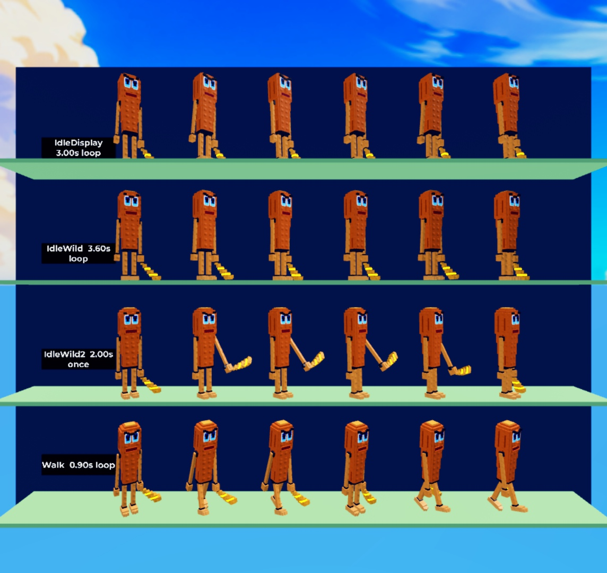
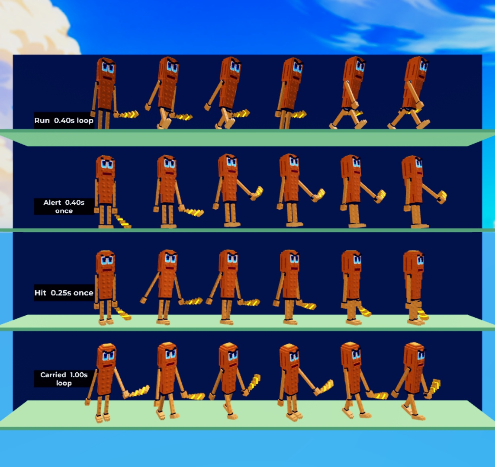
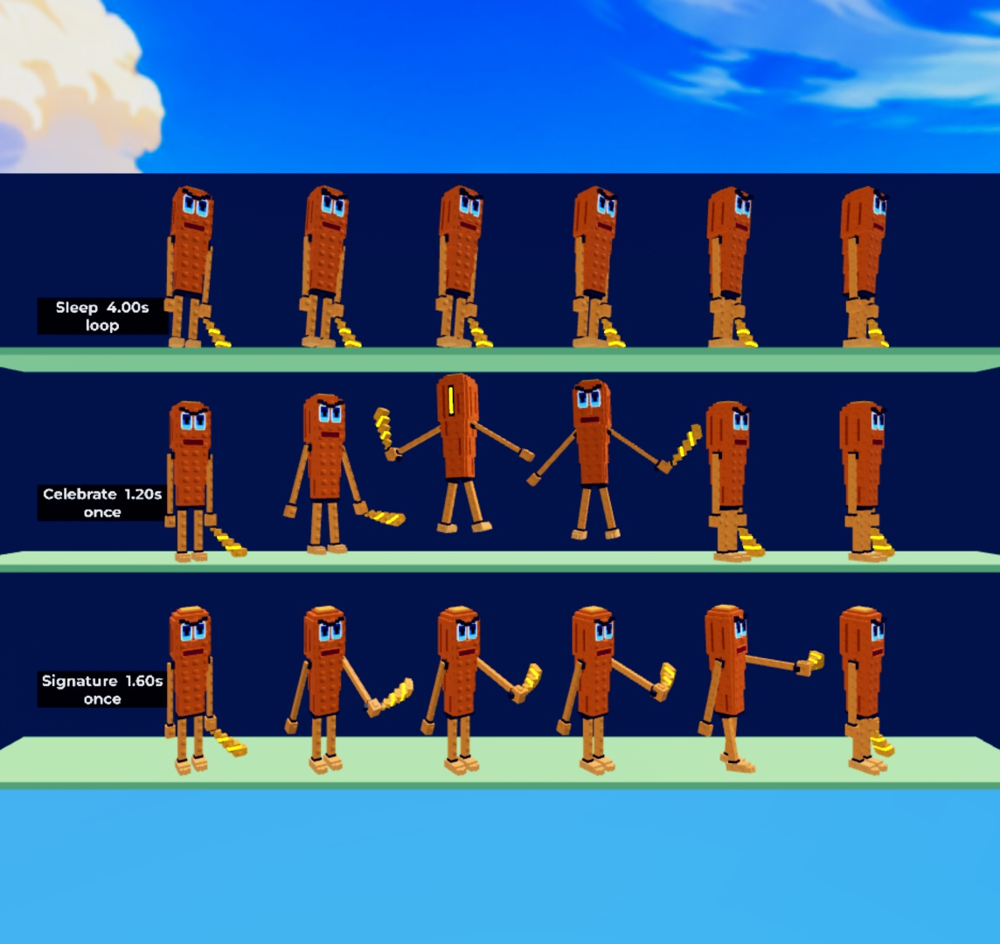

# Review package: BRT_007 Tung Tung Tung Sahur (round 1)

13 November 2026. Drafts only: nothing uploaded, nothing live, not committed.

## Rig

- **Archetype: Biped with the face on the body.** There is no head or neck joint: the face is carved into the log.
- **A rig fault fixed.** In the existing rig the bat was welded to the body, apart from one small box at the grip, so the bat would have stayed behind whenever the arm holding it moved. All eleven bat boxes are now on a new **Bat** bone under that arm, pivoting at the grip.
- **6 Motor6D joints:** Root→Torso, Torso→two legs, Torso→two arms, and LeftArm→Bat (the signature prop).
- **Bind pose:** all 131 boxes are exactly where they were, with the same colours (scripted comparison with the installed template, zero difference). Re-exported with his mutation overrides file; only the `rig` list and 11 `bone` tags changed.
- **Face:** eyes, scowl lids, brows, nose, mouth, teeth, jaw and scar are on the body and never move relative to it.

## Animations (11)

| Sheet | Rows, top to bottom |
|---|---|
|  | IdleDisplay, IdleWild, IdleWild2 (looks the bat over), Walk |
|  | Run, Alert, Hit, Carried |
|  | Sleep, Celebrate, Signature |

The idea: a scowling wooden slit-drum on long legs who comes for you with a bat. He is stiff as a log above the hips; all the menace is in the stride and the bat. This set is written for him.

- **IdleDisplay** is the slow drumbeat: the bat lifts and drops three times, then rests for a bar.
- **Walk** is the stalk: long, slow strides, leaning in, the bat swinging with the arm.
- **Run** is the sprint (he is a Sprinter): leaning hard with the bat cocked back.
- **Sleep** is asleep standing, like the log he is, arms limp.
- **Signature** is TUNG, TUNG, TUNG: the bat comes up and beats down three times, the whole log jolting on each one, then he levels it straight at you and holds.

The top row of each sheet is seen from below, which exaggerates the tilt.

## Review pen

Set `AnimationReviewPen = true` on `ReplicatedStorage`, press Play, and cross the bridge behind the villager demo. He is the tenth creature row.

Checked in Play: 15 models, all tracks load, the Bat bone is present, no errors. I did not watch each animation play.

## Self-check

| Check | Result |
|---|---|
| Loops seamless | Pass |
| Nothing under the floor | Pass (6 clips needed the floor clamp: the feet are long and the bat tip rests on the ground) |
| Face rigid | Pass |
| Clipping | Not checked animation by animation. Watch the bat against the leg on that side in Walk, and against the body when it is raised. |
| Foot sliding | Not measured |

## Concerns

1. **Which hand holds the bat.** AGENTS.md says the right hand wraps the bat handle, and the build names that hand `Hand_R`. The rig planner names the arm on that side `LeftArm`, because it labels sides from the creature's own facing. Nothing moved; I am only flagging that the two names disagree, in case one of them is wrong.
2. **The arms are single sticks.** No elbows, so the drumbeat is a whole-arm swing plus the bat's own swing at the grip.
3. **Rojo is still disconnected.** As with the Crocodilo, I wrote this species' two changed files into Studio myself and confirmed they are byte-identical to disk. I have not clicked Connect for you: AGENTS.md warns that a Rojo connect restores the old mapped native exports, so that is your call.
4. **The installed template is out of date** until approval, as with the others.
