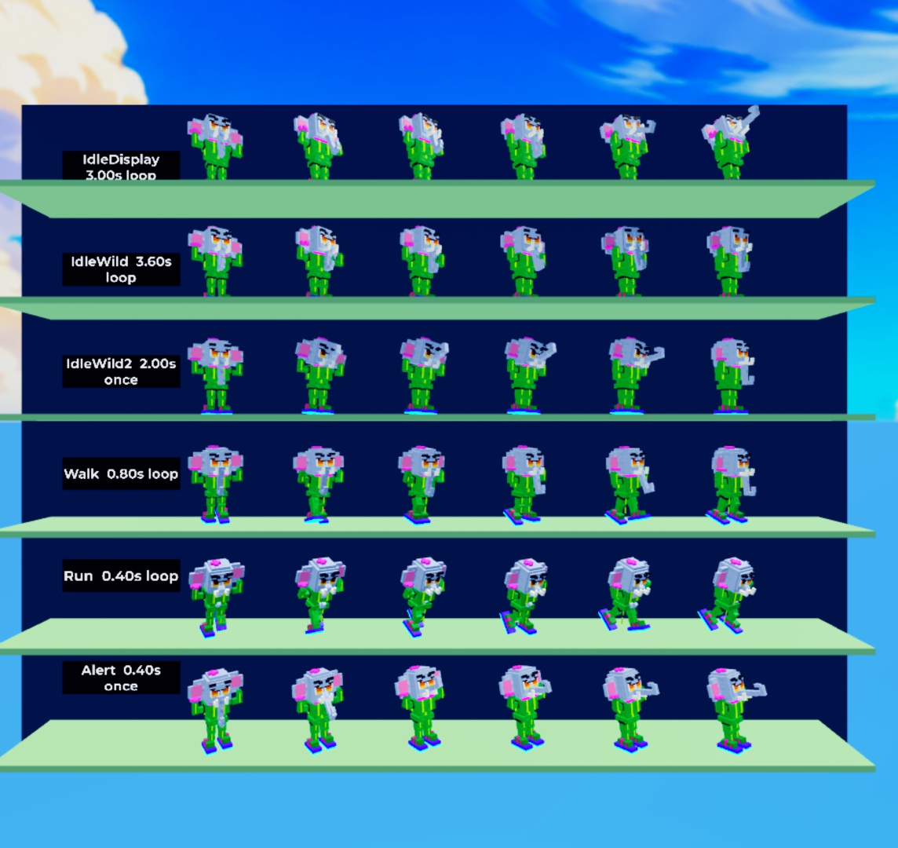
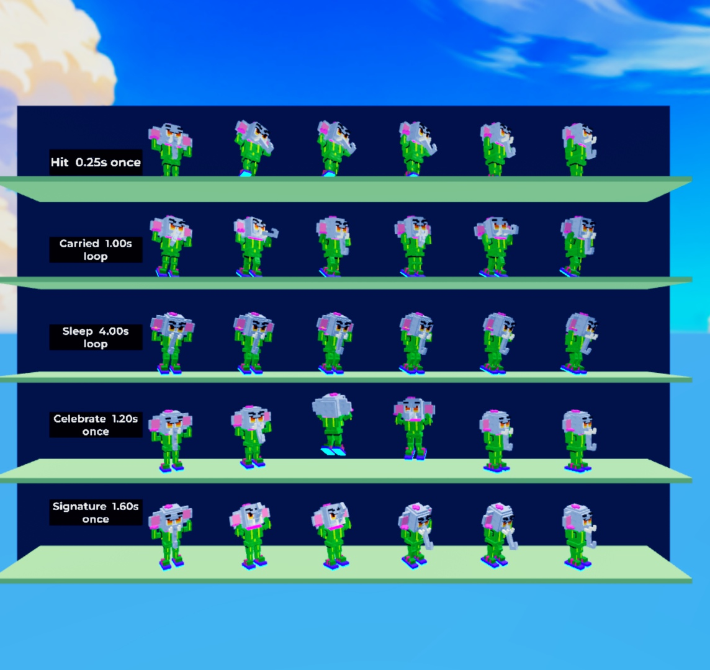

# Review package: BRT_008 Lirili Larila (round 1)

13 November 2026. Drafts only: nothing uploaded, nothing live, not committed.

## Rig

- **Archetype: Biped with knees.** He is the first species whose existing rig already had knee joints, so his legs bend properly.
- **9 Motor6D joints:** Root→Torso, Torso→Head, Torso→two arms, Torso→two thighs, each thigh→lower leg, and one new joint, **Head→Trunk**, for the signature prop. The five trunk boxes, its tip and its two wrinkles moved from the head to the Trunk bone. Tusks, ears and the cactus flowers stay rigid with the head.
- **Bind pose:** all 120 boxes are exactly where they were, with the same colours (scripted comparison with the installed template, zero difference). Only the `rig` list and 8 `bone` tags changed in `Config/VoxelCreatures/BRT_008.lua`.
- **Face:** eyes, scowl lids, brows, tusks and ears move as one rigid group on the head.

## Animations (11)

| Sheet | Rows, top to bottom |
|---|---|
|  | IdleDisplay, IdleWild, IdleWild2 (trunk scratches his head), Walk, Run, Alert |
|  | Hit, Carried, Sleep, Celebrate, Signature |

The idea: a brash cactus-bodied elephant in huge sandals. Heavy, stompy and full of himself; the trunk does the talking. This set is written for him.

- **Walk** is the stomp: heavy strides with the knees lifting and the trunk swinging like a pendulum.
- **Run** is the charge: head down, knees high, the trunk streaming back.
- **IdleDisplay** is showing off: the arms pump, the chest bounces, and once a loop the trunk lifts and trumpets.
- **Sleep** is asleep on his feet with soft knees, head hanging and the trunk swaying slowly. The sandals stay planted.
- **Signature** is the trumpet and stomp: he rears back with the trunk straight up, then slams one sandal down and then the other, the trunk whipping forward on each.

The top row of each sheet is seen from below, which exaggerates the tilt. The figures are small on these sheets; the pen shows him much better.

## Review pen

Set `AnimationReviewPen = true` on `ReplicatedStorage`, press Play, and cross the bridge behind the villager demo. He is the eleventh creature row.

Checked in Play: 15 models, all tracks load, the Trunk bone is present, no errors. I did not watch each animation play.

## Self-check

| Check | Result |
|---|---|
| Loops seamless | Pass |
| Nothing under the floor | Pass (6 clips needed the floor clamp) |
| Sleep rests on the floor with bent knees | Pass: lowest point is exactly at floor height |
| Face rigid | Pass |
| Clipping | Not checked animation by animation. Watch the trunk against the tusks and chest when it swings back (Run) and against the forehead when it curls up (IdleWild2, Signature). |
| Foot sliding | Not measured |

## Concerns

1. **The trunk is one rigid piece.** It swings and lifts from where it joins the face but cannot curl; "curls up to scratch" is the whole trunk rotating up.
2. **The ears do not flap.** They are part of the rigid head group.
3. **The arms are rigid saguaro shapes**, already bent up at the elbow. They lift and swing from the shoulder only.
4. **Rojo is still disconnected.** I mirrored this species' two changed files into Studio by hand again and confirmed they are byte-identical to disk.
5. **The installed template is out of date** until approval, as with the others.
6. **Run is authored for 10 studs/s, which is my assumption.** He is a Wanderer today and never flees.
