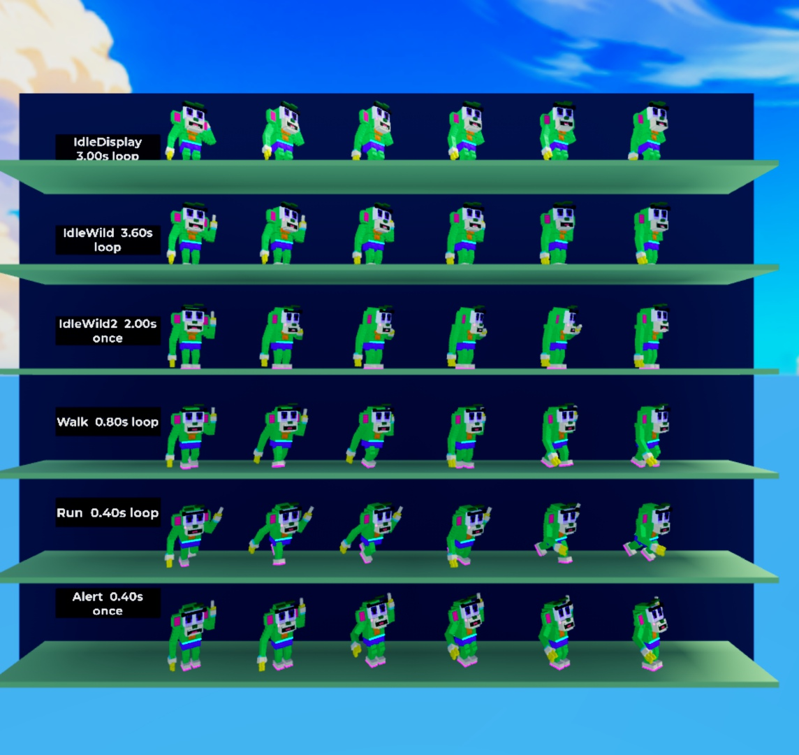
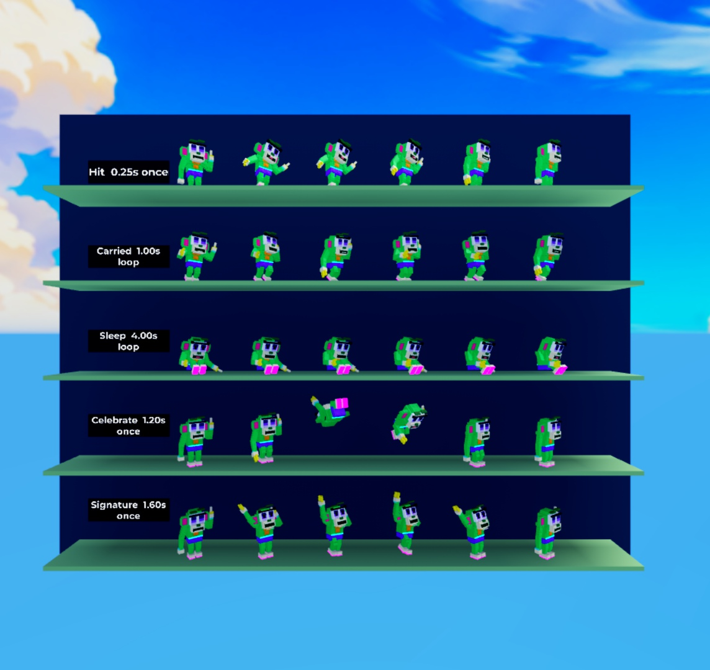
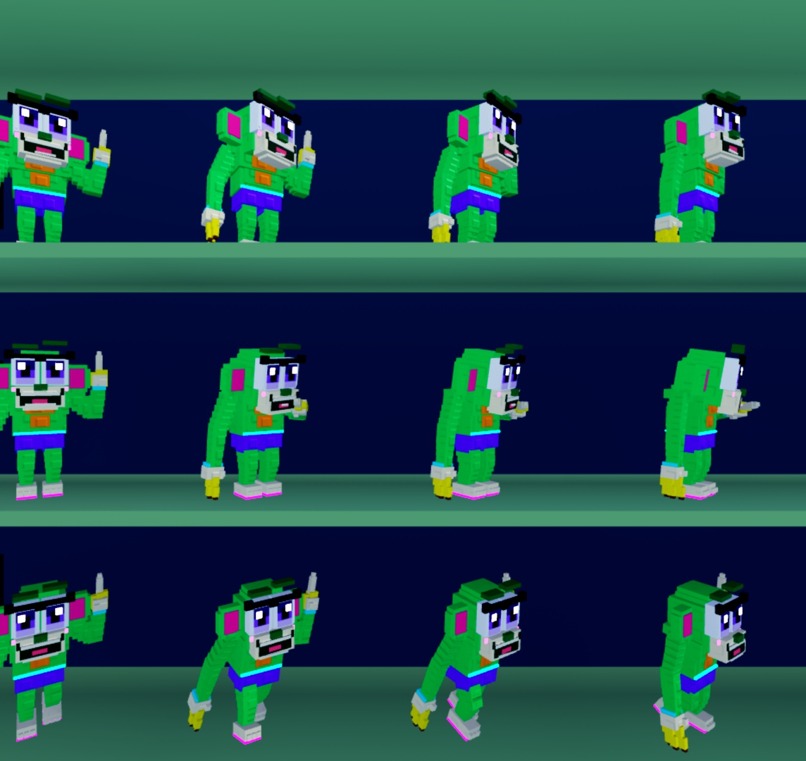
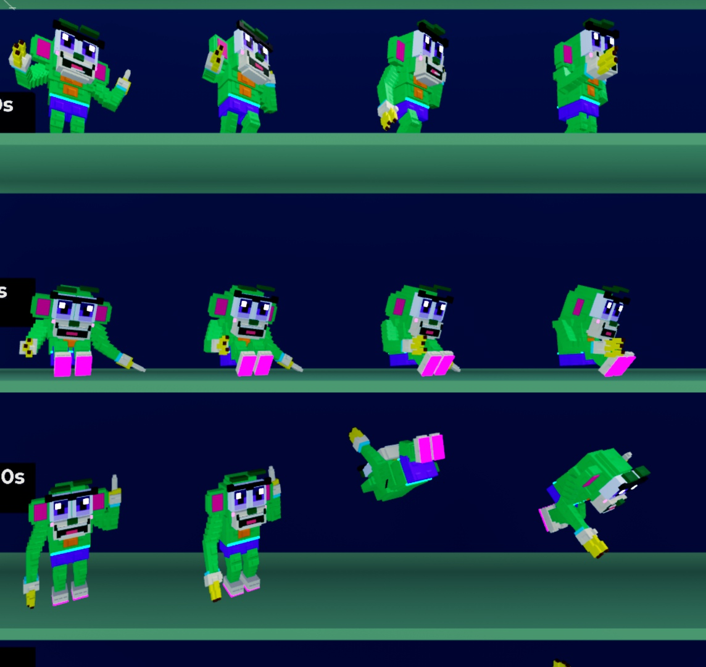

# Review package: BRT_009 Chimpanzini Bananini (round 2)

13 November 2026. Drafts only: nothing uploaded, nothing live, not committed.

Round 1 (no elbows or knees) is kept in `round1/`. The owner asked for elbows and knees; this round adds them and rewrites all 11 animations to use them.

## Rig

- **Archetype: Biped with elbows and knees.**
- **10 Motor6D joints** (was 6): Root→Torso, Torso→Head, Torso→each upper arm, upper arm→forearm, Torso→each thigh, thigh→lower leg.
- **What hangs off the new joints:** each forearm carries the lower half of the arm tube, the wristband, the hand and that hand's bananas. Each lower leg carries the lower half of the leg tube, the foot and the sole. The rounded joint ball stays on the upper segment and hides the bend.
- **Bind pose:** all 137 boxes are exactly where they are in the installed template, with the same colours (scripted comparison, zero difference). Only the `rig` list (4 new rows) and 50 `bone` tags changed in `Config/VoxelCreatures/BRT_009.lua`.
- **Face:** eyes, brows, muzzle, grin and ears move as one rigid group on the head.

## Animations (11)

| Sheet | Rows, top to bottom |
|---|---|
|  | IdleDisplay, IdleWild, IdleWild2 (bites the banana), Walk, Run, Alert |
|  | Hit, Carried, Sleep, Celebrate, Signature |
|  | Close-up: IdleDisplay, IdleWild2 (the bite), Walk |
|  | Close-up: Carried, Sleep, Celebrate |

What the new joints changed:

- **IdleWild2 (the bite)** is now mostly an elbow bend: the forearm folds in and the banana tip stops just in front of his mouth.
- **Walk and Run** lift the knee on each forward stride, and the long arm flexes at the elbow as it swings.
- **IdleDisplay** bounces on bending knees and waggles the banana from the elbow.
- **Sleep** is a proper sit: knees up, the banana bunch in his lap on a bent arm, the other arm drooped with the peeled banana resting on the floor.
- **Celebrate** is a backflip with knees and elbow tucked, with a small crouch before and after.
- **Signature** is the monkey dance: three hops from foot to foot with the free knee kicking up and the banana bunch pumping overhead, then both bananas held high.

The figures are small on the sheets; the pen shows him much better.

## Review pen

Set `AnimationReviewPen = true` on `ReplicatedStorage`, press Play, and cross the bridge behind the villager demo. He is the twelfth creature row.

Checked in Play: 15 models, all with the four new joints, a track playing on each, no errors. I did not watch each animation play.

## Self-check

| Check | Result |
|---|---|
| Loops seamless | Pass |
| Nothing under the floor | Pass (4 clips needed the floor clamp) |
| Sleep rests on the floor | Pass: lowest point is exactly at floor height |
| The bite reaches the mouth | Pass: the banana tip stops 0.16 studs from a point just in front of the mouth |
| Face rigid | Pass |
| Clipping | Not checked animation by animation. Watch the banana bunch against the legs in Sleep and Run, and the forearm against the face in the bite. |
| Gaps at the joints | Not measured. The joint ball covers the bend on the sheets; look at the knee in Run and Signature and the elbow in the bite, where the bend is largest. |
| Foot sliding | Not measured |

## Concerns

1. **The arms still do not match.** The model's own pose has the right arm hanging to the floor and the left arm raised, and the animations keep that.
2. **The backflip turns about his middle.** It reads well on the sheet but I have not watched it at speed.
3. **Rojo is still disconnected.** I put this species' two changed files into Studio by hand and confirmed both are byte-identical to disk.
4. **The installed template is out of date** until approval, as with the others that had rig changes.
5. **Run is authored for 10 studs/s, which is my assumption.**
