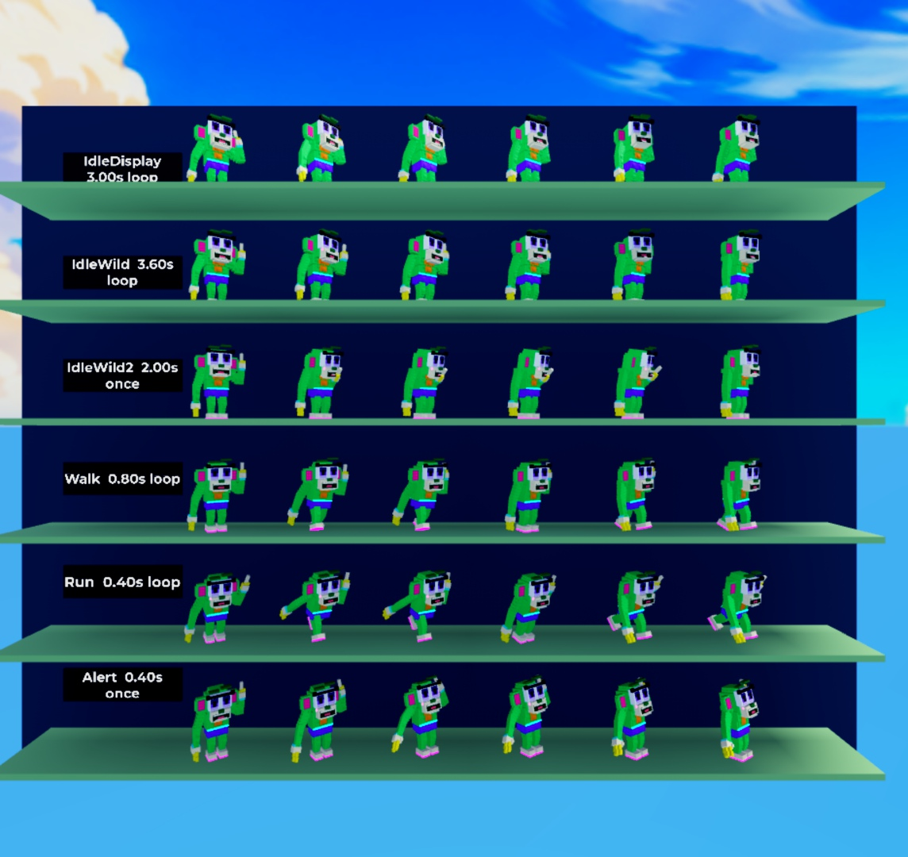
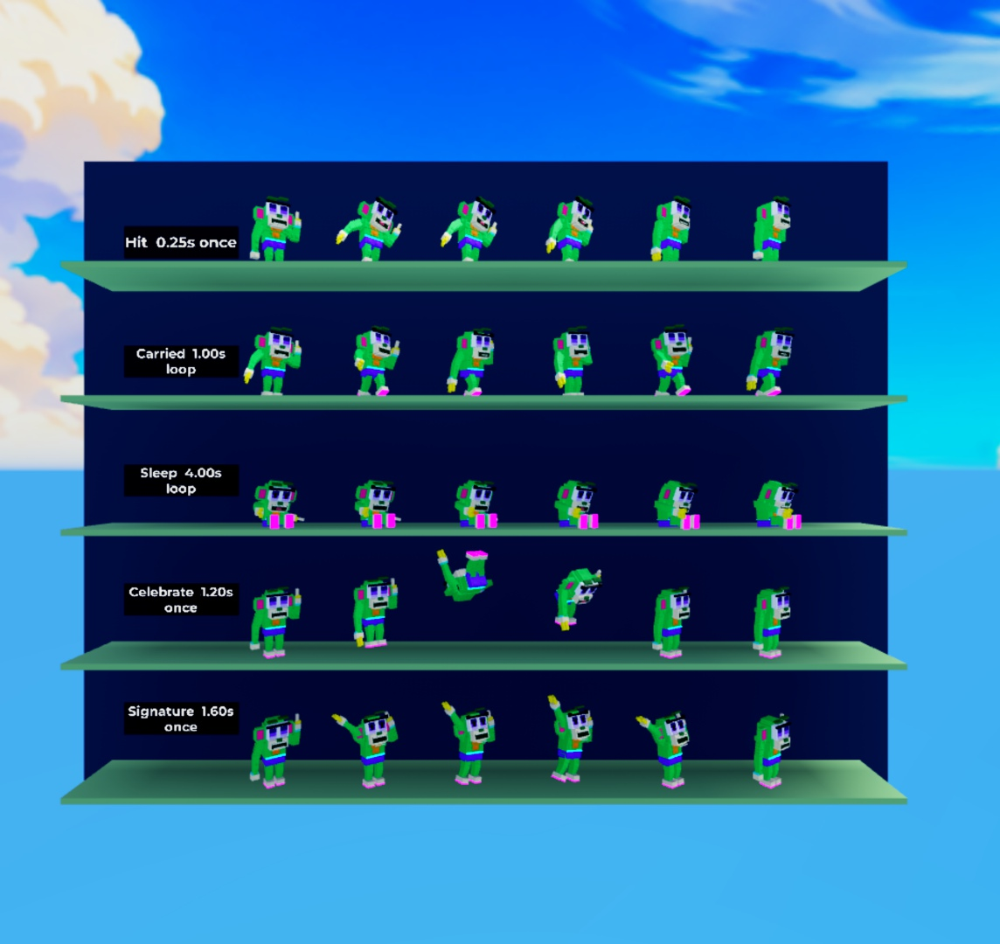
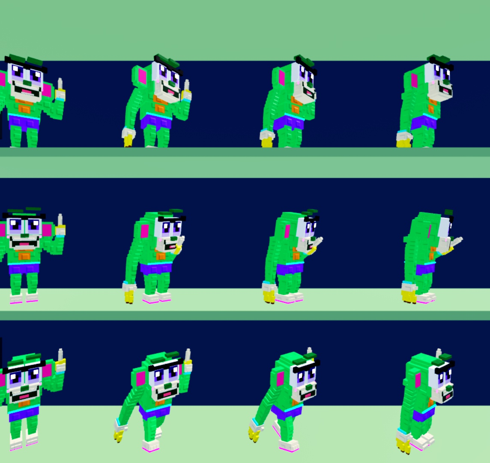

# Review package: BRT_009 Chimpanzini Bananini (round 1)

13 November 2026. Drafts only: nothing uploaded, nothing live, not committed.

## Rig

- **Archetype: Biped.** No rig change: he uses the 6 joints the V4 model already had.
- **6 Motor6D joints:** Root→Torso, Torso→Head, Torso→two arms, Torso→two legs. The banana bunch is part of the right arm and the peeled banana is part of the left arm.
- **Bind pose:** all 137 boxes are exactly where they are in the installed template, with the same colours (scripted comparison, zero difference). No model data changed.
- **Face:** eyes, brows, muzzle, grin and ears move as one rigid group on the head.

## Animations (11)

| Sheet | Rows, top to bottom |
|---|---|
|  | IdleDisplay, IdleWild, IdleWild2 (bites the banana), Walk, Run, Alert |
|  | Hit, Carried, Sleep, Celebrate, Signature |
|  | Close-up: IdleDisplay, IdleWild2 (the bite), Walk |

The idea: a cheeky green chimp who is all banana. Bouncy, rocking and never still. This set is written for him.

- **Walk** is the ape lope: he rocks from side to side with the long arm swinging low.
- **Run** is the scamper: bent right over and bounding, the long arm pumping.
- **IdleDisplay** is showing off: he bounces on the spot and waggles the peeled banana overhead.
- **IdleWild2** (the rare idle) brings the peeled banana to his mouth for two bites.
- **Sleep** is sitting down: legs out in front, the banana bunch in his lap, chin on his chest.
- **Celebrate** is a tucked backflip.
- **Signature** is the monkey dance: three hops from foot to foot with the banana bunch swung up overhead, then he holds both bananas high for a beat.

The figures are small on the sheets; the pen shows him much better.

## Review pen

Set `AnimationReviewPen = true` on `ReplicatedStorage`, press Play, and cross the bridge behind the villager demo. He is the twelfth creature row.

Checked in Play: 15 models, a track playing on each, no errors. I did not watch each animation play.

## Self-check

| Check | Result |
|---|---|
| Loops seamless | Pass |
| Nothing under the floor | Pass (3 clips needed the floor clamp) |
| Sleep rests on the floor | Pass: lowest point is exactly at floor height |
| The bite reaches the mouth | Pass: the banana stops 0.26 studs from the mouth |
| Face rigid | Pass |
| Clipping | Not checked animation by animation. Watch the long arm against the leg in Run, the bunch against the legs in Sleep, and the lowered left arm against the body in Sleep. |
| Foot sliding | Not measured |

## Concerns

1. **No elbows or knees.** Each limb is one rigid piece, so the sit is straight legs swung forward and the bite is the whole arm swinging round. I did not add joints because the arms are built as bent tubes that would split visibly; say if you want them.
2. **The arms do not match.** The model's own pose has the right arm hanging to the floor and the left arm raised. The animations keep that, so he never stands symmetrically.
3. **The backflip turns about his middle**, with the long arm tucked forward so it clears the floor. It reads well on the sheet but I have not watched it at speed.
4. **Rojo is still disconnected.** I put this species' animation file into Studio by hand and confirmed it is byte-identical to disk.
5. **Run is authored for 10 studs/s, which is my assumption.**
