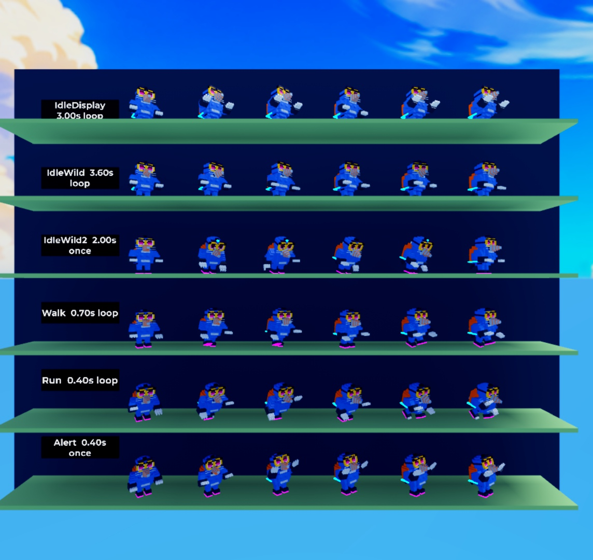
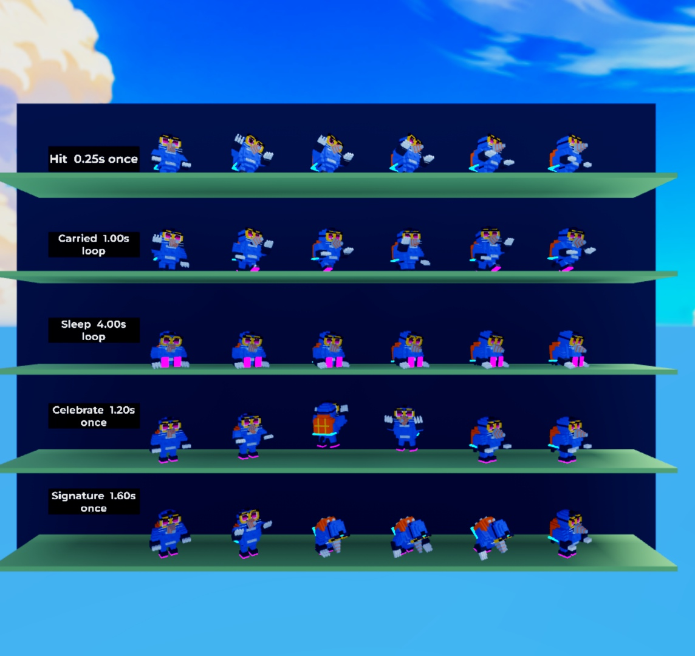
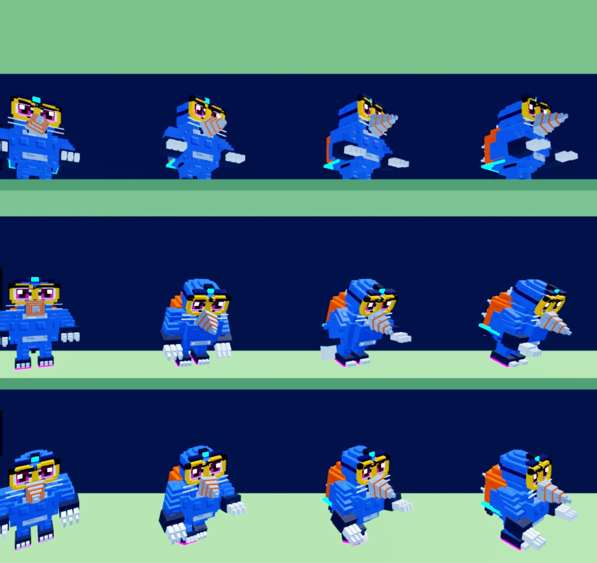
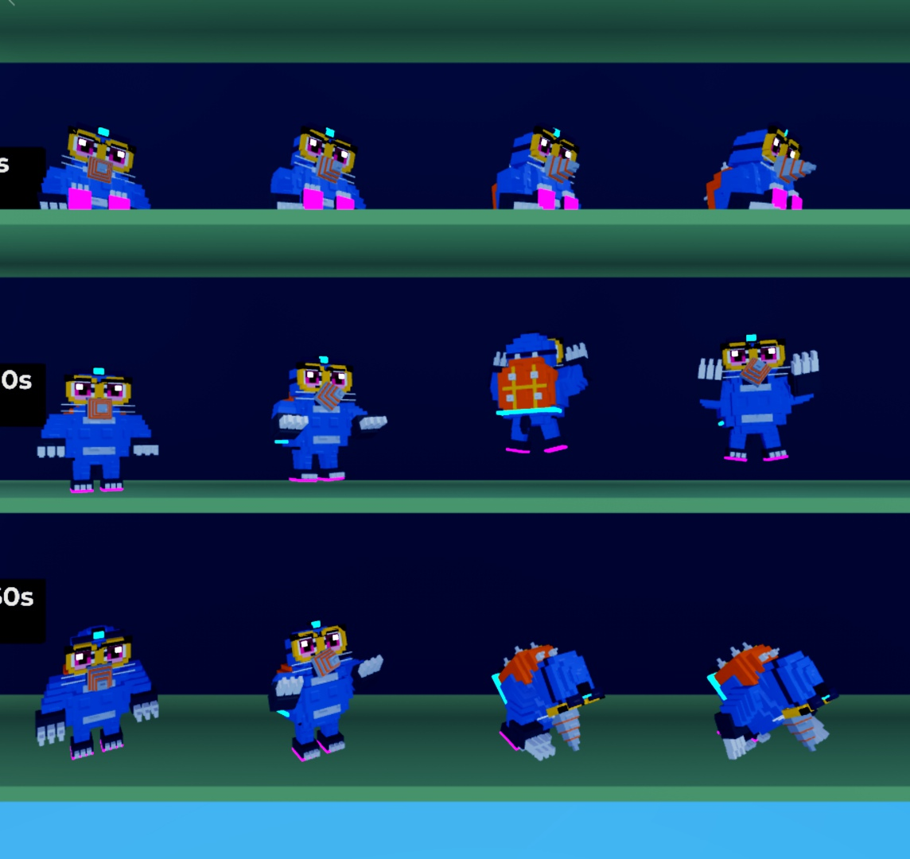

# Review package: BRT_010 Talpa Di Fero (round 2)

13 November 2026. Drafts only: nothing uploaded, nothing live, not committed.

Round 1 (no elbows) is kept in `round1/`. The owner approved round 1 and then asked for elbows; this round adds them and gives every animation forearm movement. The round 1 approval has not been recorded, because the rig changed after it.

## Rig

- **Archetype: Biped (squat) with elbows.** No knees.
- **10 Motor6D joints** (round 1 had 8): Root→Torso, Torso→Head, Head→Drill, Torso→each upper arm, upper arm→forearm, Torso→two legs, Torso→Tail.
- **Elbows:** each arm is one short tube from shoulder to hand, so the elbow sits at its midpoint. The outer half of the tube, the shovel hand and its claws hang off the forearm. There is no joint ball; the tube steps overlap, which hides moderate bends.
- **Drill:** the cone and its three orange bands are on their own bone on the drill's axis, so it spins. The collar, whiskers, goggles and headlamp stay with the head.
- **A fix to the existing rig:** the six toe claws were attached to the arms; they are now on the legs.
- **Bind pose:** all 157 boxes are exactly where they are in the installed template, with the same colours (scripted comparison, zero difference). Only the `rig` list (3 new rows in all) and `bone` tags changed in `Config/VoxelCreatures/BRT_010.lua`.
- **Face:** goggles, eyes, brows and whiskers move as one rigid group on the head.

## Animations (11)

| Sheet | Rows, top to bottom |
|---|---|
|  | IdleDisplay, IdleWild, IdleWild2 (scrabbles at the ground), Walk, Run, Alert |
|  | Hit, Carried, Sleep, Celebrate, Signature |
|  | Close-up: IdleDisplay, IdleWild2, Walk |
|  | Close-up: Sleep, Celebrate, Signature (the drill dive) |

What the elbows changed:

- **IdleWild2 and Signature** now scoop: each forearm swings a beat behind its upper arm, so the shovel hands paddle instead of the whole arm rocking.
- **Run** paddles from the elbow as he scurries.
- **IdleDisplay, Alert and Celebrate** lift the hands higher by bending the elbow.
- **Sleep** folds the forearms down and in, so the hands rest in his lap.
- **Walk, IdleWild, Hit and Carried** have a small elbow follow-through.

The rest is as round 1: the waddle, the revving drill, sitting to sleep, the hop-and-spin, and the drill dive. A still sheet cannot show the drill spinning; the pen does.

## Review pen

Set `AnimationReviewPen = true` on `ReplicatedStorage`, press Play, and cross the bridge behind the villager demo. He is the thirteenth creature row.

Checked in Play: 15 models, all with the Drill and both forearm bones, no errors. All 15 had a track playing on the first sample and 14 on a second sample 0.35 s later, which confirms the round 1 oddity: one model is briefly between one-shot clips. I did not watch each animation play.

## Self-check

| Check | Result |
|---|---|
| Loops seamless | Pass (the spinning drill ends each loop on a whole turn) |
| Nothing under the floor | Pass (5 clips needed the floor clamp) |
| Sleep rests on the floor | Pass: lowest point is exactly at floor height |
| Face rigid | Pass |
| Gaps at the elbow | Not measured. The largest bends are about 40 degrees (Celebrate, the dive); look there. |
| Clipping | Not checked animation by animation. Watch the hands against the belly in Sleep and against the floor in the dive. |
| Foot sliding | Not measured |

## Concerns

1. **The elbow has no joint ball.** His arm was built as one straight tube, so a sharp bend may show a notch at the midpoint. I kept bends to about 40 degrees.
2. **The drill is a square-stepped cone**, so the spin shows as corners turning.
3. **In the dive the drill stops about 0.7 studs above the floor.**
4. **No knees.** You asked for elbows only; his legs are still one piece each.
5. **Rojo is still disconnected.** I put this species' two changed files into Studio by hand and confirmed both are byte-identical to disk.
6. **The installed template is out of date** until approval.
7. **Run is authored for 10 studs/s, which is my assumption.**
