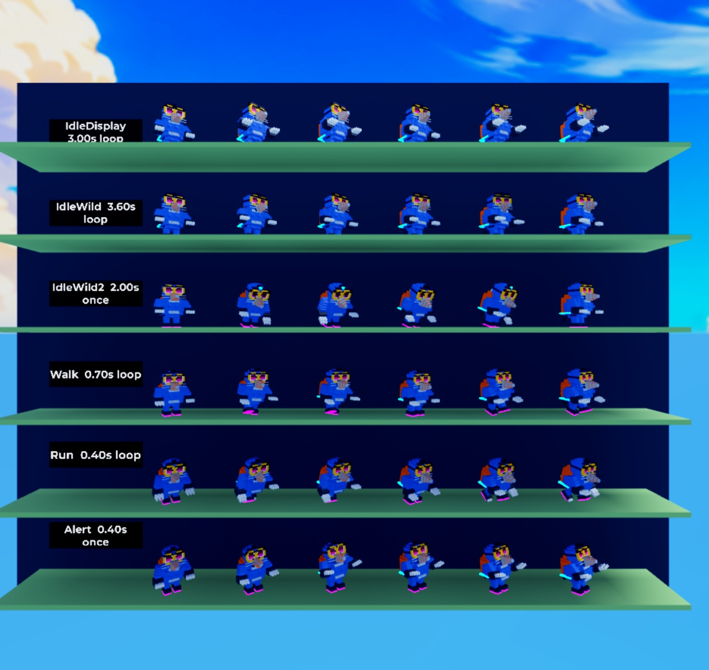
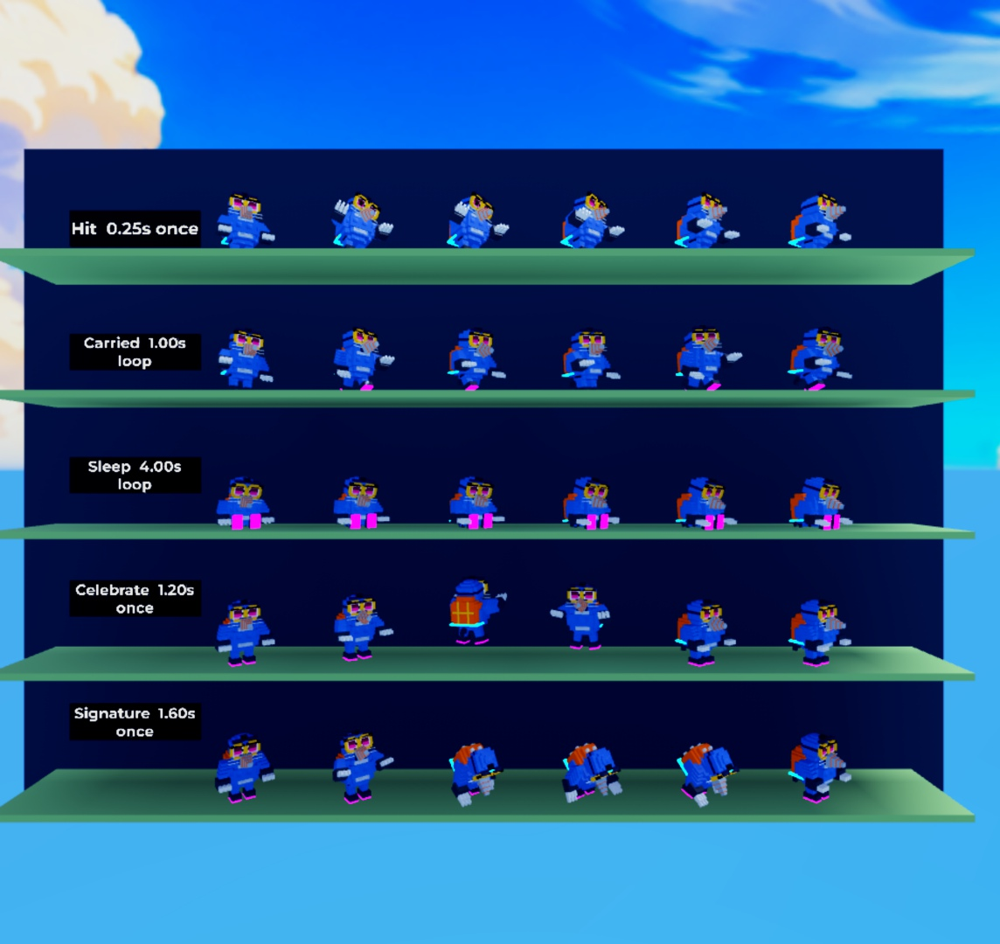
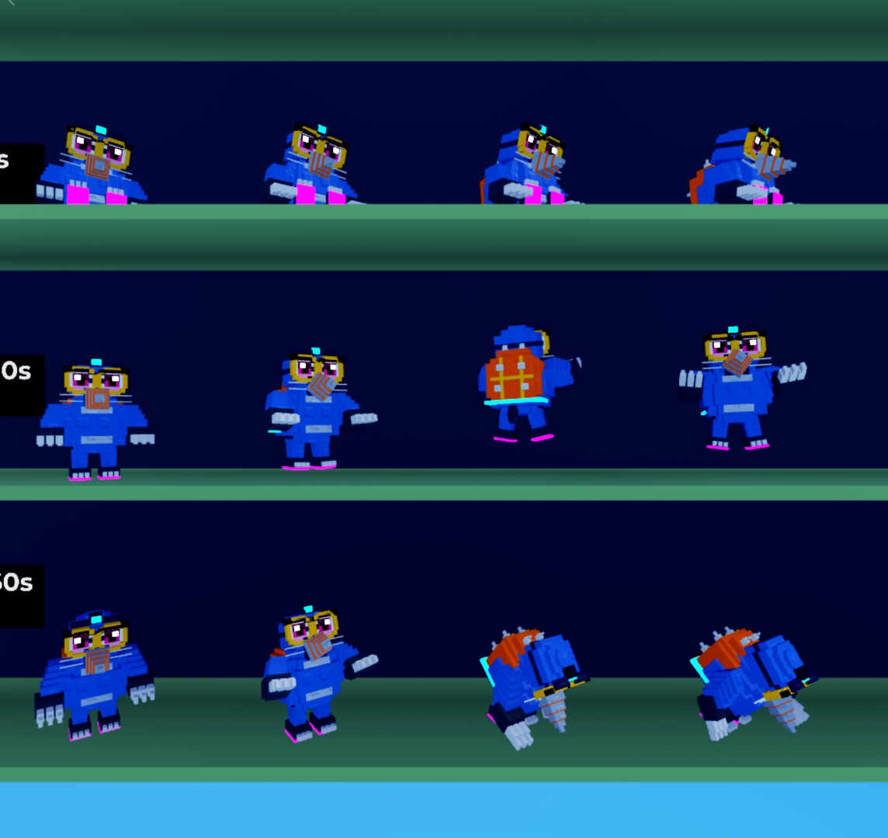

# Review package: BRT_010 Talpa Di Fero (round 1)

13 November 2026. Drafts only: nothing uploaded, nothing live, not committed.

## Rig

- **Archetype: Biped (squat).** One joint per limb; no knees or elbows.
- **8 Motor6D joints:** Root→Torso, Torso→Head, Torso→two arms, Torso→two legs, Torso→Tail, and one new joint, **Head→Drill**, on the drill's own axis so it can spin. The drill cone and its three orange spiral bands moved to the Drill bone. The navy collar, whiskers, goggles and headlamp stay rigid with the head.
- **A fix to the existing rig:** the six toe claws were attached to the arms (they share a part name with the hand claws), so they would have swung with the hands. They are now on the legs.
- **Bind pose:** all 157 boxes are exactly where they are in the installed template, with the same colours (scripted comparison, zero difference). Only the `rig` list (1 new row) and 14 `bone` tags changed in `Config/VoxelCreatures/BRT_010.lua`.
- **Face:** goggles, eyes, brows and whiskers move as one rigid group on the head.

## Animations (11)

| Sheet | Rows, top to bottom |
|---|---|
|  | IdleDisplay, IdleWild, IdleWild2 (scrabbles at the ground), Walk, Run, Alert |
|  | Hit, Carried, Sleep, Celebrate, Signature |
|  | Close-up: Sleep, Celebrate, Signature (the drill dive) |

The idea: an iron mole with a drill for a nose. Squat, waddling and short-sighted behind big goggles; everything he does ends in drilling. This set is written for him.

- **Walk** is the waddle: short steps, a big roll from side to side, the tail wagging.
- **Run** is the scurry: head down, the drill spinning one full turn per stride cycle, the shovel hands paddling.
- **IdleDisplay** is revving: twice a loop the drill spins a turn and a half while he puffs his chest and lifts his hands.
- **IdleWild** is sniffing: the drill twitches a little each way like a nose.
- **Sleep** is sitting on his round bottom with legs out in front and his head dropped.
- **Celebrate** is a hop and a full spin with the drill whirring and both hands up.
- **Signature** is the drill dive: he rears back while the drill winds up, lunges nose-first at the ground with the drill at full speed and both hands digging, then pops back upright.

A still sheet cannot show the drill spinning; the pen does. The figures are small on the sheets.

## Review pen

Set `AnimationReviewPen = true` on `ReplicatedStorage`, press Play, and cross the bridge behind the villager demo. He is the thirteenth creature row.

Checked in Play: 15 models, all with the Drill bone, no errors. 14 of the 15 had a track playing at the moment I sampled; I did not find out which one was between clips. I did not watch each animation play.

## Self-check

| Check | Result |
|---|---|
| Loops seamless | Pass (the spinning drill ends each loop on a whole turn) |
| Nothing under the floor | Pass (5 clips needed the floor clamp) |
| Sleep rests on the floor | Pass: lowest point is exactly at floor height |
| Face rigid | Pass |
| Clipping | Not checked animation by animation. Watch the drill against the belly plate in Sleep, and the hands against the floor in the dive. |
| Foot sliding | Not measured |

## Concerns

1. **The drill is a square-stepped cone**, so the spin shows as corners turning. I think that reads well as a drill, but it is your call.
2. **In the dive the drill stops about 0.7 studs above the floor.** It points at the ground but does not touch it; going lower pushes the hands through the floor.
3. **No knees or elbows.** His limbs are short single tubes, so I left them as one piece each. Say if you want them split like the chimp's.
4. **One of 15 pen models had no track playing when sampled.** Most likely a one-shot clip between repeats, but I have not confirmed it.
5. **Rojo is still disconnected.** I put this species' two changed files into Studio by hand and confirmed both are byte-identical to disk.
6. **The installed template is out of date** until approval.
7. **Run is authored for 10 studs/s, which is my assumption.**
