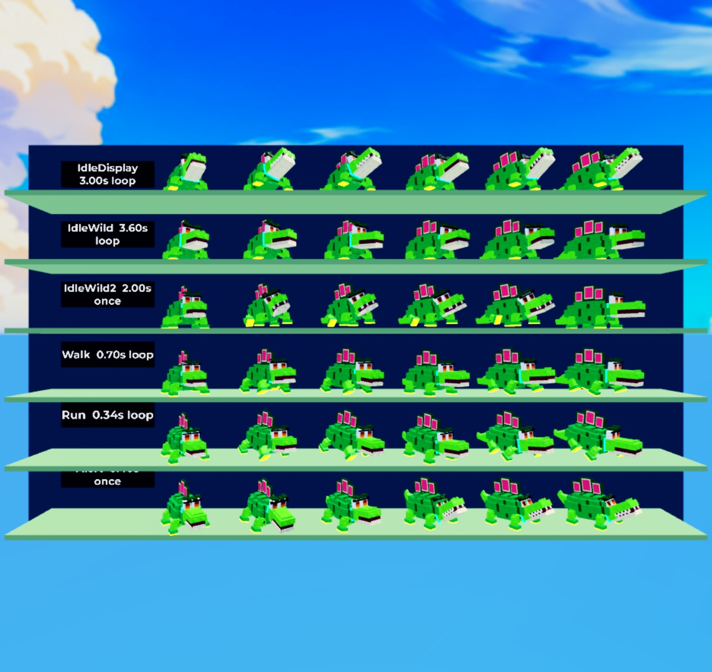
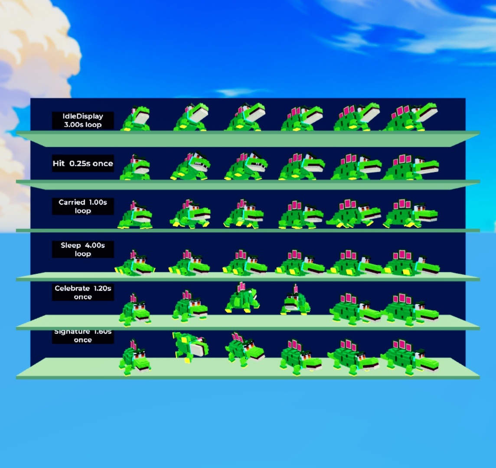

# Review package: BRT_011 Glorbo Fruttodrillo (round 1)

13 November 2026. Drafts only: nothing uploaded, nothing live, not committed.

## Rig

- **Archetype: Quadruped.** The first one, so it sets the base the other four-legged species will start from (`ServerAssets.AnimationAuthoring.Archetypes.Quadruped`).
- **7 Motor6D joints, unchanged:** Root→Torso, Torso→Head, Torso→four legs, Torso→Tail. This is the rig the V4 model already had from the 7 November pass. No model data or template changed, so the bind pose is the current model by definition.
- **Face:** eyes, brows, snout, lower jaw, teeth and tongue are all on the Head bone and move as one rigid group. The jaw does not open.

## Animations (11)

| Sheet | Rows, top to bottom |
|---|---|
|  | IdleDisplay, IdleWild, IdleWild2 (hind-leg scratch), Walk, Run, Alert |
|  | IdleDisplay, Hit, Carried, Sleep, Celebrate, Signature |

The top row of each sheet is seen from below, so the head looks more tilted than it is. IdleDisplay's head tilt was adjusted after these captures (now 8 to 14 degrees up), so judge it in the pen.

The idea: a smug watermelon crocodile. Low swagger with the body and tail swinging opposite ways in Walk, a belly-down sprawl for Sleep, and the **Signature is a crocodile death roll**: a hop, one full barrel roll, then two smug chomps of the head.

## Review pen

Set `AnimationReviewPen = true` on `ReplicatedStorage`, press Play, and cross the bridge behind the villager demo. Glorbo has its own row behind Trenostruzzo: one per animation, the 0.6× / 1.0× / 1.6× Celebrate test, and one circling at real speed (Walk at 6.6 studs/s, Run at 11).

Checked in Play: 15 Glorbo models, all tracks load, no errors. I did not watch each animation play.

## Self-check

| Check | Result |
|---|---|
| Loops seamless | Pass |
| Nothing under the floor | Pass (0.00). The torso is lifted by exactly what each leg swing, splay, pitch or roll would sink a foot. |
| Face rigid | Pass |
| Clipping | Not checked animation by animation. Watch the tall back fins during the death roll and the tail against the hind legs in Walk. |
| Foot sliding | Not measured. Legs are 1 unit long with a 26 degree swing, so the stride is short for 6.6 studs/s; playback speed will follow ground speed. |

## Concerns

1. **The jaw is fixed.** "Chomps" are head nods. A jaw joint would mean splitting the face group, which the brief forbids.
2. **No knees.** Legs are single segments, so scratching and tucking are whole-leg swings.
3. **Run speed of 11 studs/s is my assumption** for the authored cycle. Glorbo is a Reactive Runner, which today flees at walking speed (6.6); playback will scale to whatever speed it actually moves at.
4. **Mutation looks, real base platform and three-angle captures:** same position as Trenostruzzo. Nothing about the model changed.
