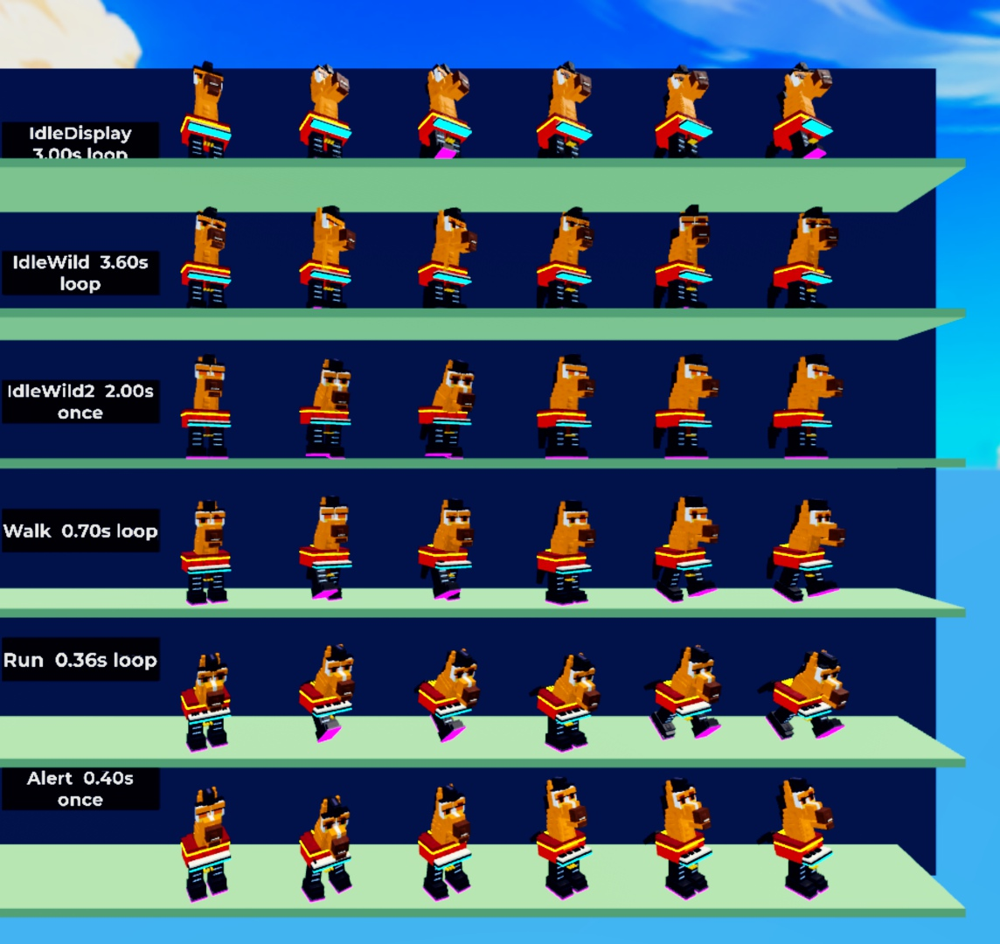
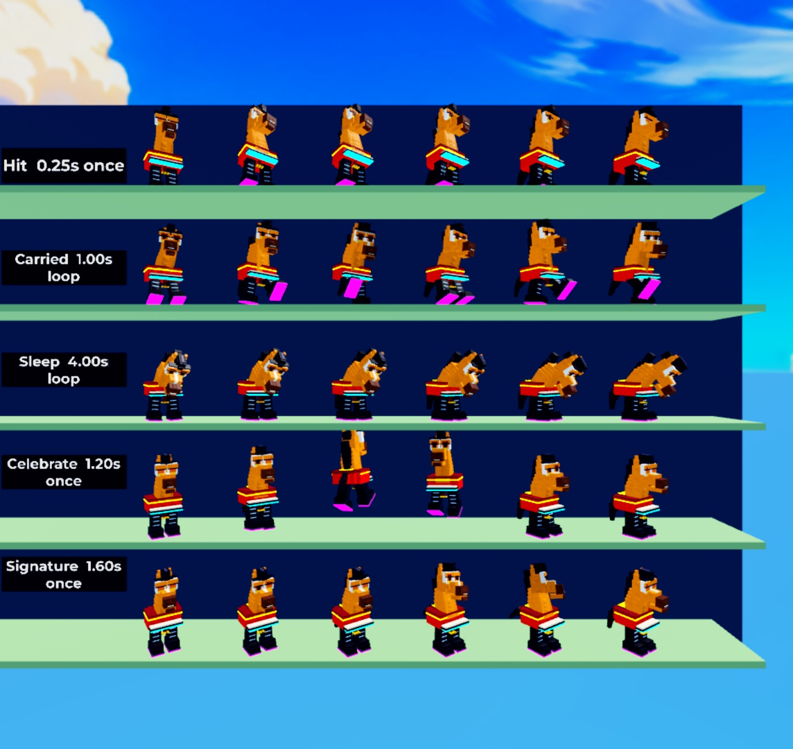

# Review package: BRT_013 Cavallo Virtuoso (round 1)

13 November 2026. Drafts only: nothing uploaded, nothing live, not committed.

## Rig

- **Archetype: Biped.** The first one, so it sets the base other two-legged species will start from (`ServerAssets.AnimationAuthoring.Archetypes.Biped`).
- **6 Motor6D joints:** Root→Torso (the piano), Torso→Neck, Neck→Head, Torso→RightLeg, Torso→LeftLeg, Torso→Tail. The neck joint is new: the four neck boxes and the four mane boxes on the neck moved from the torso to it, and the head now hangs off the neck.
- **Bind pose:** all 124 boxes are exactly where they were (scripted comparison with the installed template, zero difference). Only the `rig` list and eight `bone` tags changed in `Config/VoxelCreatures/BRT_013.lua`.
- **Face:** eyes, lids, brows, muzzle, jaw, teeth and the tooth sparkle all move as one rigid group on the head, along with the pompadour.

## Animations (11)

| Sheet | Rows, top to bottom |
|---|---|
|  | IdleDisplay, IdleWild, IdleWild2 (stretch and head shake), Walk, Run, Alert |
|  | Hit, Carried, Sleep, Celebrate, Signature |

The idea: a handsome horse who knows you are watching. A swaggering strut for Walk, neck stretched low for Run, asleep on his feet with the head hanging for Sleep, and the **Signature is the virtuoso flourish**: two boot stomps in rhythm, then a slow hair flip from one shoulder to the other.

The top row of each sheet is seen from below, which exaggerates head tilt.

## Review pen

Set `AnimationReviewPen = true` on `ReplicatedStorage`, press Play, and cross the bridge behind the villager demo. Cavallo has its own row with one copy per animation, the three-scale Celebrate test and one circling at real speed.

Checked in Play: 15 Cavallo models, all tracks load, no errors. I did not watch each animation play.

## Self-check

| Check | Result |
|---|---|
| Loops seamless | Pass |
| Nothing under the floor | Pass, after fixing which end of the boot dips on a forward or backward swing |
| Face rigid | Pass |
| Clipping | Not checked animation by animation. The neck rises through the piano lid, so watch the neck against the lid and keys when it leans forward (Run, Sleep, IdleWild2). |
| Foot sliding | Not measured |

## Concerns

1. **The piano lid stays shut.** I wanted it as the signature prop, but the neck passes through the lid, so opening it would cut through the neck.
2. **No ankles or knees.** Each boot and its shaft is one rigid piece.
3. **The piano does not play.** There are no arms, so the keys are untouched; the stomps stand in for the music.
4. **The installed template is out of date** until approval, as with Trenostruzzo. I will regenerate it then.
5. **Run speed of 11 studs/s is my assumption**, as with Glorbo.
