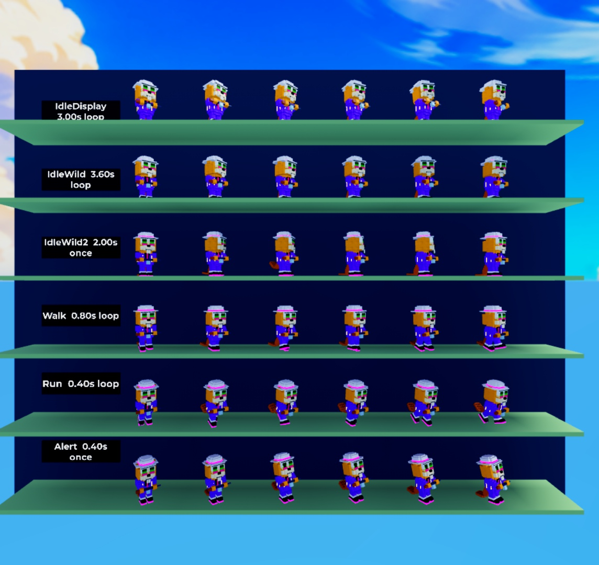
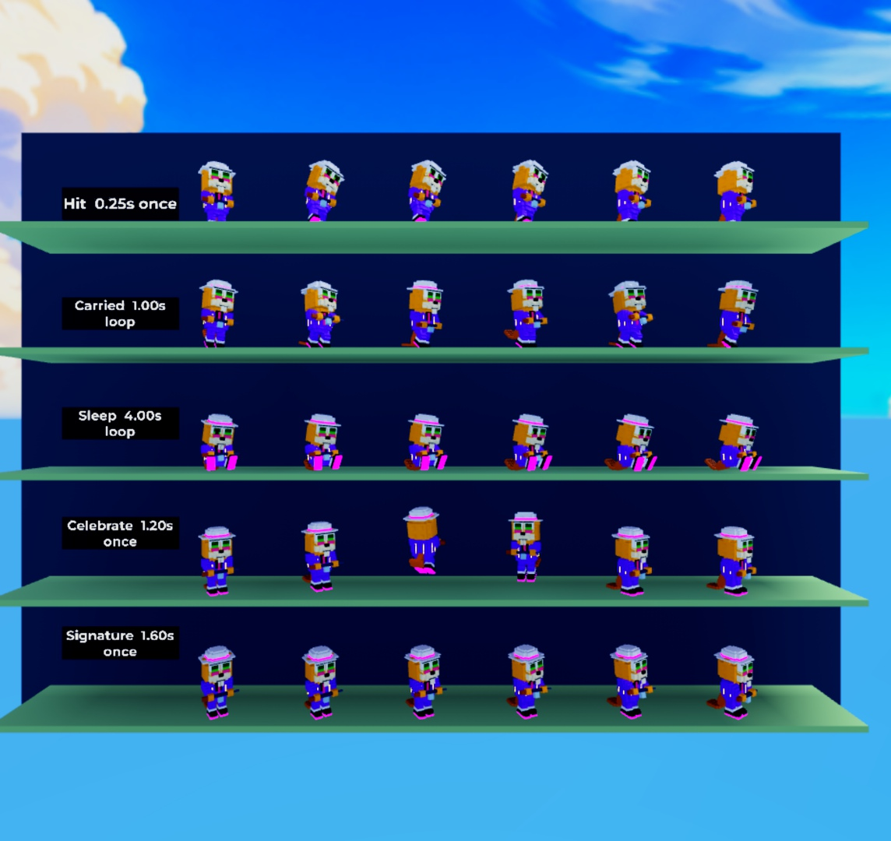
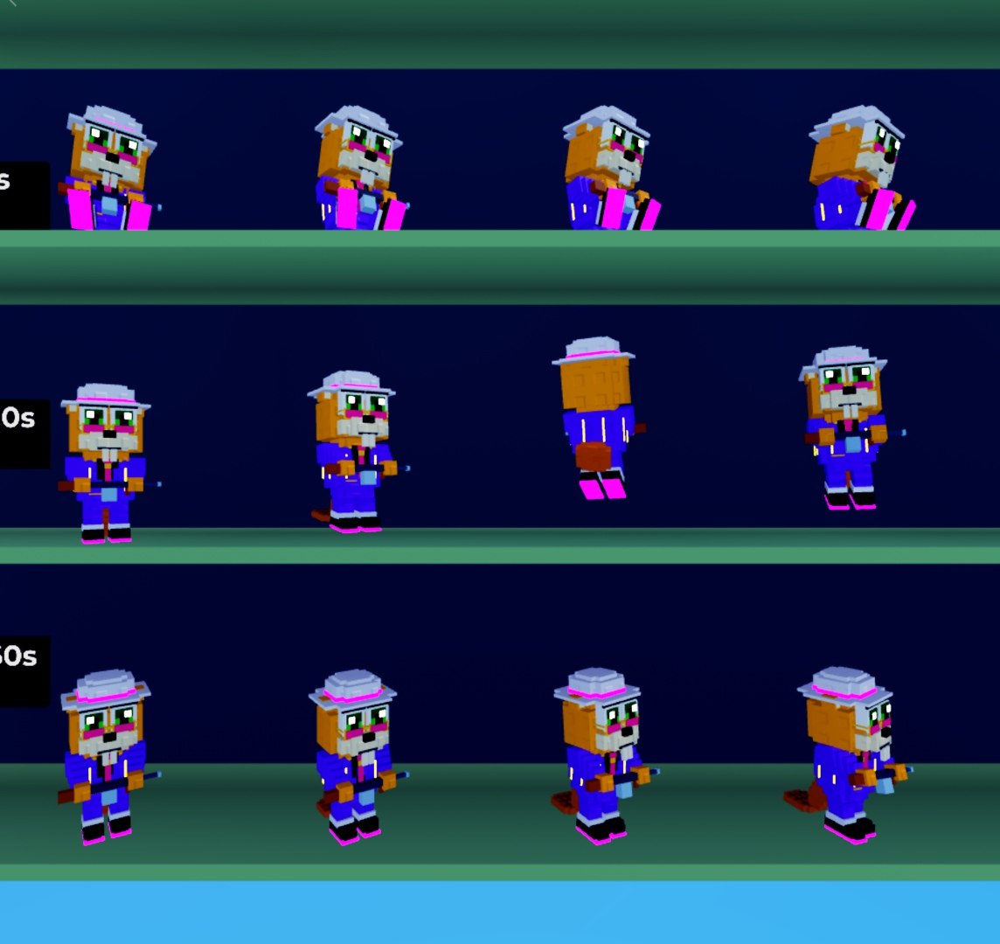

# Review package: BRT_014 Bandito Bobritto (round 1)

13 November 2026. Drafts only: nothing uploaded, nothing live, not committed.

## Rig

- **Archetype: Biped with knees.**
- **10 Motor6D joints** (was 7): Root→Torso, Torso→Head, Torso→two arms, Torso→Gun, Torso→two thighs, each thigh→lower leg, Torso→Tail.
- **Gun (new, signature prop):** the drum-gun was fixed to his body, so his paws would have slid off it whenever his arms moved. It now has its own joint on the line through both shoulders. Giving both arms and the gun the same swing keeps the paws on it; a scripted check found zero drift between paws and gun across all 11 animations.
- **Knees (new):** added without being asked, as on the camel, because you asked for them on the chimp and the mole. Each lower leg carries the lower step of the trouser tube, the shoe, the spat and the sole.
- **No elbows:** both paws hold the gun, so each arm stays one piece. An elbow on one arm would pull that paw off the gun.
- **Bind pose:** all 128 boxes are exactly where they are in the installed template, with the same colours (scripted comparison, zero difference). Only the `rig` list (3 new rows) and 16 `bone` tags changed in `Config/VoxelCreatures/BRT_014.lua`.
- **Face:** eyes, shades, muzzle, teeth, ears and fedora move as one rigid group on the head.

## Animations (11)

| Sheet | Rows, top to bottom |
|---|---|
|  | IdleDisplay, IdleWild, IdleWild2 (tail slap), Walk, Run, Alert |
|  | Hit, Carried, Sleep, Celebrate, Signature |
|  | Close-up: Sleep, Celebrate, Signature |

The idea: a beaver mob boss. All swagger: he rolls his hips when he walks, never lets go of the gun, and thumps his tail on the ground when he wants your attention. This set is written for him.

- **Walk** is the swagger: hips rolling, knees lifting, the gun bobbing, the tail dragging and swaying behind.
- **Run** is the getaway: leaning in, knees high, gun held up a little, tail streaming.
- **IdleDisplay** is the boss at ease: he rocks on his heels with the gun resting up, and twice a loop he thumps his tail.
- **IdleWild** is shifty: his head turns left and right and the gun follows a little.
- **IdleWild2** is one hard warning slap of the tail, the way a beaver sounds the alarm, with a look back over his shoulder.
- **Sleep** is sitting back on his tail with his legs out, knees turned out, hat tipped down and the gun resting across his lap.
- **Celebrate** is a hop and a full spin.
- **Signature** is the boss making an entrance: two hard tail thumps, then he hefts the gun, cocks a hip and gives one slow nod.

## Review pen

Set `AnimationReviewPen = true` on `ReplicatedStorage`, press Play, and cross the bridge behind the villager demo. He is the sixteenth creature row.

Checked in Play: 15 models, all with the gun and knee bones, a track playing on each, no errors. I did not watch each animation play.

## Self-check

| Check | Result |
|---|---|
| Loops seamless | Pass |
| Nothing under the floor | Pass (6 clips needed the floor clamp, see concern 2) |
| Paws stay on the gun | Pass: zero drift in every clip |
| Gun clear of his face | Pass: closest is 0.18 studs from his buck teeth (Signature) |
| Gun clear of his legs | Pass: closest is 0.02 studs, resting on his lap in Sleep |
| Sleep rests on the floor | Pass: lowest point is exactly at floor height |
| Face rigid | Pass |
| Other clipping | Not checked: the tail against the backs of the legs when it lifts, and the hat brim against the shoulders when the head tips. |
| Foot sliding | Not measured |

## Concerns

1. **The gun can only lift about 18 degrees.** His arms are shorter than his muzzle sticks out, so anything higher puts the gun into his face. My first draft raised it to his shoulder in the Signature and overhead in Celebrate; both went through his muzzle, so I cut them back. The Signature now reads through the tail thumps, the hip and the nod more than through the gun. Longer arms would fix this, but that is a model change.
2. **His tail rests on the ground, so the body rides up when he leans back.** Six clips needed the floor clamp for this. I lift the tail in each pose to compensate, but where I under-lifted it the clamp raises his whole body slightly instead. I did not record which six clips, or how far each was raised, so watch for a small unwanted bob wherever he leans back.
3. **Knees on very short legs.** The lower leg is one tube step plus the shoe. It bends, but there is little leg to show it.
4. **Rojo is still disconnected.** I put this species' two changed files into Studio by hand and confirmed both are byte-identical to disk.
5. **The installed template is out of date** until approval.
6. **Walk is authored for 6.6 studs/s and Run for 11**, the same figures as the other Uncommons.
