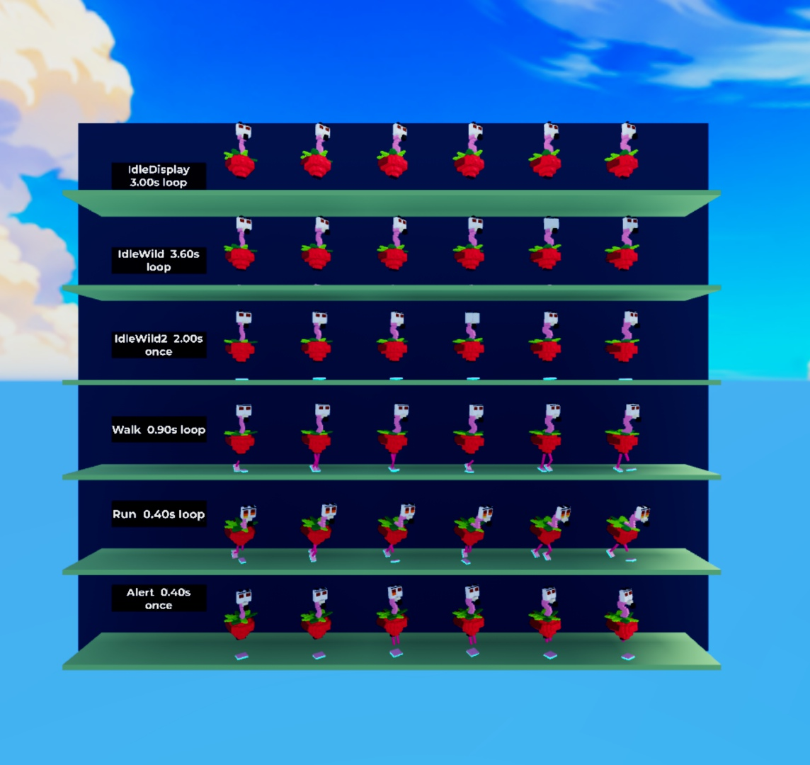
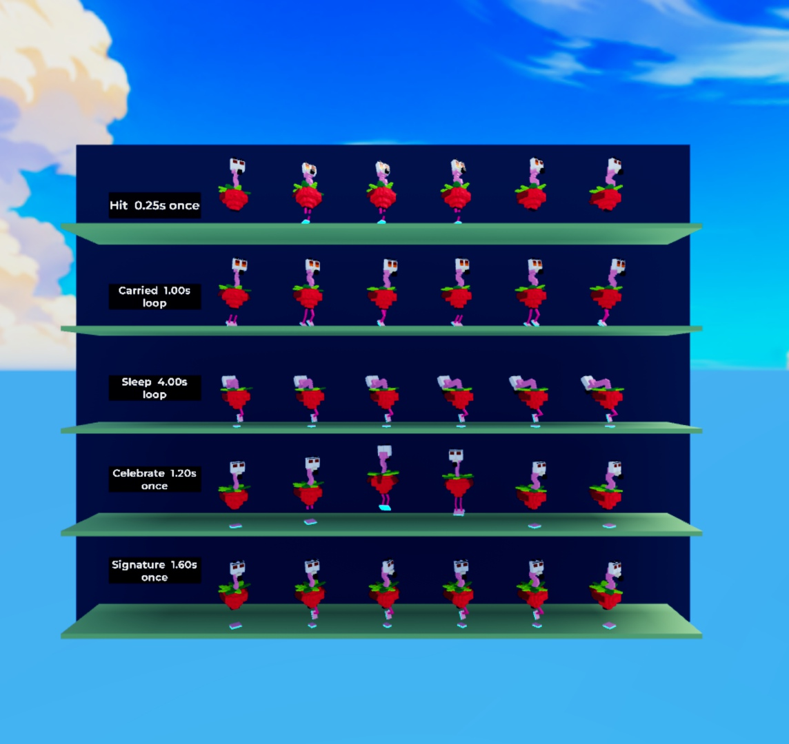
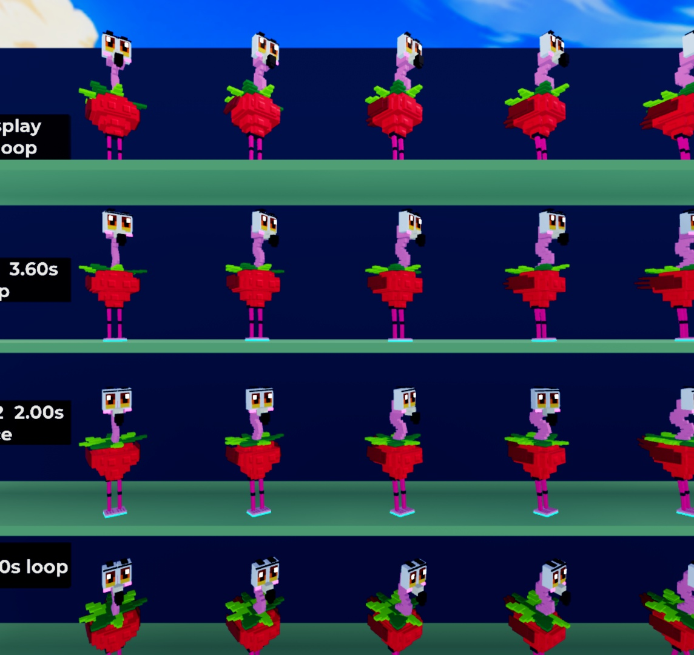
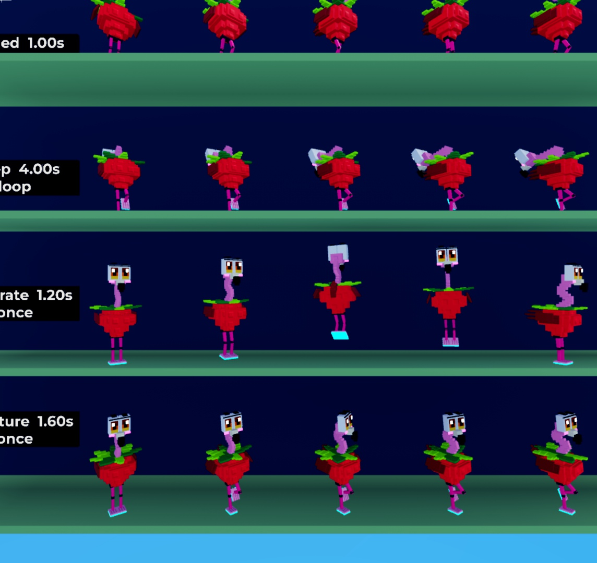

# Review package: BRT_015 Strawberelli Flamingelli (round 1)

13 November 2026. Drafts only: nothing uploaded, nothing live, not committed.

It is the last brainrot in the Beach order.

## Rig

- **Archetype: Wader.** A biped with knees, a two-joint neck, wings and tail plumes.
- **11 Motor6D joints** (was 7): Root→Torso (the strawberry), Torso→NeckBase→Neck→Head, Torso→two wings, Torso→Tail, Torso→two upper legs, each upper leg→lower leg.
- **Neck (new, two joints):** the S-shaped neck was part of the body and the head pivoted in mid-air. NeckBase sits where the neck leaves the strawberry and carries the first two bends; Neck sits at the top bend and carries the last stretch; the head now pivots at the top of the neck. This is what lets the S open, close and fold back.
- **Knees (new):** added without being asked, as on the camel and the beaver. The lower tube of each leg and the webbed foot hang off the dark knee box, which stays on the upper leg.
- **Rig tool change:** a two-joint neck needed a small addition to `tools/voxel_v4/rig.js`. It is opt-in; I re-exported three other species (BRT_012, 013, 019) and their data came out byte-identical.
- **Bind pose:** all 124 boxes are exactly where they are in the installed template, with the same colours (scripted comparison, zero difference). Only the `rig` list and 29 `bone` tags changed in `Config/VoxelCreatures/BRT_015.lua`.
- **Face:** eyes, brows and beak move as one rigid group on the head.

## Animations (11)

| Sheet | Rows, top to bottom |
|---|---|
|  | IdleDisplay, IdleWild, IdleWild2 (head-flagging), Walk, Run, Alert |
|  | Hit, Carried, Sleep, Celebrate, Signature |
|  | Close-up: IdleDisplay, IdleWild, IdleWild2 |
|  | Close-up: Sleep, Celebrate, Signature |

The legs are thin and drop out of the two overview sheets at that distance; the close-ups show them.

The idea: a strawberry that is also a flamingo, and very pleased about both. Elegant and a bit vain: the neck is always moving, and at any excuse it goes up on one leg. This set is written for it.

- **Walk** is the wade: slow and high-stepping, each knee folding right up, the head bobbing forward and back with every step.
- **Run** is the dash: neck stretched out low in front, wings half open and beating, legs flying.
- **IdleDisplay** is the neck dance: the S-curve pumps open and shut, the head sways, and the wings shimmy one after the other.
- **IdleWild2** is head-flagging, a real flamingo display: the neck stretches up tall and the head flicks from side to side four times.
- **Sleep** is the flamingo way: up on one leg with the other folded, the neck laid back and twisted round so the head rests on its back, facing behind.
- **Celebrate** is a hop and a full spin with the wings thrown wide and the neck straight up.
- **Signature** is the flamingo pose: it snaps up onto one leg, flares both wings, draws its neck into a tall curve and holds, with a slow turn of the head to be admired.

## Review pen

Set `AnimationReviewPen = true` on `ReplicatedStorage`, press Play, and cross the bridge behind the villager demo. It is the seventeenth creature row.

Checked in Play: 15 models, all with both neck joints and both knees, a track playing on each, no errors. I did not watch each animation play.

## Self-check

| Check | Result |
|---|---|
| Loops seamless | Pass |
| Nothing under the floor | Pass (2 clips needed the floor clamp) |
| Head and neck clear of the body and leaves | Pass in all 11 clips: smallest gap 0.13 studs (Sleep, head resting over the leaves) |
| Face rigid | Pass |
| Wings against the body | Not measured. Each wing moves outward as it opens so its lower edge should stay out of the strawberry, but I did not check it by measurement. |
| Folded leg against the body | Not measured (Sleep, Signature). |
| Foot sliding | Not measured |

## Concerns

1. **I dropped a ground-peck.** My first IdleWild2 had it tip forward and peck at the floor. Its neck cannot reach: the beak stopped 2.5 studs up, and the neck went through the front leaf. Head-flagging replaced it.
2. **The one-leg stands lean rather than balance.** In Sleep and the Signature the body shifts 0.2 studs over the standing leg. That is half the distance between the legs, so the standing foot ends up under the middle of the body, but the body does not otherwise counter-balance.
3. **In Sleep the neck is twisted 180 degrees.** The pose is clean, but getting into and out of it is a blend the game does, not something I animated. The neck may pass through itself for a moment as it turns.
4. **The wings are flat panels on the flanks.** They flare about 32 degrees; they do not unfold or flap like a real wing.
5. **Its leaves do not move.** The calyx is part of the strawberry.
6. **Rojo is still disconnected.** I put this species' two changed files into Studio by hand and confirmed both are byte-identical to disk.
7. **The installed template is out of date** until approval.
8. **Walk is authored for 6.6 studs/s and Run for 11**, the same figures as the other Uncommons.
