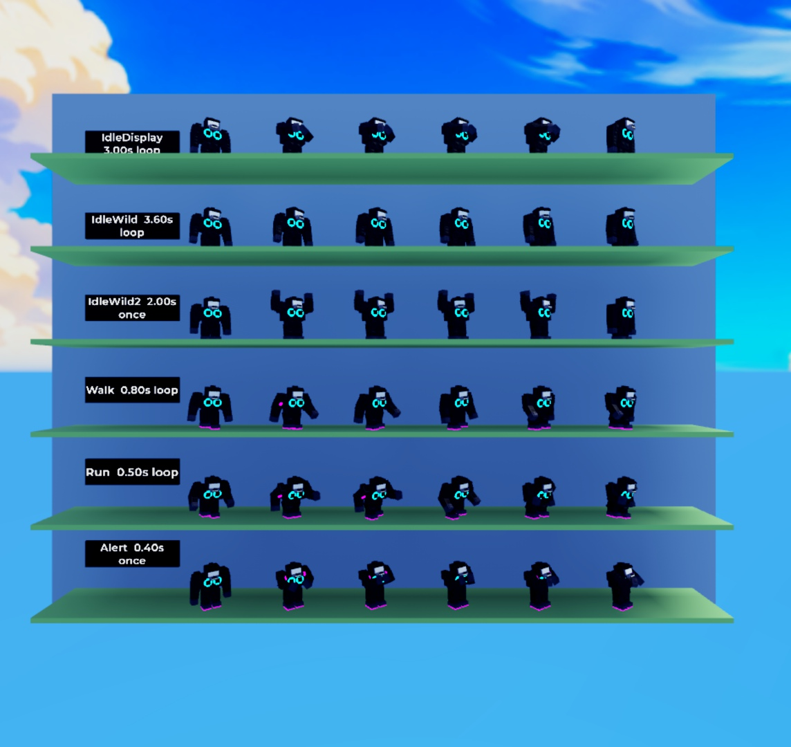
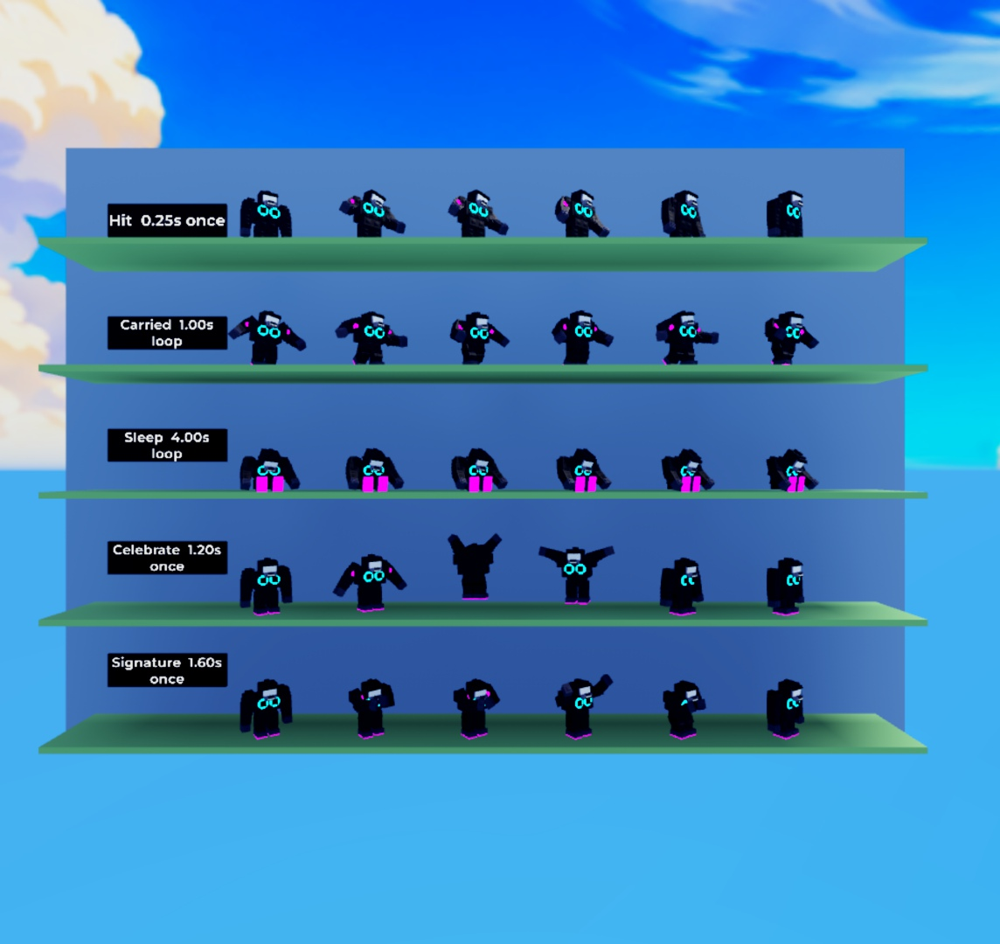
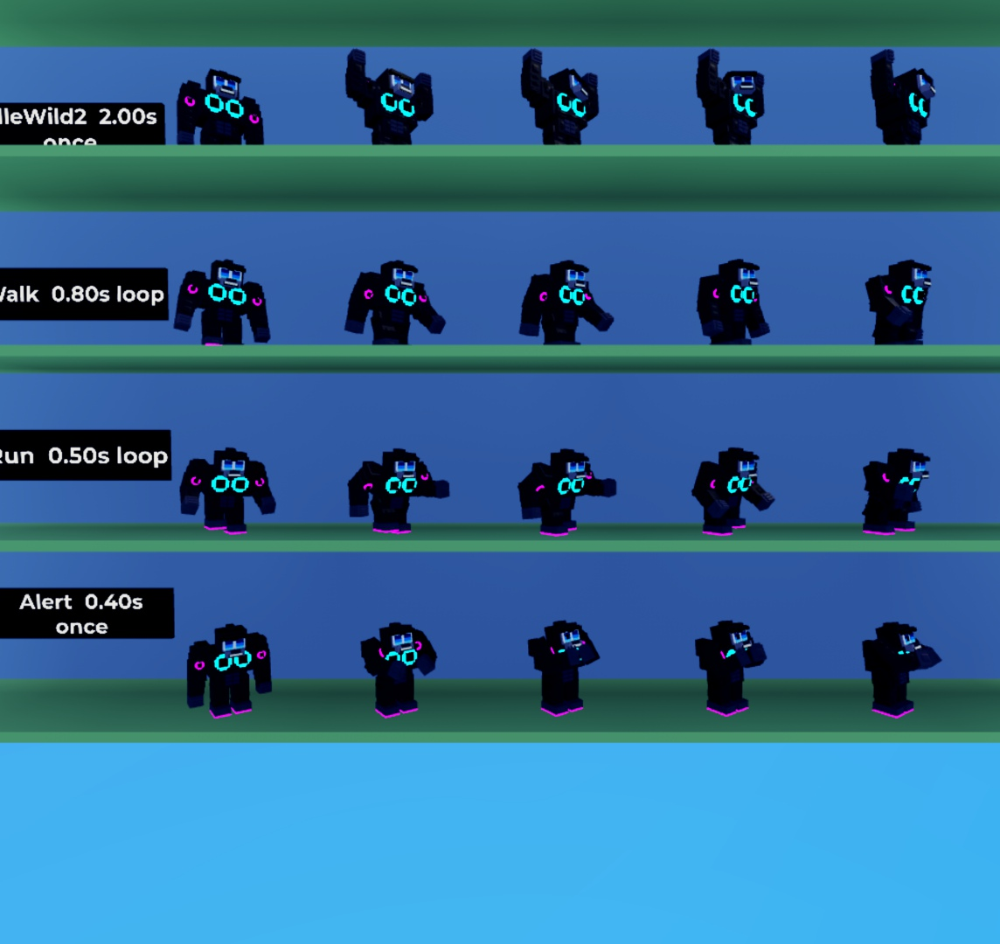
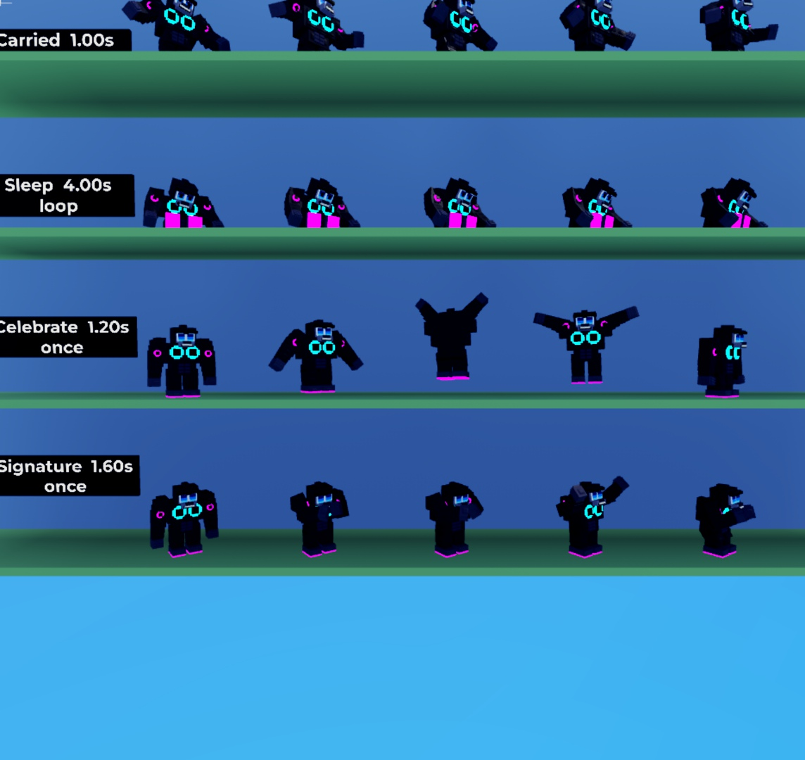
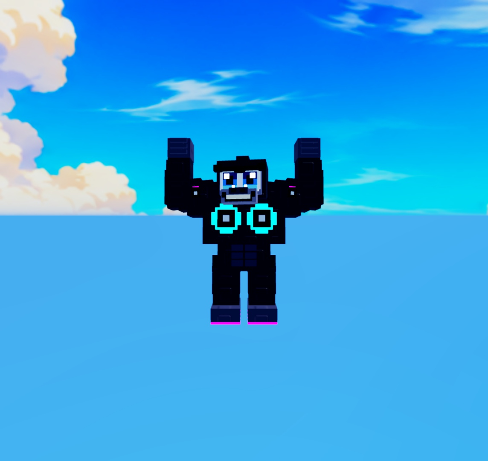

# Review package: BRT_016 Gorillo Subwoofero (round 1)

13 November 2026. Drafts only: nothing uploaded, nothing live, not committed.

It is the sixth brainrot in the Swamp order. This is the Voxel V4 bodybuilder gorilla (black fur, neon speakers, revision 4 with the neutral arms), not the older native sculpture described in AGENTS.md.

## Rig

- **Archetype: Upright biped with elbows, knees and speakers.**
- **12 Motor6D joints** (was 8): Root→Torso, Torso→Head, Torso→two upper arms, each→forearm (with the fist), Torso→two thighs, each→lower leg (new, with the foot), Torso→RightWoofer and LeftWoofer (new).
- **Chest woofers (new, two joints):** the cone and dust cap of each chest speaker can pump out and back, so every beat of his chest makes the speaker boom. I added them without being asked.
- **Knees (new):** added as on the other bipeds.
- **Three rig faults fixed:**
  1. His **mouth and teeth were tagged to the chest**, so they would have stayed behind when his head moved. They now belong to the head.
  2. **One piece of each biceps speaker ring was tagged to the chest**, so it would have floated in the air when the arm swung. All of each biceps speaker now belongs to its arm. Both faults have been in the rig since 7 November.
  3. The **deltoids** were on the arms and, being large boxes around the shoulder joint, swung into the chest and head whenever an arm lifted. They now stay on the chest as fixed shoulder caps, and the arm moves under them.
- **Head pivot moved** to the neck; it was under the chin.
- **Bind pose:** all 106 boxes are exactly where they are in the installed template, with the same colours (scripted comparison, zero difference). Only the `rig` list and 22 `bone` tags changed in `Config/VoxelCreatures/BRT_016.lua`.
- **Face:** eyes, brow, nose, mouth and teeth move as one rigid group on the head.

## Animations (11)

| Sheet | Rows, top to bottom |
|---|---|
|  | IdleDisplay, IdleWild, IdleWild2 (flex), Walk, Run, Alert |
|  | Hit, Carried, Sleep, Celebrate, Signature |
|  | Close-up: IdleWild2, Walk, Run, Alert |
|  | Close-up: Sleep, Celebrate, Signature |
|  | Straight on: the double-biceps flex |

His fur is near-black, so I lightened the sheet's backdrop for these pictures.

The idea: the "bass drop" gorilla, a bodybuilder whose pecs are subwoofers. He beats his chest like any gorilla, and every hit makes the speakers boom. This set is written for him.

- **IdleDisplay** is the chest drum: he raises his fists and beats the two woofers in turn, each hit booming that speaker, then drops his arms and nods to the beat.
- **IdleWild2** is the double-biceps flex (a nod to his earlier pose): arms up, fists up, chest out, speakers throbbing while he admires each arm in turn.
- **Walk** is a heavy swagger: shoulders rolling, long arms swinging, the speakers bumping on every footfall.
- **Run** is the charge: leaning in, fists pumping, the speakers pounding on every stride.
- **Alert** rears up and slams both fists on his chest once, and both speakers boom.
- **Sleep** is sitting on the ground with his legs stretched out, slumped forward, head on his chest, and the speakers pulsing slowly with each breath: a bass snore.
- **Celebrate** is a jump and a full spin with both arms thrown up and the speakers blasting.
- **Signature** is the bass drop: a drum roll on his chest that speeds up, eight hits with each speaker booming; then both fists go up high and come down on both woofers at once, with the biggest boom, a knee dip and his head thrown back.

## Review pen

Set `AnimationReviewPen = true` on `ReplicatedStorage`, press Play, and cross the bridge behind the villager demo. He has a row among the creatures; the pen takes several seconds to fill in.

Checked in Play: 15 models, all with the new woofer and knee joints, a track playing on each, no errors. I did not watch each animation play.

## Self-check

| Check | Result |
|---|---|
| Loops seamless | Pass |
| Nothing under the floor | Pass (2 clips needed the floor clamp) |
| Floating above the floor | None in the standing clips. My first Run floated 0.05 studs throughout; fixed. Alert and Celebrate leave the ground on purpose. |
| Fists against the woofer cones | Up to 0.03 studs at the moment of a hit (Alert, Signature): the fist just touches the cone |
| The two fists against each other | Up to 0.10 studs at the double hit in Alert, 0.07 in the Signature |
| Forearms against the chest | Up to 0.15 studs (Celebrate, Carried, Signature); clear or under 0.10 in the rest |
| Upper arms against the chest | 0.10 at rest, as built (the arm top sits inside the chest). Up to 0.30 when the arms go overhead in Celebrate. That overlap is under the shoulder caps. |
| Upper arms against the head | Up to 0.26 studs in the flex and 0.23 in Celebrate: the top of the upper arm reaches the neck when the arm is raised. Also under the shoulder caps; not visible in the front view of the flex. |
| Head against the chest | 0.05 at rest; up to 0.18 when his head is thrown back in the Signature |
| Face rigid | Pass |
| Foot sliding | Not measured |

## Concerns

1. **He is very dark.** Near-black fur makes the arm movements hard to read at a distance or in shadow; the glowing speakers carry most of it. That is the approved art, so I have not changed it.
2. **His chest hits are close, not solid.** His arms are short for his chest, so at the moment of a hit the fist is just in front of the woofer (touching by up to 0.03 studs) rather than sinking into it.
3. **The biceps speakers do not pump.** Only the two chest woofers have joints. The biceps ones could get the same treatment if you want.
4. **The shoulder caps no longer move with the arms.** When he raises his arms, the deltoids stay put and the arm rises from under them. In the front view of the flex it reads as a shoulder; say if you prefer them riding on the arms despite the clipping.
5. **Walk is authored for 6 studs/s and Run for 10.** These are my assumption.
6. **Rojo is still disconnected.** I put this species' two changed files into Studio by hand and confirmed both are byte-identical to disk.
7. **The installed template is out of date** until approval. His V4 data, build and template have never been committed; they will be on approval.
