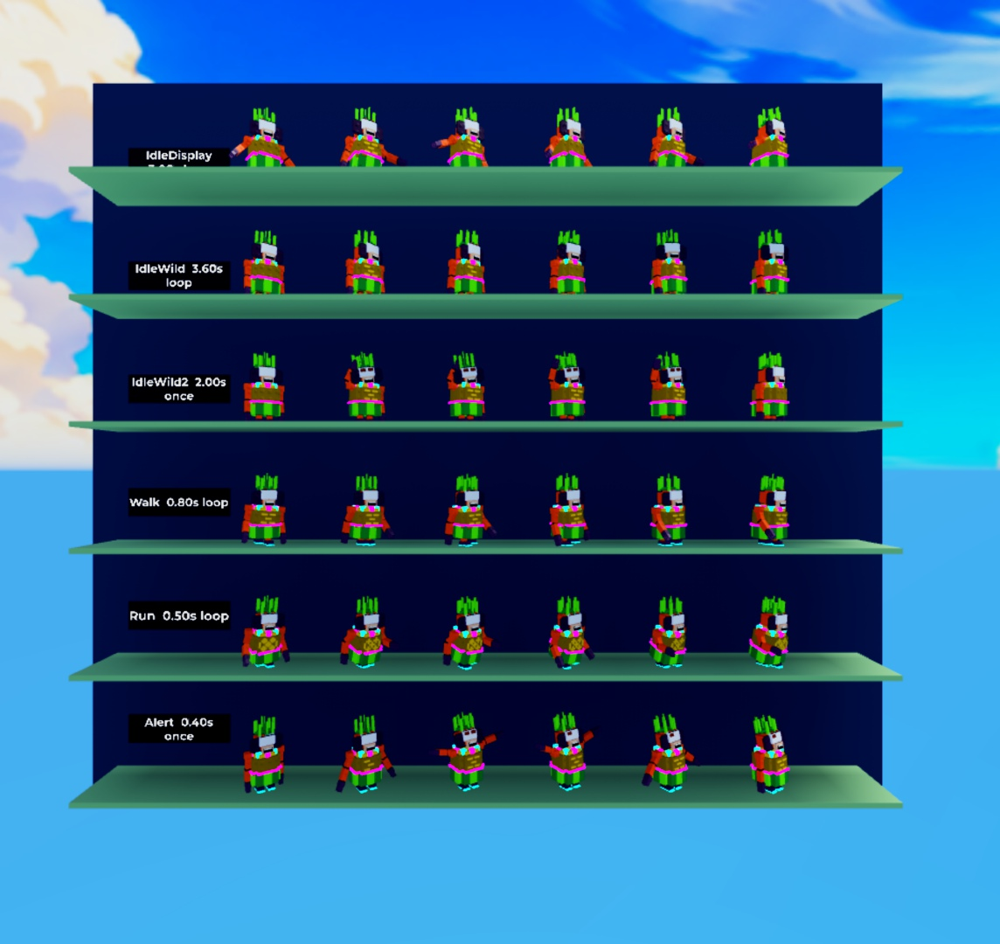
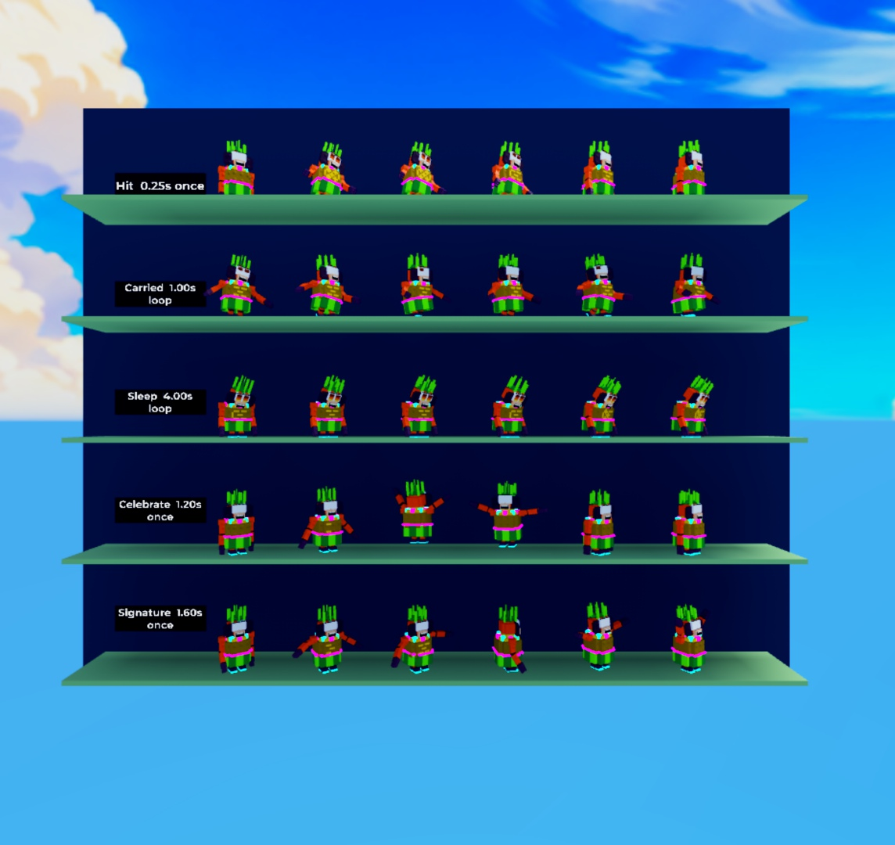
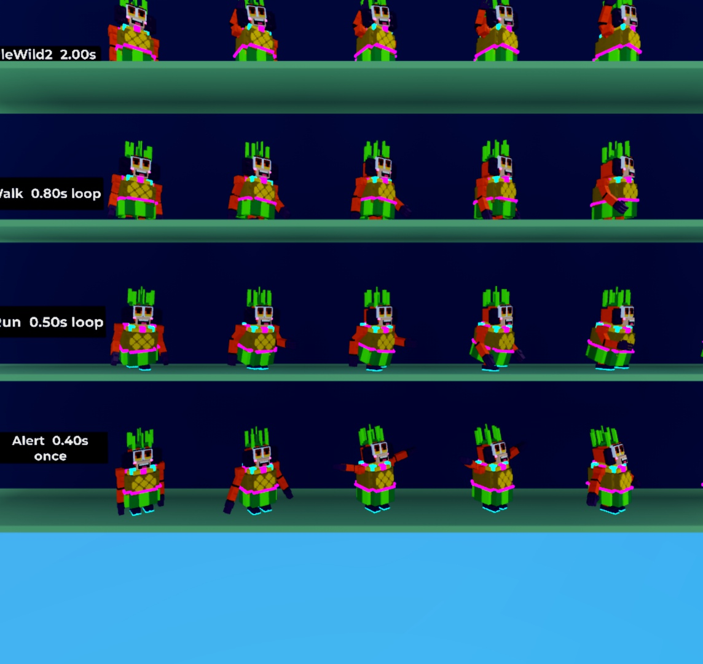
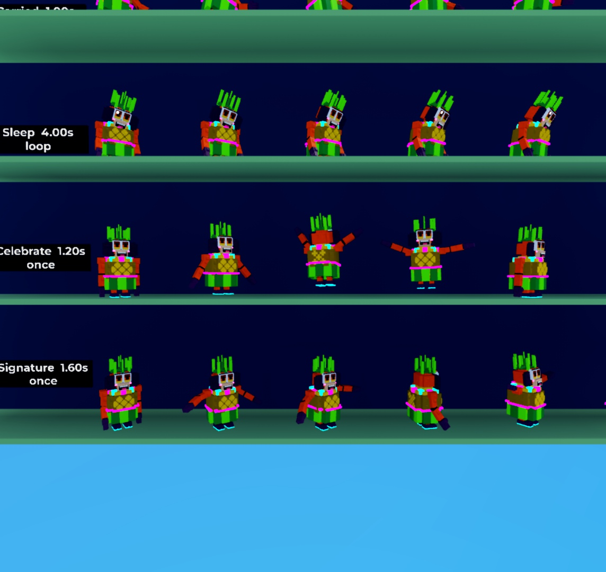
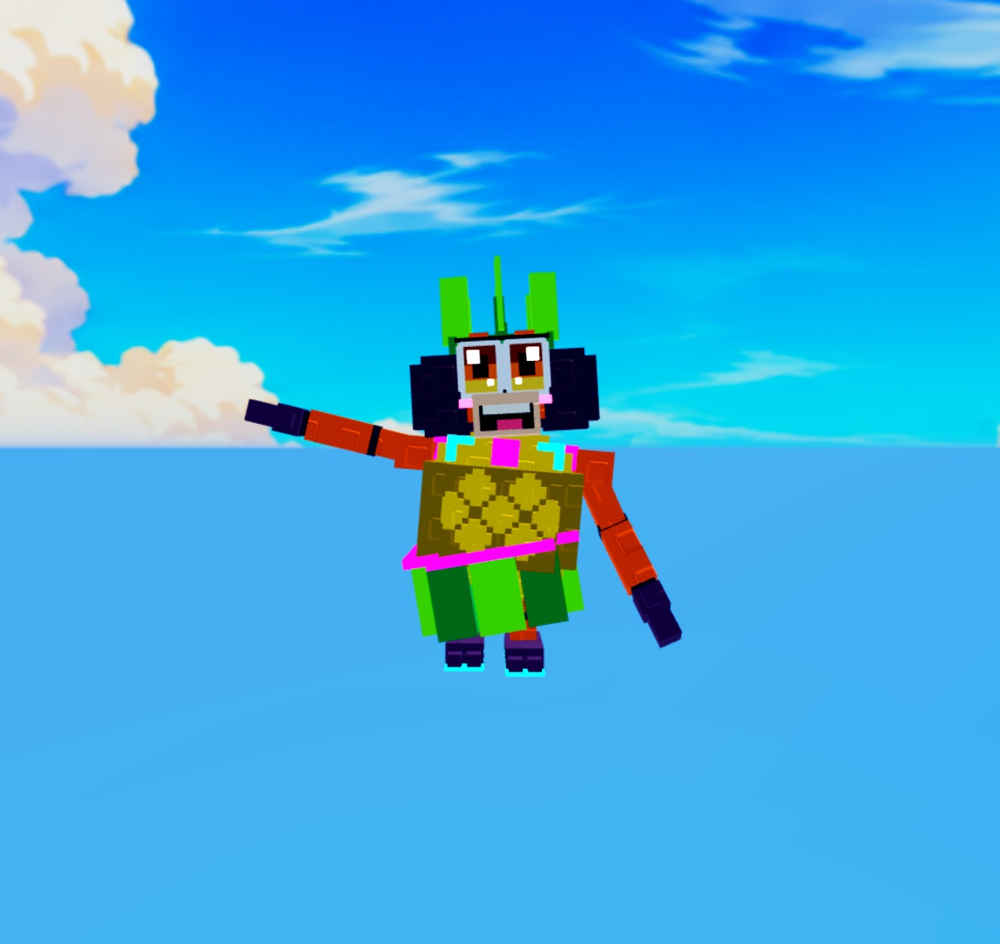

# Review package: BRT_017 Orangutini Ananassini (round 1)

13 November 2026. Drafts only: nothing uploaded, nothing live, not committed.

It is the seventh brainrot in the Swamp order.

## Rig

- **Archetype: Upright biped with long arms, knees and a swinging skirt.**
- **11 Motor6D joints** (was 10): Root→Torso (the pineapple, with the lei and the shoulder caps), Torso→Head (with the leaf crown), Torso→two upper arms, each→forearm (with the big hand), Torso→two thighs, each→lower leg, and Torso→**Skirt** (new).
- **Skirt (new):** the grass skirt and its glowing waistband now hinge at the waist, so they can sway, swish and swing. I added it without being asked; it is what makes the hula work.
- **Elbows and knees:** he already had them from the 7 November rig pass.
- **Two pivots fixed:**
  1. Each **shoulder pivoted at the middle of the upper arm**, so the arm would have swung about its midpoint and slid out of the shoulder cap. It now pivots at the top of the upper arm.
  2. The **head pivoted under the chin**; it now turns from the neck.
- **Bind pose:** all 157 boxes are exactly where they are in the installed template, with the same colours (scripted comparison, zero difference). Only the `rig` list and 12 `bone` tags changed in `Config/VoxelCreatures/BRT_017.lua`.
- **Face:** eyes, brows, cheek flanges, muzzle, grin and the leaf crown move as one rigid group on the head.

## Animations (11)

| Sheet | Rows, top to bottom |
|---|---|
|  | IdleDisplay (hula), IdleWild, IdleWild2 (scratch), Walk, Run, Alert |
|  | Hit, Carried, Sleep, Celebrate, Signature |
|  | Close-up: IdleWild2, Walk, Run, Alert |
|  | Close-up: Sleep, Celebrate, Signature |
|  | Straight on: the peak of the big hula (Signature) |

The idea: a pineapple orangutan at a tiki party. His arms are so long his knuckles brush the ground, his grin never fades, and at any excuse he breaks into a hula. This set is written for him.

- **IdleDisplay** is a gentle hula: the skirt sways from side to side while his body leans the other way, and both long arms ride out to one side with the hands rippling.
- **IdleWild2** is the ape scratch: one long arm reaches up and scratches the side of his head under the crown, his head tilting into it, puzzled. The hand position was found by a search against the model.
- **Walk** is a rolling ape amble: the long arms swing wide, the body rolls over each step and the skirt swishes a beat behind the hips.
- **Run** is a scamper: leaning in, long arms pumping high, the skirt flying back.
- **Alert** is a hop with both arms flung up.
- **Sleep** is asleep on his feet: knees bent, slumped forward, head hanging, arms dangling.
- **Celebrate** is a jump and a full spin with both arms waving overhead.
- **Signature** is the big hula: wide hip swings with the arms flowing from side to side, then a full turn on the spot and a hop that ends with both arms up: aloha.

## Review pen

Set `AnimationReviewPen = true` on `ReplicatedStorage`, press Play, and cross the bridge behind the villager demo. He has a row among the creatures; the pen takes several seconds to fill in.

Checked in Play: 15 models, all with the skirt joint, a track playing on each, no errors. I did not watch each animation play.

## Self-check

| Check | Result |
|---|---|
| Loops seamless | Pass |
| Nothing under the floor | Pass (1 clip needed the floor clamp) |
| Floating above the floor | None in the standing clips. My first Walk floated 0.02 studs throughout; fixed. Run bounces up to 0.04, and Alert, Celebrate and the Signature hop on purpose. |
| Hand against the head in the scratch | 0.14 studs: his fingers touch the side of his head, which is the point |
| Upper arms against the body | 0.06 at rest, as built; up to 0.20 when the arm is raised for the scratch (under the shoulder cap) |
| Forearms against the body and skirt | Up to 0.09 studs |
| Legs against the skirt | Clear in nine clips; 0.09 in Run and 0.08 in Carried, under the skirt |
| Head against the body | 0.08 at rest; up to 0.13 |
| Face rigid | Pass |
| Foot sliding | Not measured |

## Concerns

1. **The skirt moves as one rigid piece.** Its ten slats sway together; they do not fan out or flutter separately. A real hula skirt would ripple.
2. **The lei does not move.** It is part of the pineapple.
3. **In Sleep his eyes stay open**, as on every brainrot, so from the front it can read as a puzzled head tilt rather than sleep.
4. **His hands rest at ground level as built**, so in any clip that lowers his body the hands would sink. I bend his elbows a little in Walk, Run and Sleep to keep them just off the ground.
5. **Walk is authored for 6.6 studs/s and Run for 11**, the same as the other Uncommons.
6. **Rojo is still disconnected.** I put this species' two changed files into Studio by hand and confirmed both are byte-identical to disk.
7. **The installed template is out of date** until approval. His V4 data and build have never been committed; they will be on approval.
