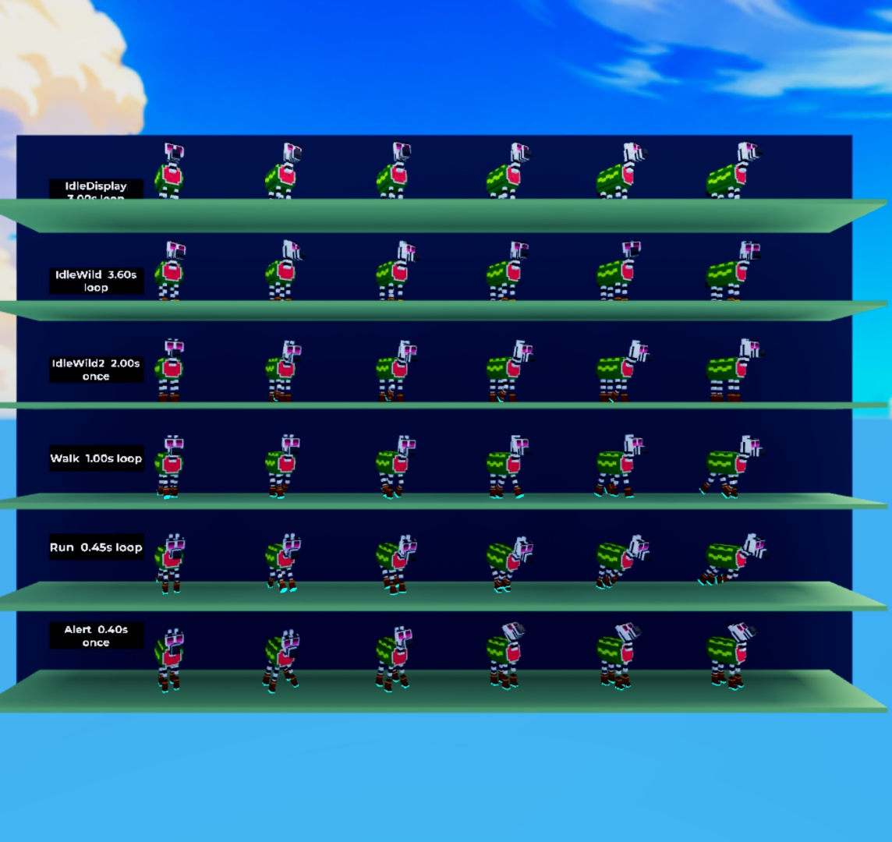
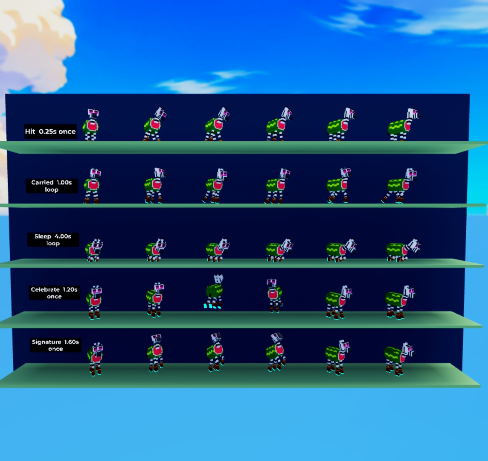
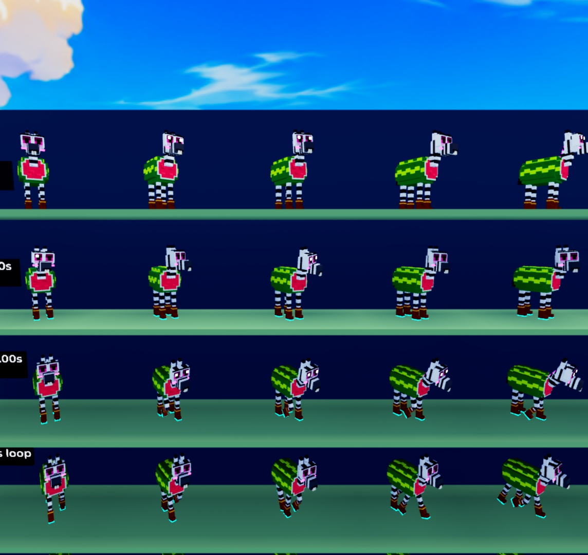
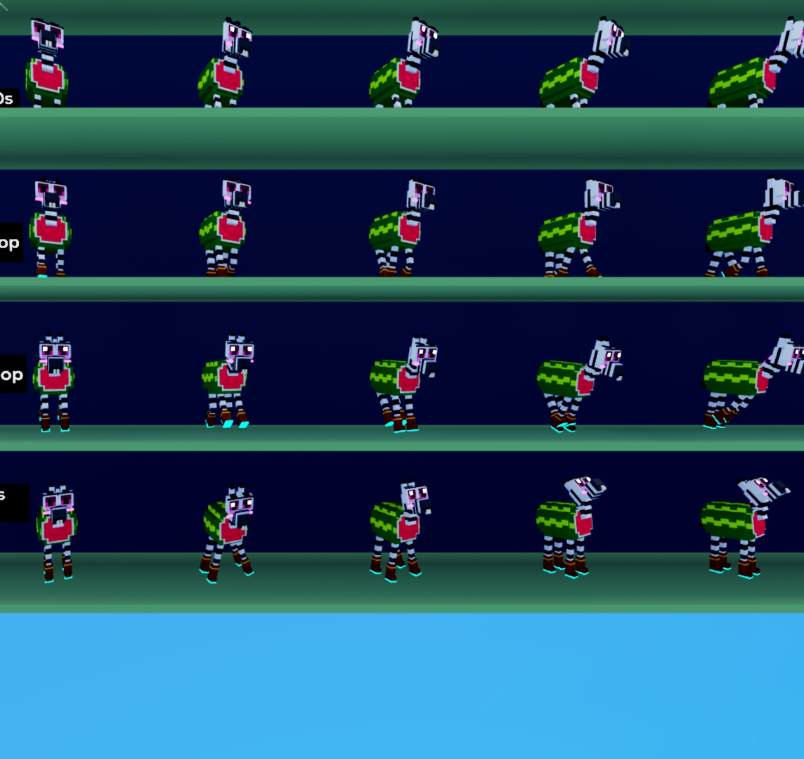
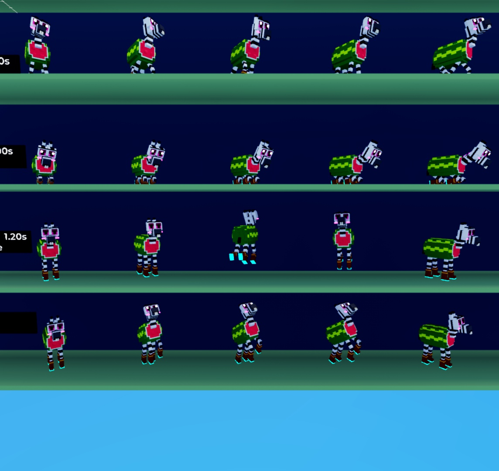
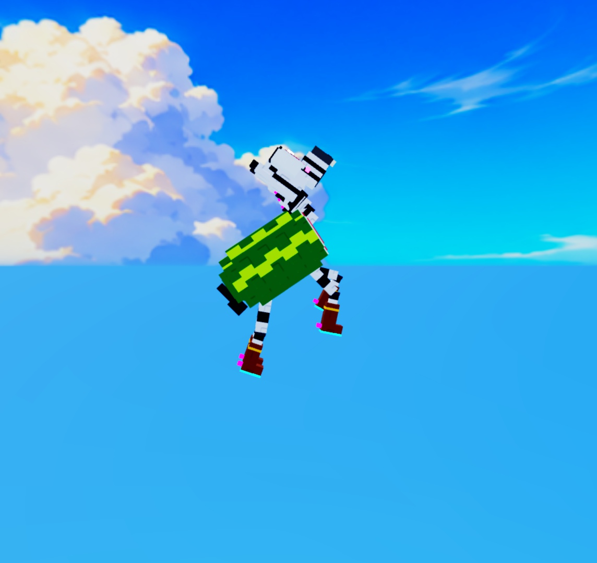

# Review package: BRT_018 Zibra Zubra Zibralini (round 1)

13 November 2026. Drafts only: nothing uploaded, nothing live, not committed.

It is the last brainrot in the Swamp order.

## Rig

- **Archetype: Quadruped with a neck and knees.**
- **12 Motor6D joints** (was 11): Root→Torso (the watermelon), Torso→**Neck** (new), Neck→Head, Torso→four thighs, each→lower leg (with the cowboy boot), Torso→Tail.
- **Neck (new):** the striped neck and its neon-tipped mane were part of the watermelon, and the head turned about a point under its jaw. The neck now has its own joint where it bursts out of the cut melon, and the head turns at the top of the neck. Added as on the camel, so the head can toss, nod, reach out and lie down.
- **One rig fault fixed:** a mouth piece was tagged to the watermelon, so it would have stayed behind when the head moved. It is now on the head.
- **Knees:** it already had them from the 7 November rig pass.
- **Bind pose:** all 158 boxes are exactly where they are in the installed template, with the same colours (scripted comparison, zero difference). Only the `rig` list and 16 `bone` tags changed in `Config/VoxelCreatures/BRT_018.lua`.
- **Face:** eyes, brows, ears, muzzle, nose, mouth and buck teeth move as one rigid group on the head.

## Animations (11)

| Sheet | Rows, top to bottom |
|---|---|
|  | IdleDisplay, IdleWild, IdleWild2 (pawing), Walk, Run, Alert |
|  | Hit, Carried, Sleep, Celebrate, Signature |
|  | Close-up: IdleDisplay, IdleWild, IdleWild2, Walk |
|  | Close-up: IdleWild2, Walk, Run, Alert |
|  | Close-up: Carried, Sleep, Celebrate, Signature |
|  | From the side: the top of the rodeo rear (Signature) |

On the first overview sheet the top row's legs are hidden by the shelf in front; the first close-up shows that row properly.

The idea: a zebra bursting out of a watermelon, dressed as a desert cowboy in boots and glowing spurs. A proud horse at heart. This set is written for it.

- **Walk** is a proud four-beat horse walk (back right, front right, back left, front left), the neck nodding twice a stride.
- **Run** is a gallop: hind pair then front pair, the body rocking front to back, the neck reaching out low and the tail streaming.
- **IdleDisplay** is the boot-scoot: it shifts its weight, taps its front right boot twice with the spur flashing, then tosses its head.
- **IdleWild2** is pawing the ground: the front right boot scrapes back three times, head low, tail swishing, like a horse impatient to go.
- **Sleep** is lying down: all four legs folded under the melon, the neck laid forward and the head resting low.
- **Signature** is the rodeo rear: up on its hind legs, front boots pawing the air twice, head thrown back; then it drops and stamps.
- **IdleWild, Alert, Hit, Carried and Celebrate** come from the shared quadruped set, with neck and knee motion added for it.

## Review pen

Set `AnimationReviewPen = true` on `ReplicatedStorage`, press Play, and cross the bridge behind the villager demo. It has a row among the creatures; the pen takes several seconds to fill in.

Checked in Play: 15 models, all with the neck joint, a track playing on each, no errors. I did not watch each animation play.

## Self-check

| Check | Result |
|---|---|
| Loops seamless | Pass |
| Nothing under the floor | Pass (3 clips needed the floor clamp) |
| Floating above the floor | My first version floated in IdleDisplay, Walk and Run (Run never touched the ground); fixed. Now the lowest point reaches the floor in every ground clip except the shared IdleWild, which hovers 0.01 to 0.06 studs with its breathing. The gallop leaves the ground up to 0.36 between strides on purpose. |
| Head against the body and legs | Clear in all 11 clips |
| Neck against the melon | 0.12 studs at rest, as built (the neck sinks into the cut flesh); no more than 0.13 in any clip |
| Legs against the melon | 0.08 at rest, as built; up to 0.20 in Sleep with the legs folded, 0.18 in Run |
| Legs against each other | Clear in eight clips; 0.06 in Walk, 0.12 in Run, 0.13 in Carried |
| Face rigid | Pass |
| Foot sliding | Not measured |

## Concerns

1. **The spurs do not flash.** They glow all the time; I describe the boot taps as flashing the spur, but nothing changes colour.
2. **The rear is driven by the shared stance code**, which keeps the hind boots planted by lifting the body; the hind legs angle back a little rather than crouching under it.
3. **Five clips are the shared quadruped ones** with neck and knee motion added, as on the camel. Say if you want any of them written for it.
4. **Walk is authored for 6.6 studs/s and Run for 11**, the same as the other Uncommons.
5. **Rojo is still disconnected.** I put this species' two changed files into Studio by hand and confirmed both are byte-identical to disk.
6. **The installed template is out of date** until approval. Its V4 data and build have never been committed; they will be on approval.
