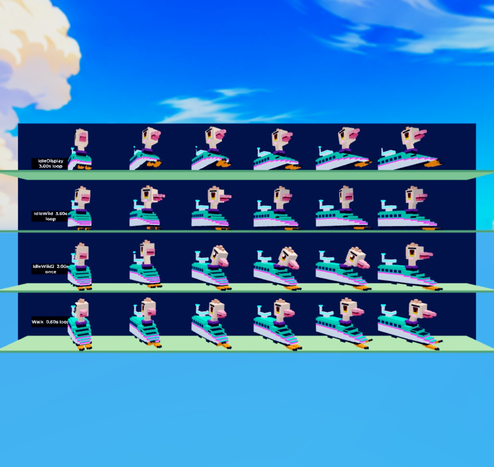
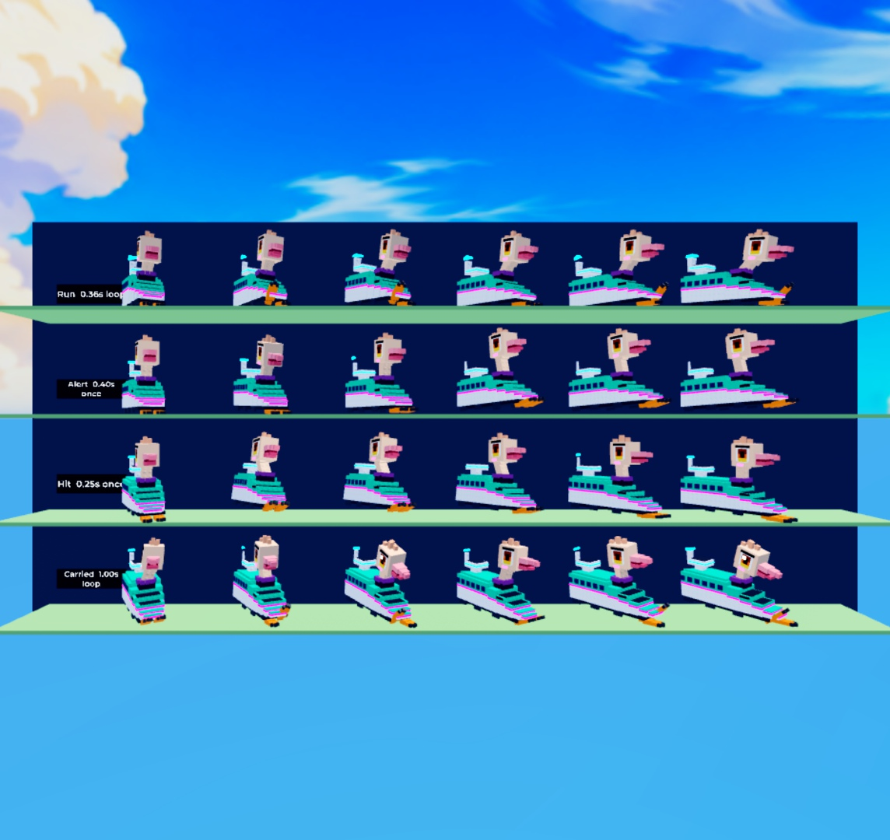
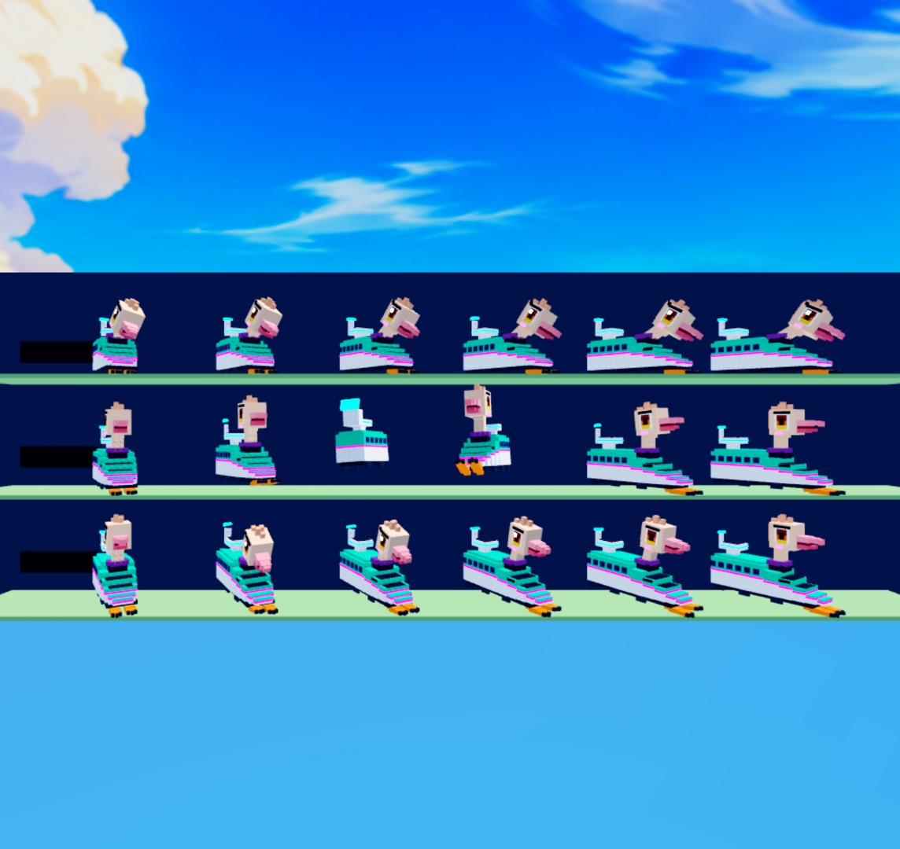

# Review package: BRT_019 Trenostruzzo Turbo 3000 (round 1)

13 November 2026. Drafts only: nothing uploaded, nothing live, not committed.

## Rig

- **Archetype: Vehicle-hybrid.** A bullet-train chassis with an ostrich neck and head, two feet poking out under the nose, and the toilet on the roof.
- **Model rigged: the Voxel V4 model.** It already had a four-bone rig (torso, head, two legs) from the 7 November "make them riggable" pass. I extended that through the existing pipeline (`tools/voxel_v4/rig.js` → `export_lua.js`) rather than building a second rigging system.
- **6 Motor6D joints:** Root→Torso (chassis), Torso→Neck, Neck→Head, Torso→RightLeg, Torso→LeftLeg, Torso→ToiletLid (the +1 signature prop).
- **Bind pose:** all 135 boxes are in exactly the same place, size, colour, material and role as the current V4 model (scripted comparison, zero difference). Only the `rig` list and four `bone` tags changed in `Config/VoxelCreatures/BRT_019.lua`.
- **Face:** eyes, beak, mouth and tongue are all on the Head bone and move as one rigid group.
- **Scale:** in Play at 0.6×, 1.0× and 1.6×, the Celebrate jump height scales exactly with the model (jump ÷ scale is 1.83 at both 0.6× and 1.6×), so translations scale correctly with `ScaleTo`.

## Animations (11)

| Sheet | Rows, top to bottom |
|---|---|
|  | IdleDisplay, IdleWild, IdleWild2, Walk |
|  | Run, Alert, Hit, Carried |
|  | Sleep, Celebrate, Signature (labels did not render in this capture) |

The idea: the chassis stays stiff and train-like, and the neck and head do the nervous-ostrich acting. Walk has the ostrich head-bob; Run lays the neck flat like an express; Signature is four rapid pecks with the toilet lid clacking; Sleep lays the head on the nose and the lid lifts with each snore.

## Review pen

Add the boolean attribute `AnimationReviewPen = true` on `ReplicatedStorage`, press Play, then walk across the bridge behind the villager behaviour demo. You will find one Trenostruzzo per animation, three copies at 0.6× / 1.0× / 1.6× playing Celebrate, and one circling at real speed (8 s of Walk at 7.26 studs/s, then 4 s of Run at 13). Remove the attribute afterwards.

Checked in Play: 15 creatures, all tracks load, no errors. I did not watch each animation play.

## Self-check

| Check | Result |
|---|---|
| Loops seamless | Pass |
| Nothing under the floor | Pass, after lifting the chassis by what a pitch or roll would sink it |
| Face rigid | Pass |
| Nothing detaches | Pass by construction (every box is welded to a bone) |
| Clipping | Not checked animation by animation. Watch the beak against the nose in Signature and Sleep. |
| Foot sliding | See concern 1 |

## Concerns

1. **The feet cannot stride.** They are short stubs hinged at the heel with long toes in front, so any downward swing pushes the toes through the floor. In Walk and Run they only lift and slap, and the body reads as rolling. Playback speed will still follow ground speed.
2. **Bogies have no joints.** They are rectangular boxes, not wheels; spinning them would look wrong.
3. **Mutations and studs** were not re-captured. Every part keeps its role, colour and material attributes, and the mutation code is untouched, so the six looks should be unchanged.
4. **Not on a real base platform.** The pen shows IdleDisplay on a plinth, not a base cell.
5. **The installed template is now out of date.** `ReplicatedStorage.CodeAssets.CreaturesV4.BRT_019_V4` still has the old four-bone rig; the pen builds from the data instead. On approval I will regenerate the template file through the existing dump pipeline. V4 is not live (`VoxelCreaturesV4Enabled` is off), so no player sees either rig today. Until then, any V4 spec that compares the template with the data will report BRT_019 as different; I have not run that suite.
6. **No `_Rigged` copy.** The brief asks for the rigged template to sit beside the live one until approved. Because the change is to V4 data that is not live, and is geometry-neutral, I changed it in place. These files are not tracked in git, so to revert: remove the `rigOverrides` block at the end of `tools/voxel_v4/builds/BRT_019.js` and re-run `node export_lua.js builds/BRT_019.js BRT_019 Amber` (or restore `BRT_019.lua` from `.checkpoints/animation_20261113/source_pre_partA.tgz`).
7. **Three-angle pre-rig captures were replaced by the scripted comparison** above.
