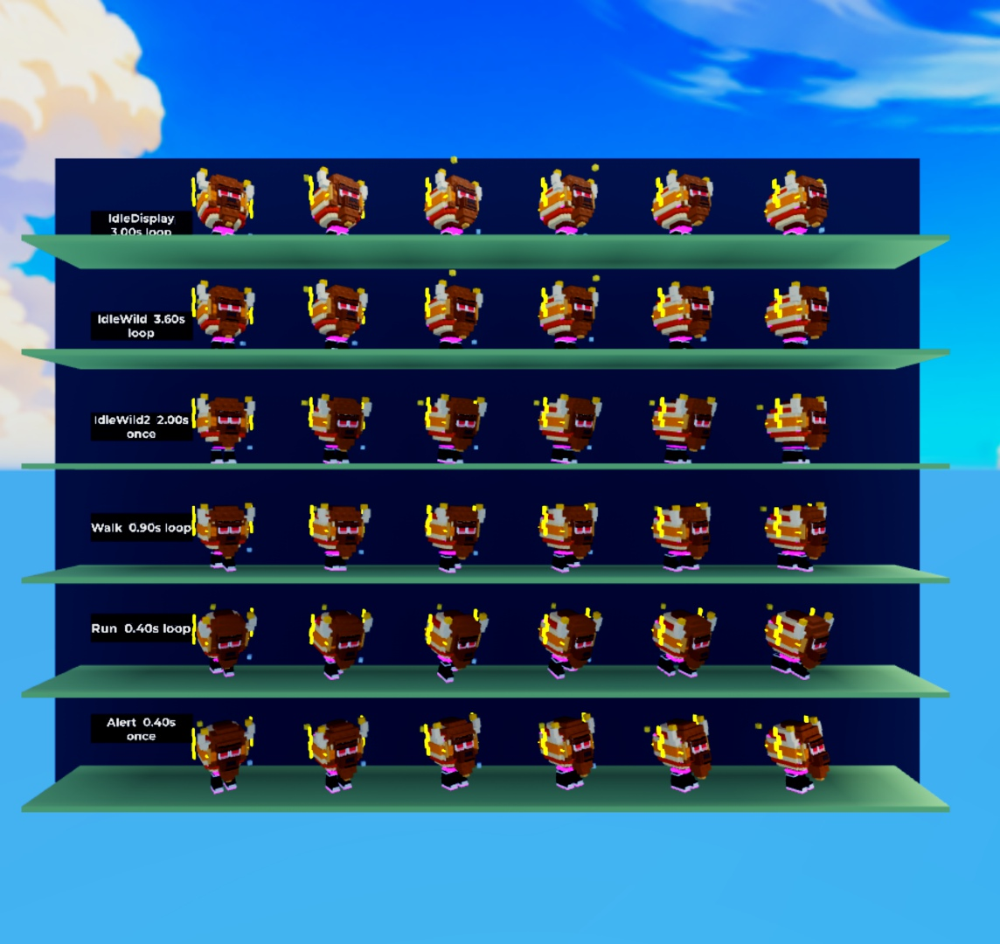
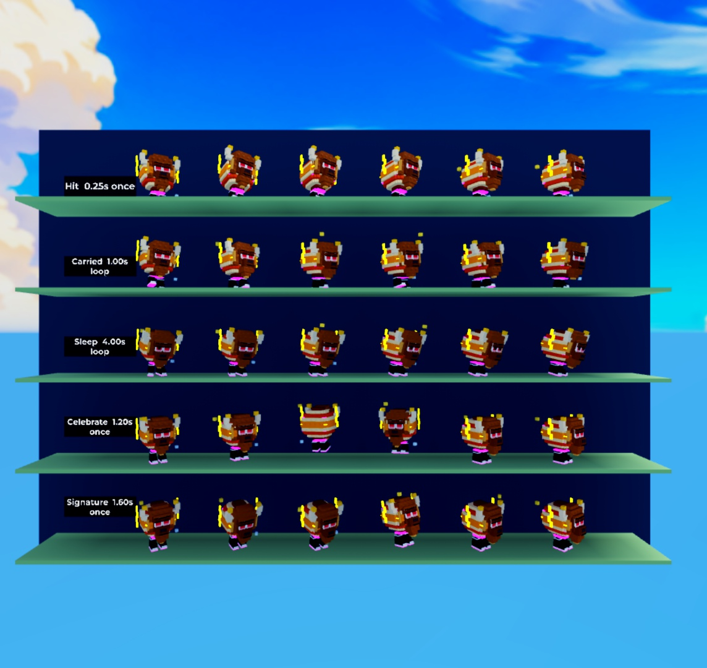
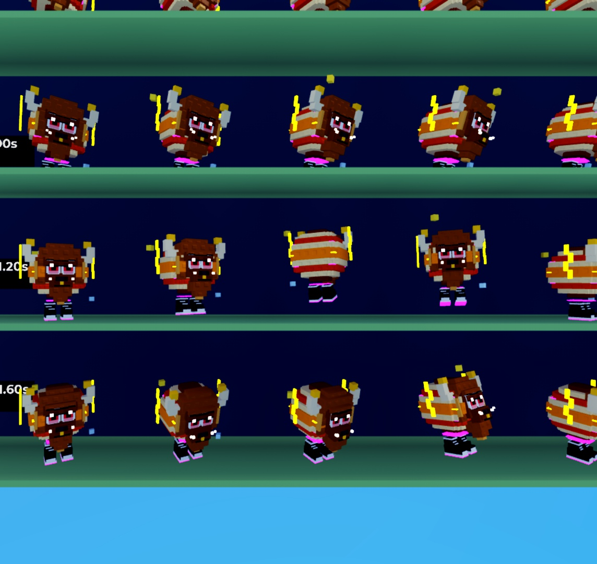

# Review package: BRT_020 Bisonte Giuppitere (round 1)

13 November 2026. Drafts only: nothing uploaded, nothing live, not committed.

He is the first Beach-order brainrot and the first "hoverer": a planet on sneakers, with no legs, arms or tail.

## Rig

- **Archetype: Hoverer.** 6 Motor6D joints: Root→Torso (the planet), Torso→Head, Torso→each sneaker, and two new joints, **Torso→MoonIo** and **Torso→MoonEuropa**, both at the planet's centre so each moon can orbit.
- **A fix to the existing rig:** his beard, his mouth and two pieces of mane were attached to the planet, not the head, so they would have stayed behind when the head moved. They are now on the head, which makes the whole face, mane, beard and horns one rigid group.
- **Bind pose:** all 129 boxes are exactly where they are in the installed template, with the same colours (scripted comparison, zero difference). Only the `rig` list (2 new rows) and 9 `bone` tags changed in `Config/VoxelCreatures/BRT_020.lua`.
- **Not changed:** the planet does not spin. Its front equator box is the gameplay `Body` part, so I left the whole planet as one piece.

## Animations (11)

| Sheet | Rows, top to bottom |
|---|---|
|  | IdleDisplay, IdleWild, IdleWild2 (paws the ground), Walk, Run, Alert |
|  | Hit, Carried, Sleep, Celebrate, Signature |
|  | Close-up: Sleep, Celebrate, Signature |

The idea: a giant, tough bison-planet with an aura. Heavy and unhurried; his moons never stop circling, and when he means it he paws the ground and drops his horns. This set is written for him.

- **The moons.** Io (the yellow one) makes full orbits and rises in an arc over his head as it passes the front, so it clears the horns. Europa (the pale blue one, low on his left) only swings back and forth: at its height the beard and snout block a full orbit.
- **Walk** is the march: the sneakers stride under the hovering planet, which rolls a little with each step, and the moons sway behind.
- **Run** is the charge: horns down, the planet pitched forward, the sneakers pounding.
- **IdleDisplay** is holding court: he hovers with his chin up, Io circles once a loop, and near the end he snorts with a toss of the head.
- **IdleWild2** drops his horns and paws the ground twice with the right sneaker.
- **Sleep** is asleep on his feet: the planet tips forward until his beard hangs over his toes, the sneakers turn out, and Io slows to one orbit every four seconds.
- **Celebrate** is a hop and a full spin, sneakers and all, with Io whipping round twice.
- **Signature** is the storm: he drops his horns and paws the ground twice, then rears up with his head thrown back while Io whirls three times round him, and slams back down.

The figures are small on the sheets and the moons are a few pixels; the pen shows them far better.

## Review pen

Set `AnimationReviewPen = true` on `ReplicatedStorage`, press Play, and cross the bridge behind the villager demo. He is the fourteenth creature row.

Checked in Play: 15 models, all with both moon bones, no errors. 13 of the 15 had a track playing on each of two samples; the others are one-shot clips waiting to replay. I did not watch each animation play.

## Self-check

| Check | Result |
|---|---|
| Loops seamless | Pass (Io ends each loop on a whole orbit) |
| Nothing under the floor | Pass (3 clips needed the floor clamp) |
| Moons clear the head, horns, beard and sneakers | Pass in all 11 clips: smallest gap 0.19 studs (Io past a horn in Sleep) |
| Face rigid | Pass, after the fix above |
| Clipping | The moons are measured. Not checked: the mane against the planet when the head turns, and the sneakers against the glowing ring when they lift. |
| Foot sliding | Not measured |

## Concerns

1. **The head can only move a little** (up to about 8 degrees). It is mounted flat on the planet, so a bigger nod or turn would push the mane into the planet or open a gap behind it.
2. **The sneakers step by sliding and lifting, not by swinging.** They hang from their tops, so a swing would drive the toes into the floor.
3. **Europa never completes an orbit.** If you want both moons circling, Europa has to sit higher or further out, which is a model change.
4. **His lightning and aura do not animate.** They are fixed boxes on the planet.
5. **He is a giant** (1.5 times the usual height in the game). The sheets show him at design size. I have not checked what size the pen shows him at.
6. **Rojo is still disconnected.** I put this species' two changed files into Studio by hand and confirmed both are byte-identical to disk.
7. **The installed template is out of date** until approval.
8. **Run is authored for 10 studs/s, which is my assumption.**
