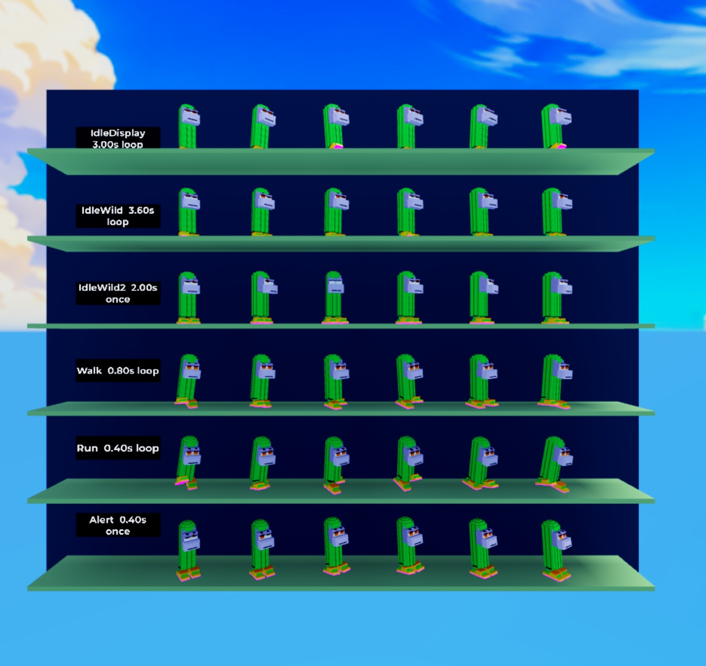
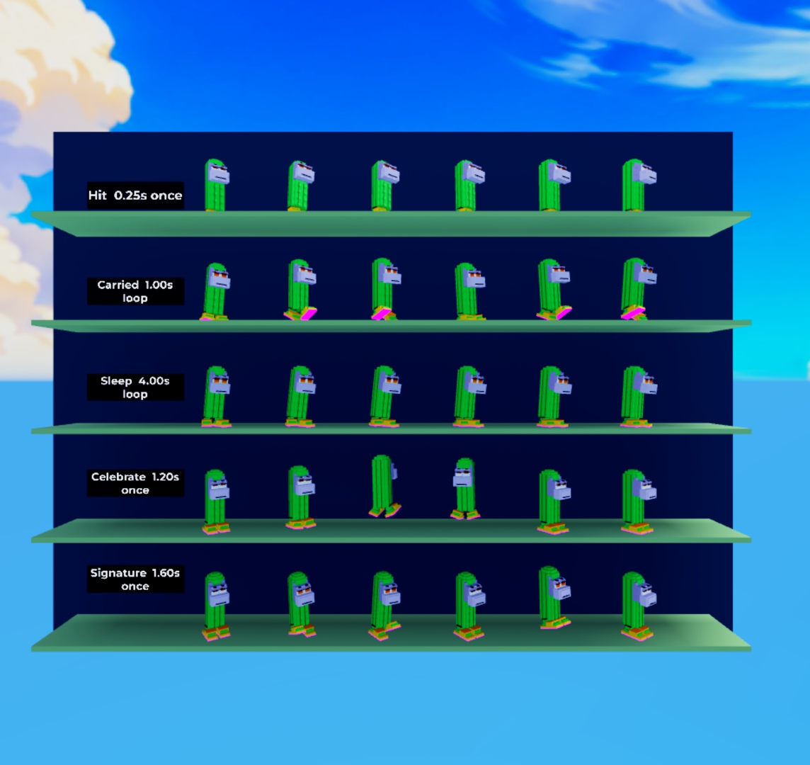
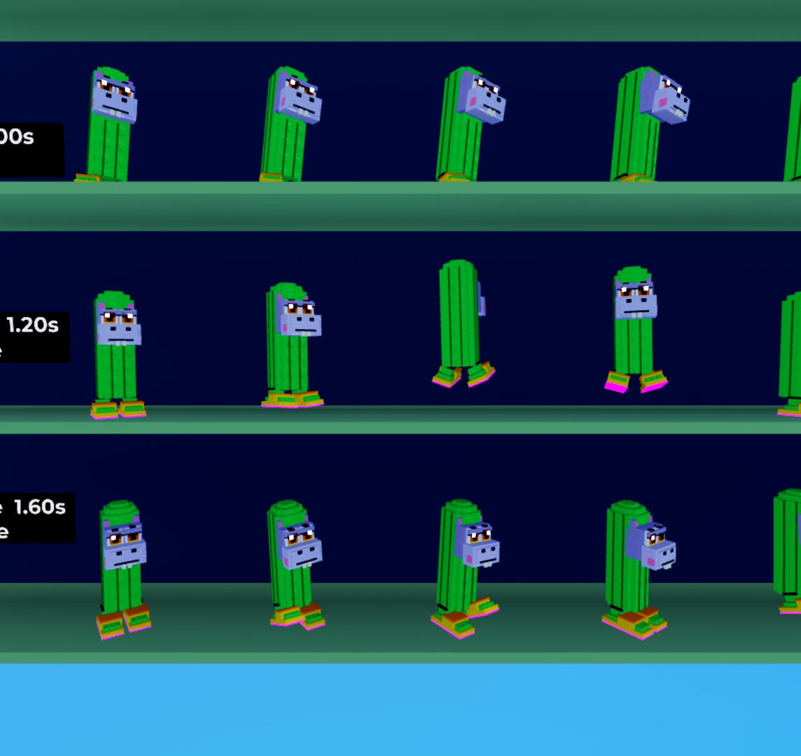

# Review package: BRT_021 Cacto Hipopotamo (round 1)

13 November 2026. Drafts only: nothing uploaded, nothing live, not committed.

It is the first brainrot in the Swamp order.

## Rig

- **Archetype: Column.** A tall rigid body on two feet, with no arms, tail or neck.
- **4 Motor6D joints** (unchanged): Root→Torso (the cactus column), Torso→Head (the hippo face on its front), Torso→two legs (each a stub leg and one giant slipper).
- **One rig fix:** six of the dark spine dots on the column were tagged to the Head, so they would have slid across the cactus whenever the face moved. They now belong to the column.
- **No joints added.** He has no elbows, knees or neck to add: the legs are stubs inside the column, and the face is mounted flat on it.
- **Bind pose:** all 115 boxes are exactly where they are in the installed template, with the same colours (scripted comparison, zero difference). Only six `bone` tags changed in `Config/VoxelCreatures/BRT_021.lua`.
- **Face:** eyes, brows and buck teeth move as one rigid group on the head.

## Animations (11)

| Sheet | Rows, top to bottom |
|---|---|
|  | IdleDisplay, IdleWild, IdleWild2 (shimmy), Walk, Run, Alert |
|  | Hit, Carried, Sleep, Celebrate, Signature |
|  | Close-up: Sleep, Celebrate, Signature |

The idea: a deadpan cactus with a hippo's face, standing in huge yellow slippers. He cannot bend, so everything he does is a sway, a hop or a slap of a slipper. This set is written for him.

- **Walk** is the shuffle: he rocks from slipper to slipper, each one sliding forward flat and landing with a little flap.
- **Run** is the flip-flop sprint: leaning in, slippers slapping fast and high.
- **IdleDisplay** is the metronome: the whole column ticks from side to side while the right slipper taps time.
- **IdleWild2** is a shimmy: he twists hard left and right four times, like shaking off sand.
- **Sleep** is standing, as a cactus does: slippers turned out, the column leaning a little and swaying very slowly.
- **Celebrate** is a hop and a full spin with the slippers kicked out to the sides.
- **Signature** is the slipper slap: two slaps of the right slipper, two of the left, then a hop with both toes up and a flat two-footed landing.

## Review pen

Set `AnimationReviewPen = true` on `ReplicatedStorage`, press Play, and cross the bridge behind the villager demo. He has a row among the creatures.

Checked in Play: 15 models, a track playing on each, no errors. I did not watch each animation play.

## Self-check

| Check | Result |
|---|---|
| Loops seamless | Pass |
| Nothing under the floor | Pass (1 clip needed the floor clamp) |
| Face rigid | Pass |
| Slippers against each other | They touch by 0.04 studs in Sleep, where they are turned out. Clear in the other ten. |
| Legs against the column | The stub legs slide 0.15 to 0.38 studs up inside the column whenever a slipper lifts. They are hidden inside it, so nothing shows. |
| Foot sliding | Not measured |

## Concerns

1. **His face can barely move.** It is mounted flat on the front of the column, so it nods and turns about 5 degrees and no more; anything larger pulls it off the cactus. All his expression comes from the body and the slippers.
2. **The column cannot bend.** There is no squash or stretch on landings, only a small dip of the whole body.
3. **The slippers carry almost everything.** If you want more character than sways, hops and slaps, it would have to come from a new joint in the column (a waist), which would put a visible seam across the cactus.
4. **His eyes do not close in Sleep.** The face is a rigid group, as on every brainrot; he sleeps by leaning and turning his slippers out.
5. **Walk is authored for 6 studs/s and Run for 10.** These are my assumption for him, not read from his behaviour tuning.
6. **Rojo is still disconnected.** I put this species' two changed files into Studio by hand and confirmed both are byte-identical to disk.
7. **The installed template is out of date** until approval.
