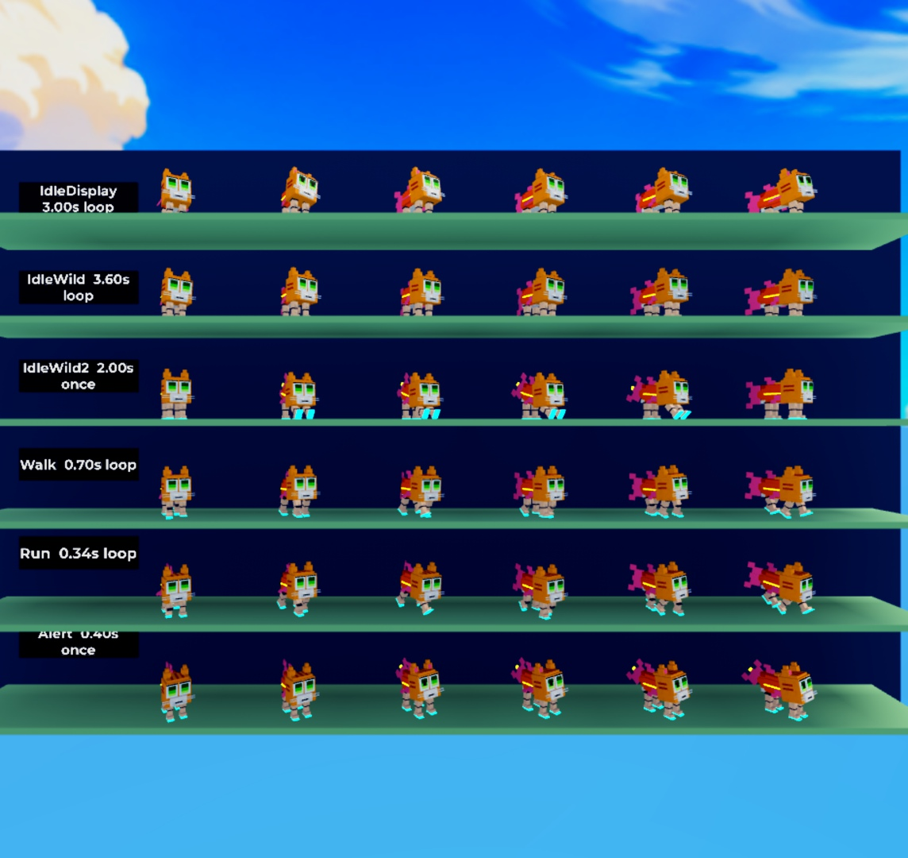
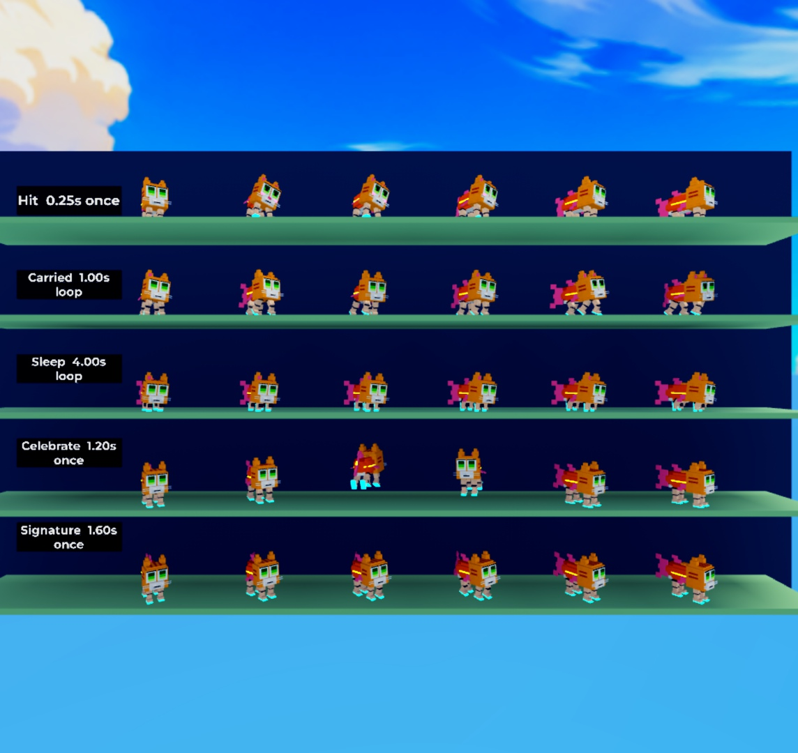
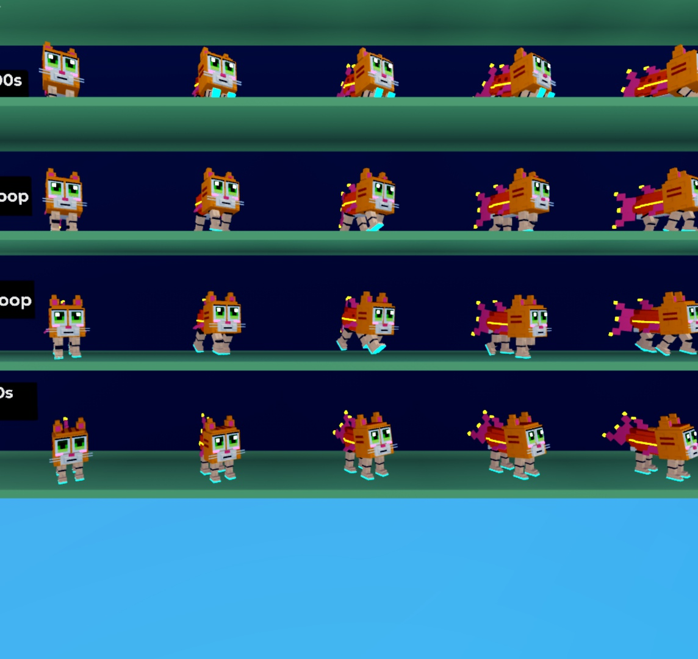
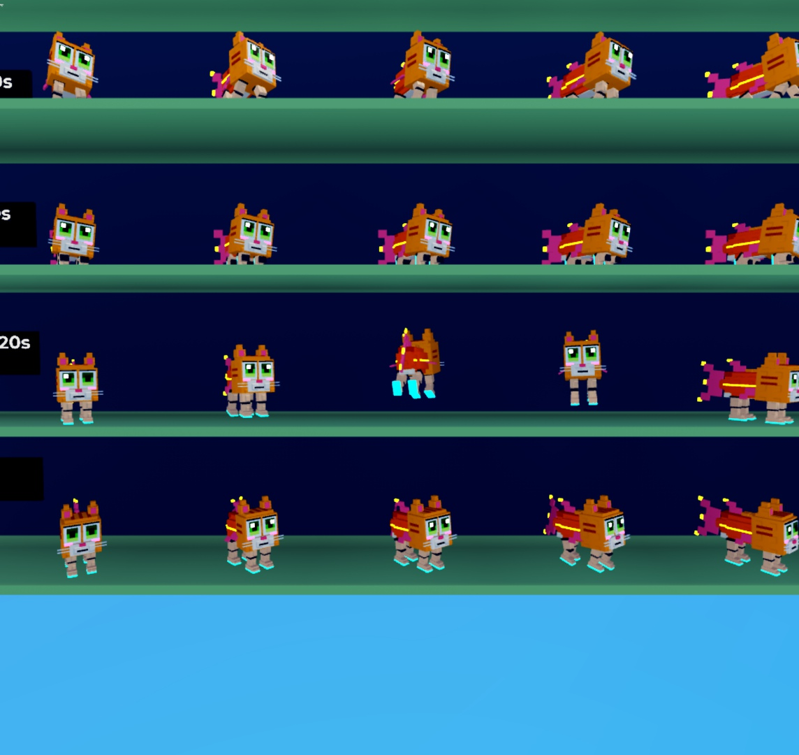

# Review package: BRT_022 Trulimero Trulicina (round 1)

13 November 2026. Drafts only: nothing uploaded, nothing live, not committed.

It is the second brainrot in the Swamp order.

## Rig

- **Archetype: Quadruped with knees and fins.** A cat's head on a goldfish that walks on four human legs.
- **14 Motor6D joints** (was 11): Root→Torso (the goldfish), Torso→Head, Torso→four thighs, each thigh→lower leg, Torso→Tail, Torso→RightFin, Torso→LeftFin, Torso→DorsalFin.
- **Fins (new, three joints):** the two side fins and the dorsal fin were part of the body. Each side fin now hinges along its top edge so it can open outward and paddle; the dorsal fin leans from its base. I added these without being asked, because the fish half has nothing else to move.
- **Knees:** it already had them from the 7 November rig pass.
- **Head pivot moved:** the head used to turn about a point at its bottom front, under the chin. It now turns where it meets the fish.
- **Tail pivot moved** to the middle of the tail's root; it was 0.34 studs too high, so the fan swung lopsided.
- **One fur tuft** on the fish's back was tagged to the head; it now stays on the fish.
- **Bind pose:** all 118 boxes are exactly where they are in the installed template, with the same colours (scripted comparison, zero difference). Only the `rig` list and 8 `bone` tags changed in `Config/VoxelCreatures/BRT_022.lua`.
- **Face:** eyes, nose, mouth, whiskers and ears move as one rigid group on the head.

## Animations (11)

| Sheet | Rows, top to bottom |
|---|---|
|  | IdleDisplay, IdleWild, IdleWild2 (cat stretch), Walk, Run, Alert |
|  | Hit, Carried, Sleep, Celebrate, Signature |
|  | Close-up: IdleWild2, Walk, Run, Alert |
|  | Close-up: Carried, Sleep, Celebrate, Signature |

It is small (3.1 studs tall), so the overview sheets show little detail; the close-ups are the ones to look at.

The idea: the cat half stays deadpan while the fish half never stops swimming. The body wiggles, the tail fans and the fins paddle, even on dry land. This set is written for it.

- **Walk** is a brisk human-legged trot under a body that swims: the fish wiggles from side to side with every stride, the tail sweeps the other way and the fins paddle.
- **Run** is the dash: legs flying, the whole fish thrashing.
- **IdleDisplay** shows off the fins: they fan open one after the other while the tail swishes and the head tilts from side to side.
- **IdleWild2** is the cat stretch: the front legs slide out forward, the chest drops, the back end and tail stay up, and it holds before standing again.
- **Carried** is a landed fish: the tail flaps hard, the fins beat and the legs pedal.
- **Sleep** is a cat loaf: all four legs folded under the fish, the head settled low, the tail curled round to one side.
- **Celebrate** is a hop and a full spin with the fins flung out.
- **Signature** is the swim: it forgets it has legs and swims on the spot, body snaking, tail beating and fins paddling while the feet patter underneath and the cat head stays level; then a small hop with both fins out.

## Review pen

Set `AnimationReviewPen = true` on `ReplicatedStorage`, press Play, and cross the bridge behind the villager demo. It has a row among the creatures.

Checked in Play: 15 models, all with the three fin joints, no errors. 14 of the 15 had a track playing when sampled; the other was a one-shot animation between repeats. I did not watch each animation play.

## Self-check

| Check | Result |
|---|---|
| Loops seamless | Pass |
| Nothing under the floor | Pass (3 clips needed the floor clamp) |
| Floating above the floor | In the standing clips the lowest point is never more than 0.08 studs up. Run bounces 0.19 and the Alert and Signature hops reach 0.14 and 0.22, all on purpose. |
| Fins against the legs | Clear in all 11 clips |
| Tail against the body | Up to 0.11 studs at the tail root (0.05 at rest) |
| Front legs against the head | The front legs sit 0.10 studs inside the head at rest, as built. That grows to 0.23 in Hit and Carried and 0.33 in Sleep. It is under the head and should not show; I did not check it from below. |
| Face rigid | Pass |
| Foot sliding | Not measured |

## Concerns

1. **The head can only move a little.** The front legs are attached to the fish but sit under the head, so a big turn or nod would slide the head off its own legs. I kept it to about 13 degrees of turn and 8 of nod. The deadpan suits it, but it cannot look around like the other quadrupeds.
2. **The fins are small.** They open up to 80 degrees, but each is a thin plate about half a stud deep; from a distance the paddling is hard to see. The tail and the body wiggle carry the swimming.
3. **In the Signature the feet patter rather than stand still.** I chose that so the swim reads as "still trying to walk"; say if you would rather the legs froze.
4. **Walk is authored for 6 studs/s and Run for 10.** These are my assumption, the same as the last two Rares.
5. **Rojo is still disconnected.** I put this species' two changed files into Studio by hand and confirmed both are byte-identical to disk.
6. **The installed template is out of date** until approval.
