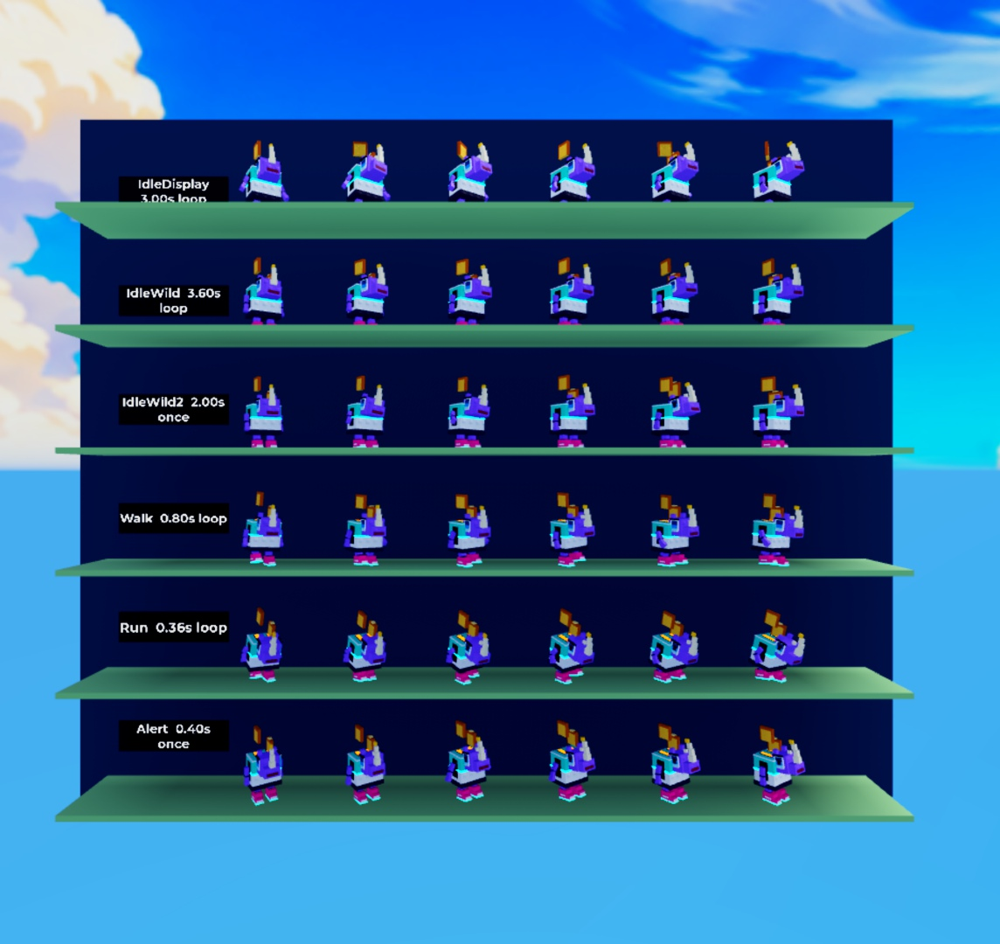
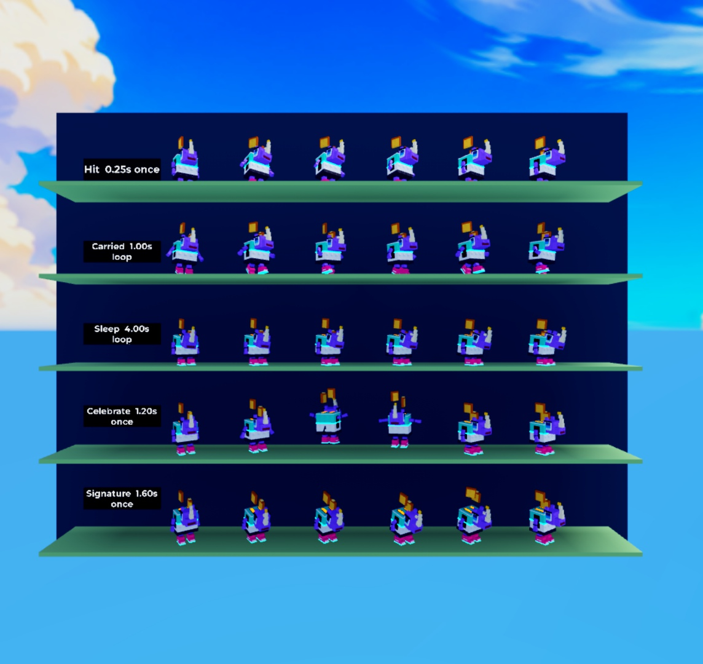
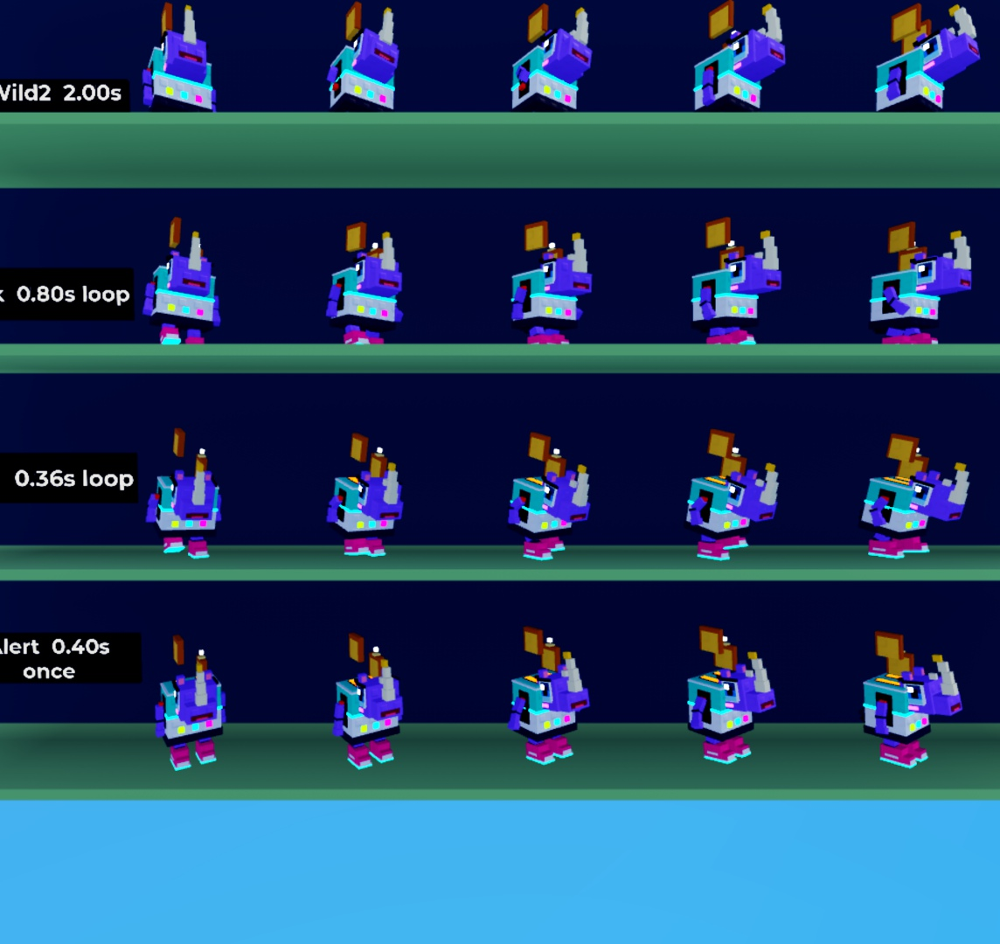
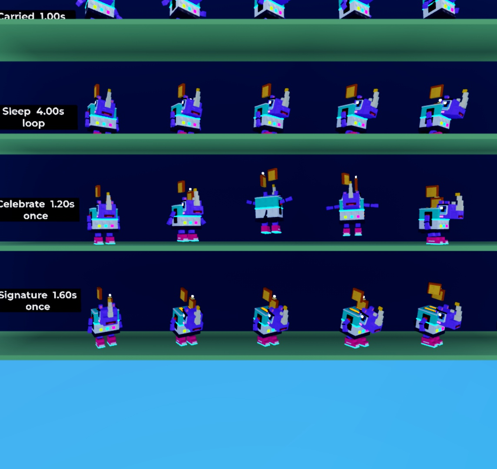

# Review package: BRT_026 Rhino Toasterino (round 1)

13 November 2026. Drafts only: nothing uploaded, nothing live, not committed.

It is the third brainrot in the Swamp order.

## Rig

- **Archetype: Upright biped with elbows, knees and working parts.**
- **14 Motor6D joints** (was 10): Root→Torso (the toaster), Torso→Head, Torso→two upper arms, each→forearm, Torso→two thighs, each→lower leg (the sneaker), Torso→LeftToast, Torso→RightToast, Torso→LeverKnob, Torso→Tail.
- **Toast (new, two joints):** both slices were part of the toaster. The slice in the slot now moves on its own and carries its butter and steam; the slice that has popped out and hangs in the air moves and turns on its own.
- **Lever knob (new):** the red knob on his right side slides down its track and back.
- **Power-cord tail (new):** the cord and plug swing from where the cord leaves the toaster.
- I added these four without being asked. A toaster whose toast and lever cannot move has very little to animate.
- **Elbows and knees:** he already had them from the 7 November rig pass.
- **Head pivot moved:** the head used to turn about a point under its chin. It now turns where it meets the front of the toaster.
- **Bind pose:** all 113 boxes are exactly where they are in the installed template, with the same colours (scripted comparison, zero difference). Only the `rig` list and 20 `bone` tags changed in `Config/VoxelCreatures/BRT_026.lua`.
- **Face:** eyes, mouth, nostrils, ears and both horns move as one rigid group on the head.

## Animations (11)

| Sheet | Rows, top to bottom |
|---|---|
|  | IdleDisplay, IdleWild, IdleWild2 (makes toast), Walk, Run, Alert |
|  | Hit, Carried, Sleep, Celebrate, Signature |
|  | Close-up: IdleWild2, Walk, Run, Alert |
|  | Close-up: Sleep, Celebrate, Signature |

The idea: a cheerful rhino who is also a toaster. He is always making toast: one slice hovers and turns above him, the other jumps in its slot, and when he gets excited he lowers his horn and charges. This set is written for him.

- **Walk** is a stomping waddle: he rocks from sneaker to sneaker with his arms pumping, the slotted slice jumping at every step and the cord wagging behind.
- **Run** is the charge: body pitched forward, horn levelled, arms tucked back, sneakers hammering, cord streaming out behind.
- **IdleDisplay** is the showroom toaster: the lever dips and the slotted slice pops, twice a loop, while the hovering slice turns one slow full circle and he holds his arms out.
- **IdleWild2** is making toast: the lever goes down and the slice sinks into the slot; he waits, head tilted and cord twitching; the lever springs back, the slice shoots up, and he hops and looks up at it.
- **Sleep** is standby: knees bent, body slumped forward, head hanging, the slotted slice sunk half into the toaster and the other hovering low.
- **Celebrate** is a jump and a full spin with both arms thrown out; the slotted slice flies out and drops back in as he lands.
- **Signature** is the rhino charge: he drops his horn and paws the ground twice with his right sneaker, lunges forward horn first, and the jolt launches both slices of toast.

## Review pen

Set `AnimationReviewPen = true` on `ReplicatedStorage`, press Play, and cross the bridge behind the villager demo. He has a row among the creatures.

Checked in Play: 15 models, all with the four new joints, a track playing on each, no errors. I did not watch each animation play.

## Self-check

| Check | Result |
|---|---|
| Loops seamless | Pass |
| Nothing under the floor | Pass (1 clip needed the floor clamp) |
| Floating above the floor | In the standing clips the lowest point is never more than 0.06 studs up. Run rides 0.04 to 0.09 up, and the hops in Alert, Signature and Celebrate are on purpose. |
| Arms against the toast and the head | Clear in all 11 clips |
| The two slices against each other | Clear in all 11 clips |
| Toast against the head | Up to 0.08 studs in IdleDisplay, IdleWild and Carried, the clips where the head turns most. I did not work out which part of the head touches which slice. Clear or under 0.05 in the other eight. |
| Arms against the toaster | Up to 0.06 studs in ten clips; 0.15 in Celebrate, where the top inner corner of each shoulder dips into the side panel as the arm lifts |
| Face rigid | Pass |
| Foot sliding | Not measured |

## Concerns

1. **The lever knob is mostly hidden.** It sits behind his right shoulder as built, so you see it slide only when the arm swings forward or out. In "makes toast" his right arm swings forward for that reason.
2. **He does not reach the lever.** His arms are too short to touch it; the knob goes down on its own while the arm gestures.
3. **The hovering slice never lands.** The glowing crumbs under it are fixed to the toaster, so if the slice dropped into its slot the crumbs would be left hanging. I kept it in the air in every clip, lower in Sleep.
4. **The slotted slice sinks inside the toaster** in "makes toast" and Sleep. The toaster is a solid box, so the slice simply passes into it; from above the slot you cannot see it descend.
5. **His legs are very short.** The Walk and Run are waddles with small steps, so the feet will slide at 6 and 10 studs/s. Those speeds are my assumption, as for the last two.
6. **In the Signature the whole body slides 0.7 studs forward and back.** The model moves; his position in the game does not.
7. **Rojo is still disconnected.** I put this species' two changed files into Studio by hand and confirmed both are byte-identical to disk.
8. **The installed template is out of date** until approval.
