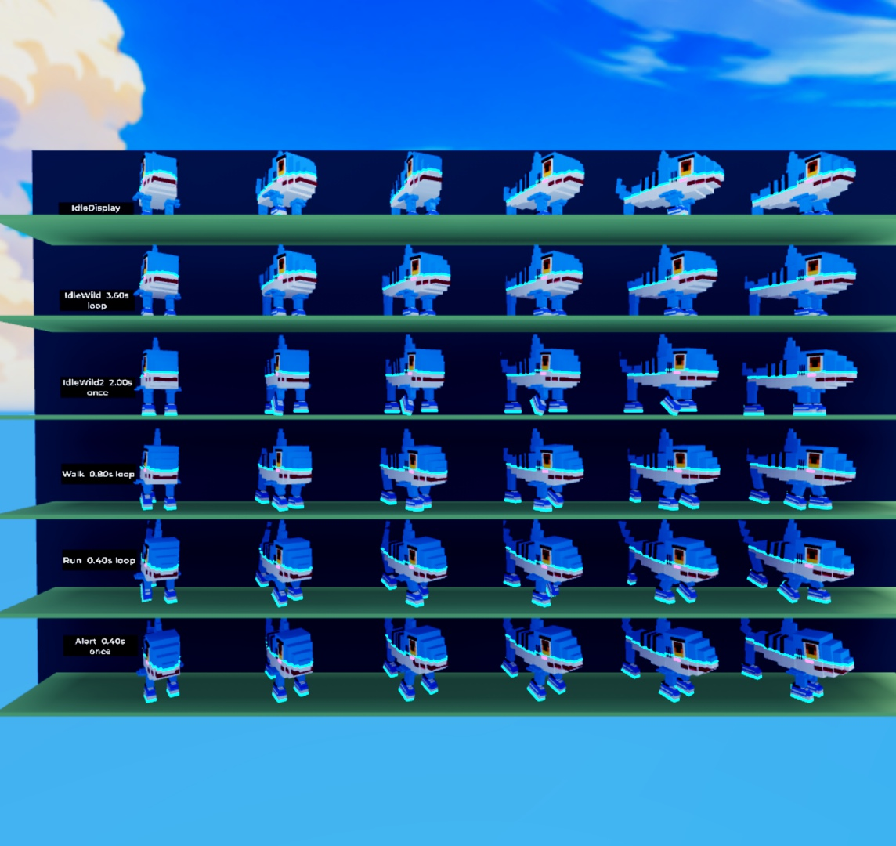
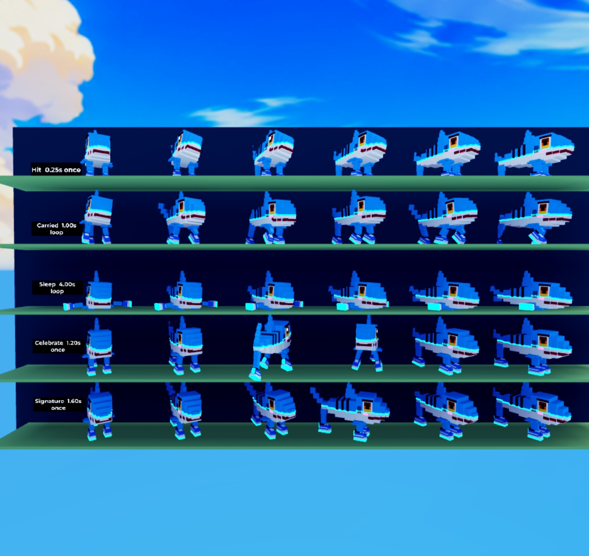
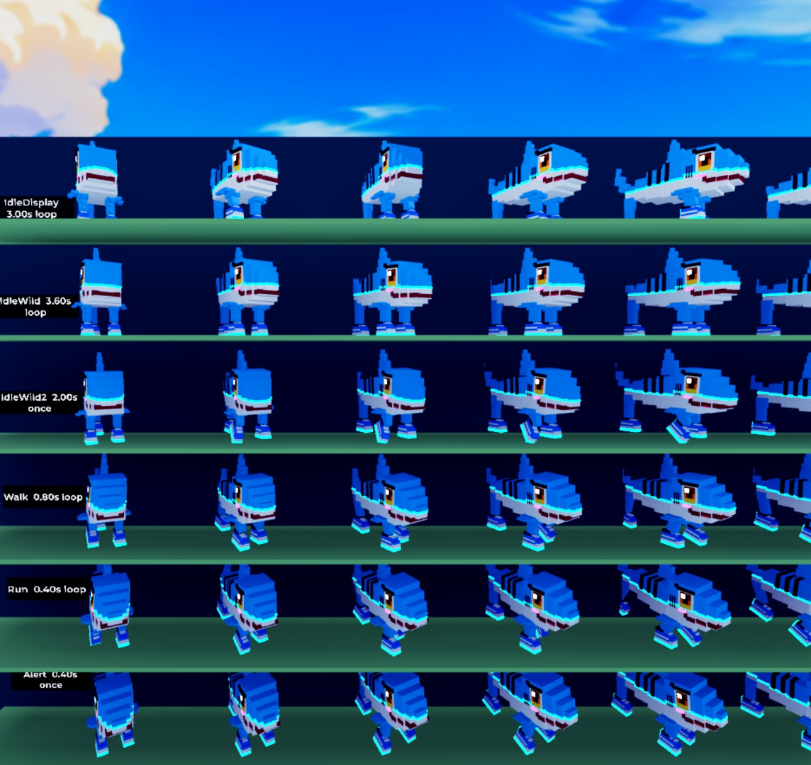
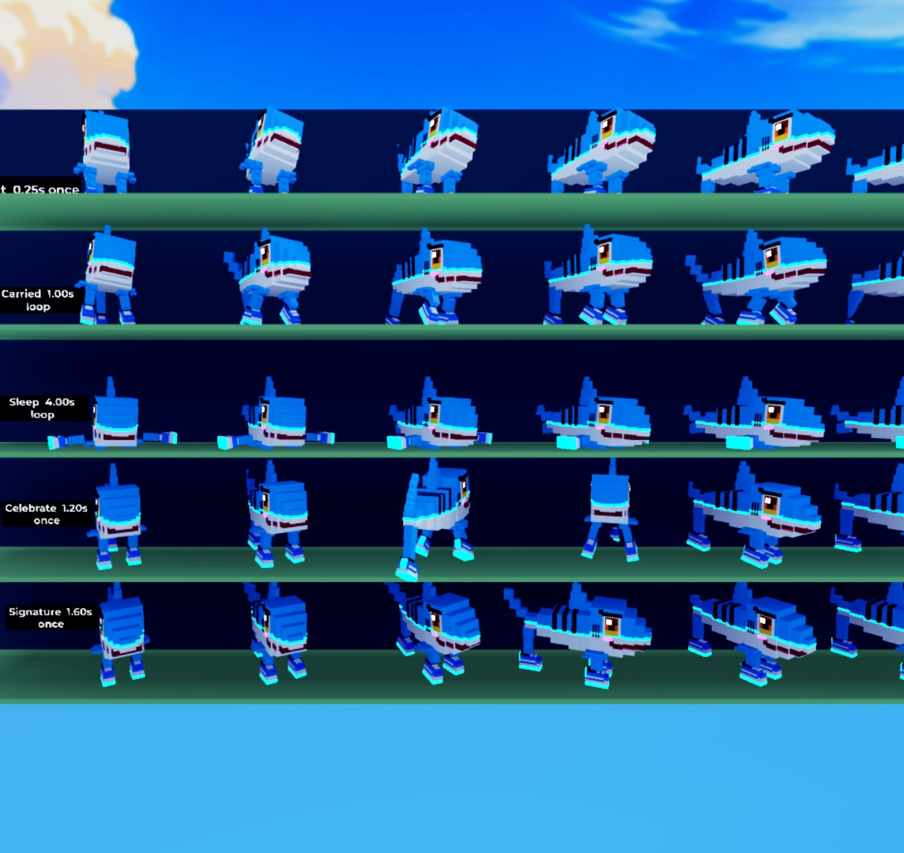

# Review package: BRT_027 Tralalero Tralala (round 1)

13 November 2026. Drafts only: nothing uploaded, nothing live, not committed.

It is the first brainrot in the Jungle order.

## Rig

- **Archetype: Three-legged walker.**
- **9 Motor6D joints** (was 5): Root→Torso (the shark's body, with the dorsal fin and back stripes), Torso→**Head** (new), Torso→Tail (the upper tail lobe), Torso→two fin-legs at the front and the tail leg, each→a **lower leg** (new, three of them) carrying its sneaker.
- **Head (new):** the head and snout, with the face, grin and gills, were part of the body. They now turn about a point behind the gills, so he can bop, nod and look down at his sneakers.
- **Knees (new):** each leg was one piece from hip to sneaker. All three now bend just above the sneaker, so he can step, kick, hop and fold his legs.
- **Two rig faults fixed:**
  - The sneakers on the tail leg flashed between bones, because part of each sneaker was tagged to the body. All 12 boxes of each sneaker now move with the lower leg.
  - The roots of the fin-legs, where they join the body, swung inside the head when it moved (0.74 studs). They now stay on the body.
- **Bind pose:** all 152 boxes are exactly where they are in the installed template, with the same colours (scripted comparison, zero difference). Only the `rig` list and the `bone` tags changed in `Config/VoxelCreatures/BRT_027.lua`.
- **Face:** eyes, lashes, blush, nostrils, mouth, teeth and tongue move as one rigid group on the head.

## Animations (11)

| Sheet | Rows, top to bottom |
|---|---|
|  | IdleDisplay, IdleWild, IdleWild2 (sneaker check), Walk, Run, Alert |
|  | Hit, Carried, Sleep, Celebrate, Signature |
|  | Close-up: IdleDisplay, IdleWild, IdleWild2, Walk, Run, Alert |
|  | Close-up: Hit, Carried, Sleep, Celebrate, Signature |

Each row shows six moments of one clip with the camera turning from the front to the side, so the left column is a front view and the right column is a side view.

The idea: a grinning blue shark on three legs in blue sneakers. He walks like a person and grooves like one; the sneakers do the work while the body still sways as if swimming. The whole set is written for him; none of it is shared quadruped motion.

- **IdleDisplay** (on the platform) is the sneaker groove: he bounces on the beat, stepping from one front sneaker to the other with a heel tap, body swaying, grin bopping, tail keeping time.
- **IdleWild** is a slow breathe with a look around and a lazy tail swish.
- **IdleWild2** is admiring his sneakers: he lifts his right front sneaker, looks down at it, wiggles it left and right to show it off, and puts it back.
- **Walk** is a swaggering three-legged stroll: the front sneakers step in turn, the tail leg takes a short step after each, and the body swings side to side.
- **Run** leans in, sneakers pounding, the tail thrashing like a shark in a hurry.
- **Alert** is a startled hop with the head up and the tail flicked.
- **Hit** knocks him sideways with the head and tail jolted.
- **Carried** has all three sneakers pedalling in the air and the tail thrashing.
- **Sleep** is belly-down on the sand: the two fin-legs spread out to the sides like fins again, the tail leg stretched out behind with its sneaker sole-up, chin down, tail drooping to one side.
- **Celebrate** is a hop and a full spin with all three sneakers kicked out and the tail flung up.
- **Signature, "the Tralala":** three bouncing hop-steps on the beat, kicking a front sneaker out on each, then a full spin, finishing with a flick of the head.

## Review pen

Set `AnimationReviewPen = true` on `ReplicatedStorage`, press Play, and cross the bridge behind the villager demo. He has a row among the creatures; the pen takes several seconds to fill in.

Checked in Play: 15 models, every one with all 9 joints, a track playing on each, no errors. I did not watch each animation play.

## Self-check

| Check | Result |
|---|---|
| Loops seamless | Pass |
| Nothing under the floor | Pass (several clips needed the floor clamp) |
| Floating above the floor | My first Run floated up to 0.30 studs; fixed. Now IdleWild and Walk hover at most 0.03, Run 0.08 and Signature 0.06 between steps. Celebrate leaves the ground up to 0.67 in its hop on purpose. |
| Head against the body | 0.15 studs at rest, as built (the head and body sections meet in a slight overlap behind the gills); up to 0.28 in IdleWild2 when he looks down at his sneaker, 0.26 in Carried and 0.25 in Sleep and Celebrate |
| Front legs against the head | Clear at rest; up to 0.11 in Signature as he kicks, 0.10 or less elsewhere (my first Signature reached 0.29; I shortened the kicks) |
| Legs against the body | 0.05 at rest, as built; up to 0.19 in Signature and 0.18 in Walk, Run and Carried, where the hips swing |
| Sleep resting on the ground | The belly touches the sand (my first Sleep folded the legs under him and left him 2.25 studs up, looking like a crouch; redone) |
| Face rigid | Pass |
| Foot sliding | Not measured |

## Concerns

1. **The head seam.** Where the head meets the body there is no gap to hide the joint, so a turned head shows its back edge slightly sunk into the body, at most 0.13 studs deeper than at rest. Say if you want the head's turns made smaller.
2. **Sleep has the sneakers sideways.** The fin-legs lie flat out to the sides, so the front sneakers lie on their sides. Folding them under him is not possible without his body staying high off the ground.
3. **Walk is authored for 6 studs/s and Run for 10**, the same as the other Epics.
4. **His catalogue region is the Beach** (`REGION_BEACH`) but he is first in the Jungle animation order. I left both as they are.
5. **Rojo is still disconnected.** I put this species' two changed files into Studio by hand and confirmed both are byte-identical to disk.
6. **The installed template is out of date** until approval. His V4 data and build have never been committed; they will be on approval.
