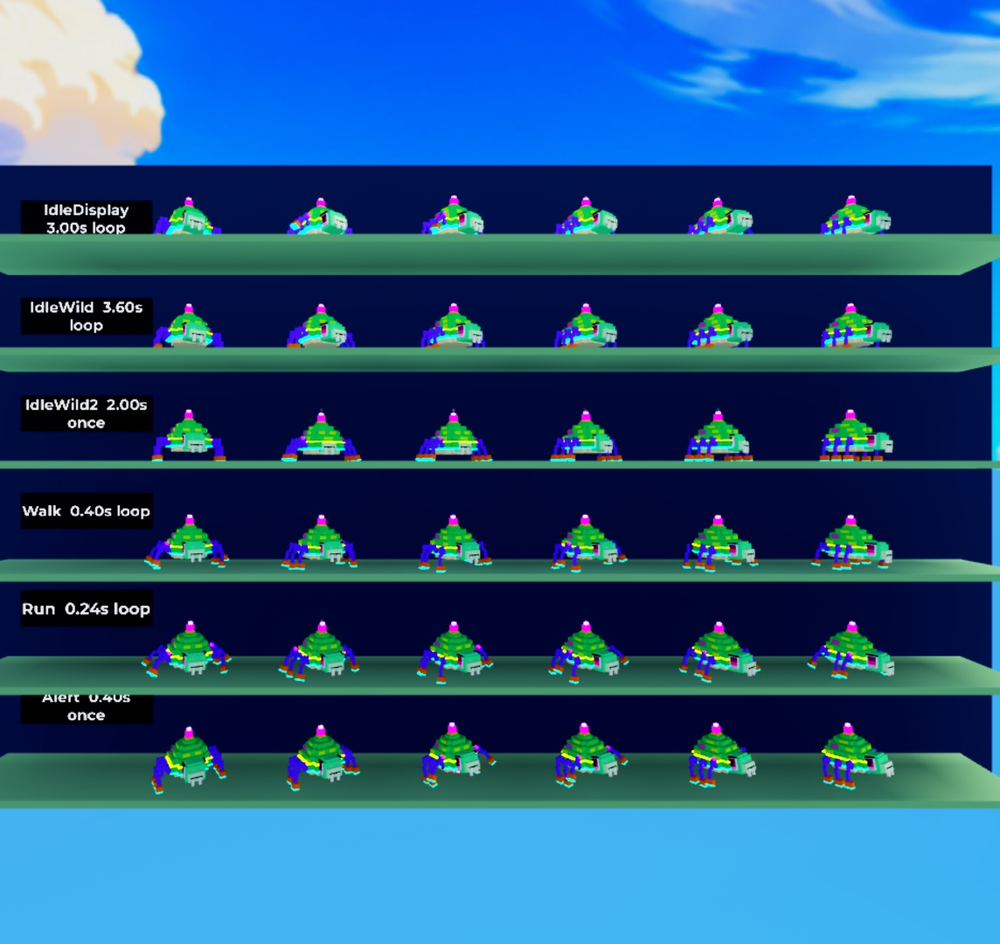
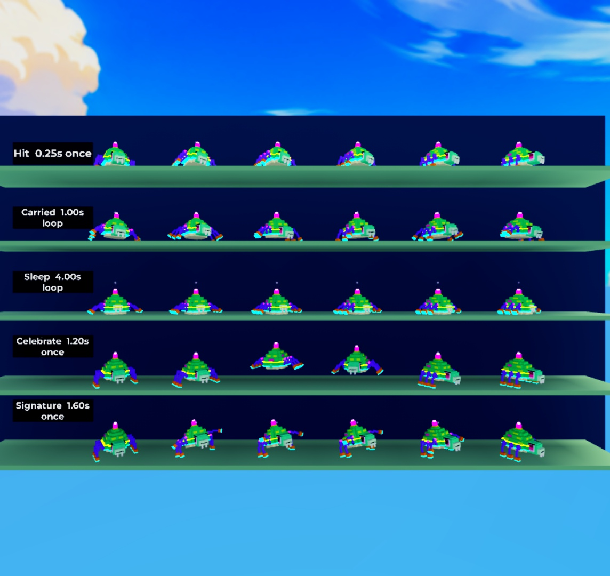
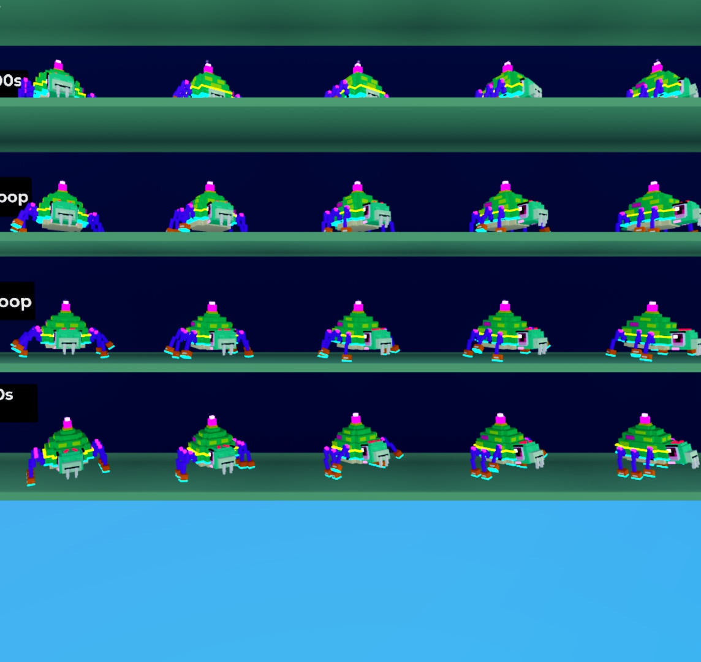
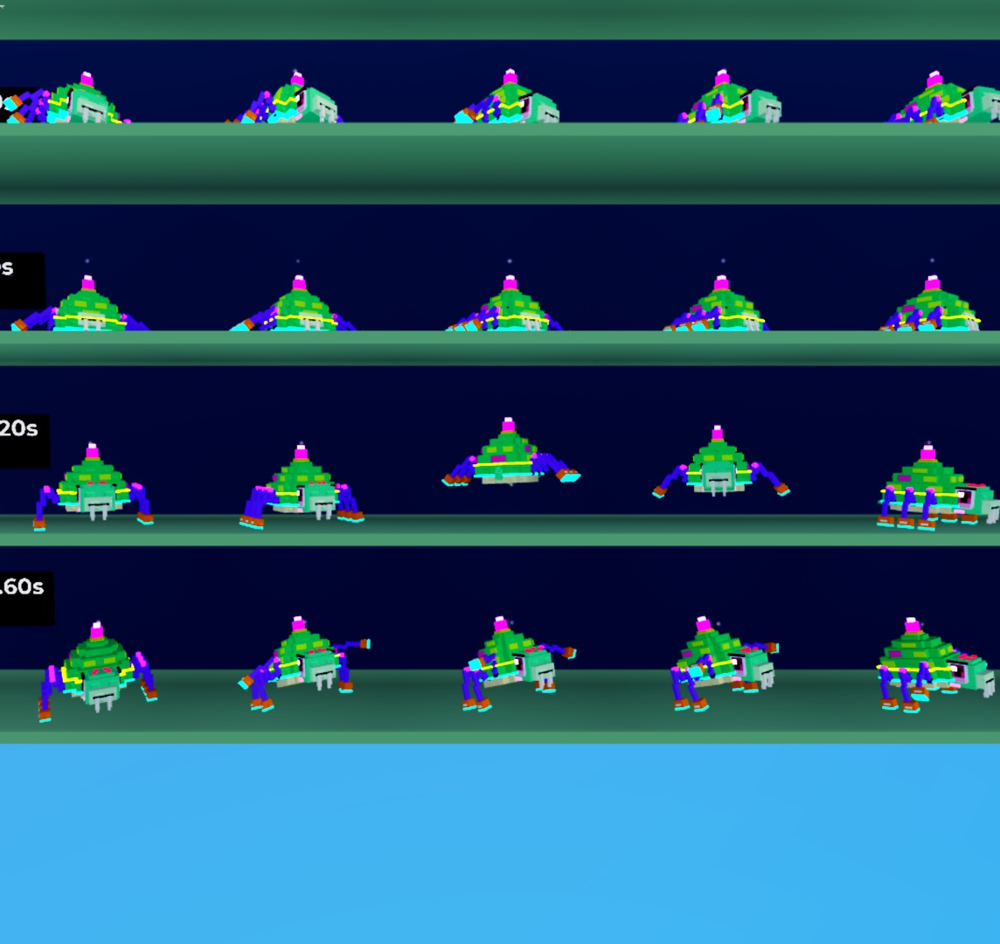

# Review package: BRT_028 Tartaragno (round 1)

13 November 2026. Drafts only: nothing uploaded, nothing live, not committed.

It is the fourth brainrot in the Swamp order.

## Rig

- **Archetype: Six-legged crawler.** A turtle shell and head on six spider legs.
- **15 Motor6D joints** (unchanged): Root→Torso (the shell), Torso→Head, Torso→Tail, and six legs in three pairs, each a hip under the shell rim and a knee that carries the lower leg and sneaker.
- **No joints added.** It already had hips and knees on all six legs from the 7 November rig pass.
- **Head pivot moved:** the head used to turn about a point under its chin, in front of the shell. It now turns from inside the front of the shell, which is also what lets it pull straight back into the shell.
- **Bind pose:** all 129 boxes are exactly where they are in the installed template, with the same colours (scripted comparison, zero difference). Only one line changed in `Config/VoxelCreatures/BRT_028.lua` (the head's pivot).
- **Face:** the two main eyes, the four spider eyes, the mouth and both fangs move as one rigid group on the head.

## Animations (11)

| Sheet | Rows, top to bottom |
|---|---|
|  | IdleDisplay, IdleWild, IdleWild2 (hides), Walk, Run, Alert |
|  | Hit, Carried, Sleep, Celebrate, Signature |
|  | Close-up: IdleWild2, Walk, Run, Alert |
|  | Close-up: Carried, Sleep, Celebrate, Signature |

The idea: a turtle that is also a spider. It scuttles on six legs like a spider and hides in its shell like a turtle, and when it wants to look frightening it rears up and waves its front legs. This set is written for it.

- **Walk** is a real six-legged gait: three legs step while the other three push, then they swap. The shell sways a little and the head leads.
- **Run** is the scuttle: low to the ground, legs going twice as fast, head stretched forward.
- **IdleDisplay** is slow push-ups on all six legs, so the gem on the shell rises and falls, while it waves its front sneakers one after the other.
- **IdleWild2** is the turtle hiding: the head snaps back into the shell and the body drops; it peeks half out, looks left and right, and comes out again.
- **Alert** pops it up tall on its back four legs with the front legs thrown up.
- **Hit** makes it flinch the head halfway into the shell.
- **Sleep** is a turtle asleep: shell down on the ground, head pulled inside, tail tucked in, the six legs splayed out with their knees up.
- **Celebrate** is a jump and a full spin with all six legs flung out.
- **Signature** is the spider threat: it rears up on its back legs, fangs forward, waves its front legs in the air four times, then drops back down with a thump.

## Review pen

Set `AnimationReviewPen = true` on `ReplicatedStorage`, press Play, and cross the bridge behind the villager demo. It has a row among the creatures.

Checked in Play: 15 models, a track playing on each, no errors. I did not watch each animation play.

## Self-check

| Check | Result |
|---|---|
| Loops seamless | Pass |
| Nothing under the floor | Pass. 10 of the 11 clips rely on the floor clamp: I lower the shell further than the legs allow on purpose and let the clamp rest it on its feet. |
| Floating above the floor | None in the nine standing clips: something touches the floor in every frame checked. Carried and Celebrate are in the air. |
| In Sleep the shell rests on the ground | Pass: the body's lowest point is on the floor and the feet are 0.05 studs above it. |
| Neighbouring legs against each other | Clear in nine clips; 0.02 studs in Run and 0.07 in Carried |
| Legs against the shell | 0.06 studs at rest, as built (each hip collar sits in the rim). Up to 0.13 in the Signature and 0.11 or less in nine others. Sleep was not measured again after I changed its leg fold. |
| Head inside the shell when hidden | Not measured. The muzzle tip and the fangs should still show at the shell's edge; the close-up of Sleep shows the head gone. |
| Face rigid | Pass |
| Foot sliding | Not measured |

## Concerns

1. **Its feet will slide when it walks.** The legs are short and reach only about a third of a stud per step, so at 6 and 10 studs/s the feet skate. A faster leg cycle hides some of it (the Walk loops every 0.4 s and the Run every 0.24 s). Those speeds are my assumption.
2. **The first version of the walk made neighbouring feet collide.** I fixed it by fanning the legs in Walk and Run: the front pair reaches a little forward and the back pair a little back. At rest the legs are straight out to the sides as built.
3. **When a leg lifts, its sneaker tilts.** Each leg lifts by rolling at the hip, so the sole tips outward instead of staying flat. In Sleep all twelve soles are tipped about 46 degrees.
4. **The head passes through the solid shell when it hides.** There is no opening modelled; it simply slides inside.
5. **In the Signature the back sneakers tip onto their heels** as the shell rears up 22 degrees.
6. **Rojo is still disconnected.** I put this species' two changed files into Studio by hand and confirmed both are byte-identical to disk.
7. **The installed template is out of date** until approval.
