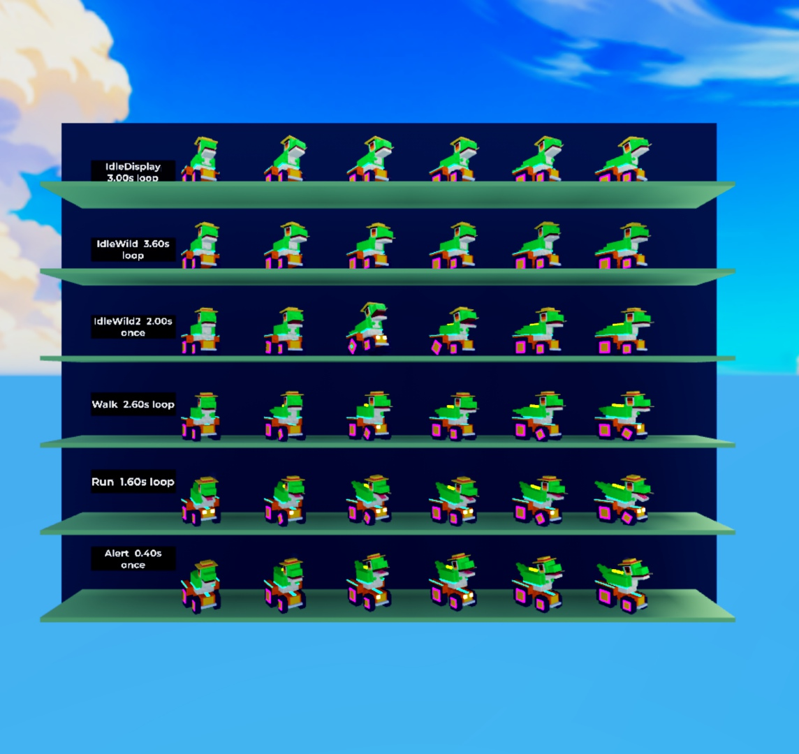
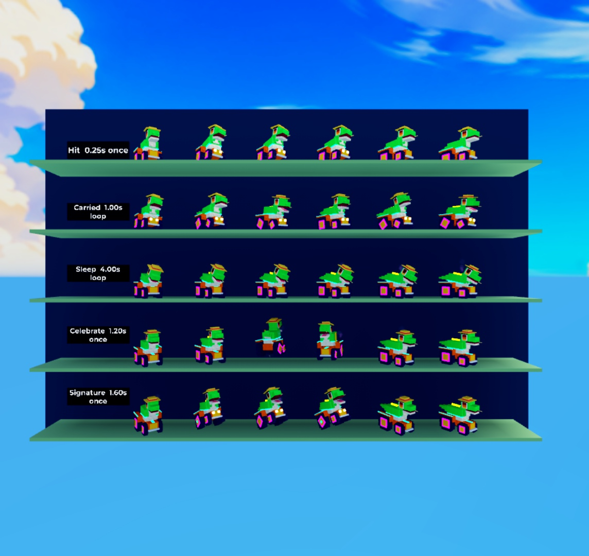
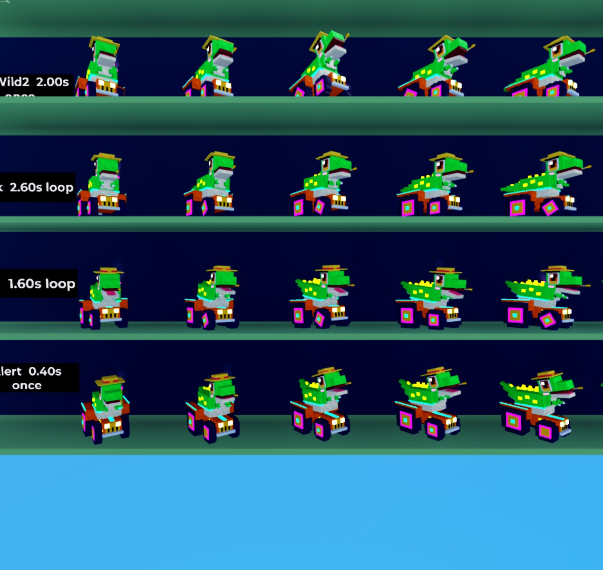
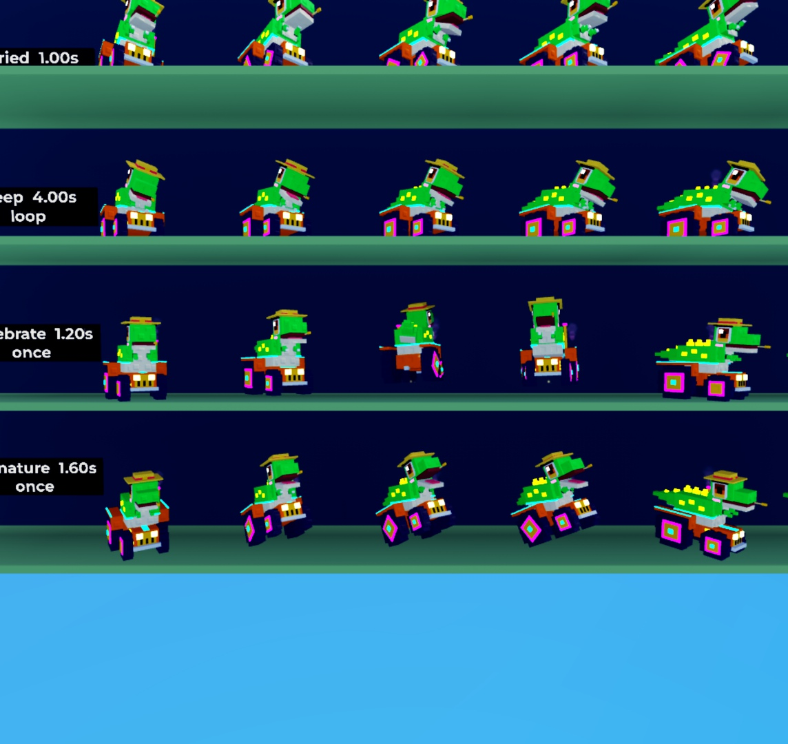

# Review package: BRT_030 Tractoro Dinosauro (round 1)

13 November 2026. Drafts only: nothing uploaded, nothing live, not committed.

It is the fifth brainrot in the Swamp order.

## Rig

- **Archetype: Rider on a vehicle.** A T-rex riding a tractor.
- **12 Motor6D joints** (was 5). This is the biggest rig change so far, so please look at it closely.
- **Before:** one joint held the tractor and the dinosaur's body together as a single rigid block, with only the head, two arms and tail able to move. Nothing on the tractor could move at all.
- **Now:** Root→Torso is the **tractor**, turning on its rear axle so it can do a wheelie. On the tractor: four **wheel hubs** and the **exhaust stack**. Also on the tractor: **Dino**, the dinosaur's body, which can now bounce and lean in his seat. On the dinosaur: Head, **Jaw** (new: the lower jaw and tongue open), two arms and the Tail.
- **Only the hubs turn, not the tyres.** Each tyre is a blocky cross, so a turning tyre would dip its corners 0.19 studs under the floor and into the mudguard eight times per turn. The glowing ring, gold hubcap and gem turn inside a tyre that stays still.
- **Head pivot moved** to where the head meets the neck; it was out under the jaw.
- **Bind pose:** all 144 boxes are exactly where they are in the installed template, with the same colours (scripted comparison, zero difference). Only the `rig` list and 35 `bone` tags changed in `Config/VoxelCreatures/BRT_030.lua`.
- **Face:** eyes, snout, upper teeth, wheat stalk and hat move as one rigid group on the head. The jaw is the one part of the face that moves, which your brief allows only if you agree: say if you want it fixed shut.

## Animations (11)

| Sheet | Rows, top to bottom |
|---|---|
|  | IdleDisplay, IdleWild, IdleWild2 (revs the engine), Walk, Run, Alert |
|  | Hit, Carried, Sleep, Celebrate, Signature |
|  | Close-up: IdleWild2, Walk, Run, Alert |
|  | Close-up: Sleep, Celebrate, Signature |

The idea: a T-rex farmer who is also his own tractor. The engine never stops shaking, the hubs really turn, and the dinosaur rides it like a rodeo. This set is written for him.

- **Walk** is the drive: hubs turning, the tractor rocking over the ground, the dinosaur bouncing in his seat a beat behind it and steering with his tiny arms.
- **Run** is flat out: nose lifted, everything rattling, the dinosaur crouched forward with his jaw open, arms up and tail streaming.
- **IdleDisplay** is parked with the engine running: the tractor shivers, the stack chugs, and he sways his head, chews his wheat and waves his arms one after the other.
- **IdleWild2** revs the engine: the stack jumps, the rear hubs spin a full turn, the nose pops up, and he throws his head back and roars.
- **Sleep** is asleep at the wheel: engine still, the dinosaur slumped forward, head hanging to one side, arms dangling, jaw loose.
- **Celebrate** is a jump and a full spin with the hubs whirling, arms up and jaw wide.
- **Signature** is the wheelie roar: the tractor rears up 30 degrees on its back wheels while the rear hubs spin two full turns; he throws his head up and roars with his arms in the air; then the front end slams down and bounces.

## Review pen

Set `AnimationReviewPen = true` on `ReplicatedStorage`, press Play, and cross the bridge behind the villager demo. He has a row among the creatures. The pen now takes a few seconds to fill in, back row last.

Checked in Play: 15 models, all with the new joints, a track playing on each, no errors. I did not watch each animation play.

**The pen needed a fix.** With 22 species it ran past Roblox's script time limit and stopped before building his row. It now pauses for a frame between species. That is a change to `AnimationReviewPen.lua`, the review tool only; it is in Studio and on disk, not committed.

## Self-check

| Check | Result |
|---|---|
| Loops seamless | Pass. The hubs turn whole turns per loop (three rear, four front in Walk and Run). |
| Nothing under the floor | Pass (4 clips needed the floor clamp) |
| Floating above the floor | None in the eight ground clips. Alert hops 0.12 and Celebrate jumps 0.70, on purpose. |
| Head, jaw, arms and tail against the tractor | Clear in all 11 clips |
| Tail and head against the exhaust stack | Clear in all 11 clips |
| Dinosaur's body against the tractor | 0.04 studs at rest, as built. Up to 0.15 in Sleep, where he slumps forward. |
| Arms against the jaw | Clear in seven clips; up to 0.11 studs in Hit, 0.07 in Celebrate, 0.04 in the Signature |
| Head against his own chest | 0.22 studs at rest, as built; up to 0.28 when the head turns |
| Hub turn against ground speed | Rear hubs match the authored speed exactly, front hubs within 3 per cent, at the model's design size. Not checked at the size he has in the game. |

## Concerns

1. **The tyres do not turn.** From the side you see the bright hub spin inside a still tyre and still tread. I think it reads as a turning wheel, but look at the close-up and judge.
2. **The Walk loop is 2.6 seconds and the Run 1.6**, much longer than the other brainrots, because each has to hold a whole number of hub turns.
3. **In Sleep he does not look very asleep.** He leans 10 degrees and his head hangs 16, but his eyes stay open, as on every brainrot. He may read as "looking down" more than "asleep".
4. **In Carried the wheels touch the floor on the sheet**, because nothing lifts him there. In the game he is held up.
5. **Walk is authored for 6 studs/s and Run for 10.** These are my assumption.
6. **Rojo is still disconnected.** I put this species' two changed files and the pen fix into Studio by hand and confirmed all three are byte-identical to disk.
7. **The installed template is out of date** until approval.
