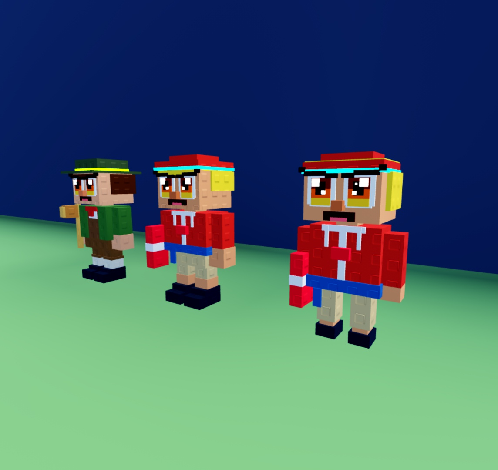
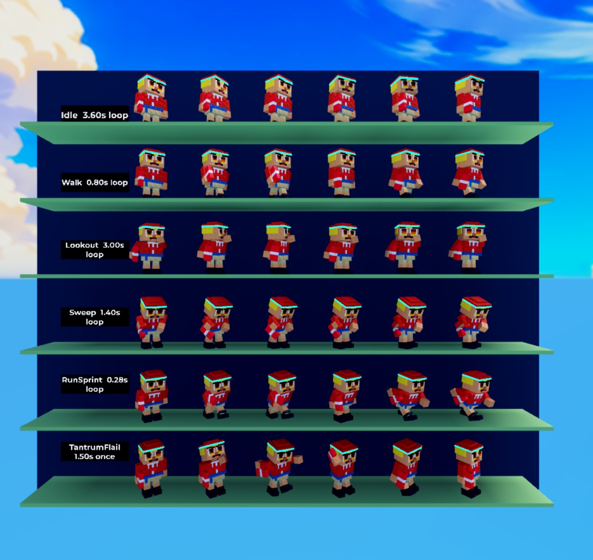

# Review package: Bagnino Bruno as a skin on the villager body (round 1)

13 November 2026. Draft only: not approved, not live, not committed. `VillagerAnimationEnabled` is off and the game still shows the old Sprinter template.

Bruno is the first of the five Beach villagers. A skin adds no joints and no animations: he uses the 17 joints and 24 animations approved for the body.

## The skin

Left to right: Taglialegna Tito (approved Forest skin, for scale), **new Bruno**, old Bruno (the current Sprinter Lifeguard template in the Beach outfit).

- **File:** `Shared.Config.VillagerSkins.Beach_BagninoBruno`, 51 boxes (limit 80). Colours come from his existing palette row; nothing in `Villagers/Beach.lua` changed.
- **Same body:** a scripted check confirms his joint names, parents and positions are identical to the bare body.
- **Identity kept:** red knitted fisherman's cap with the Beach glow band, blond hair, red work blouse with a white collar and placket, the whistle on its white lanyard, blue waist sash with a tail, canvas knee breeches, bare shins, dark boots, and the red rescue tube with its white band in his right hand.
- **One glow line:** the cap band is the only Neon part.
- **Cap:** all three cap boxes are on the Hat bone at or above the head top, so the cap lands flat if a tantrum throws it. A thin layer of blond hair on top of the head shows when it does.
- **Height:** 5.58 studs to the top of the cap. The old Bruno is 5.85.

## What changed from the old Bruno

1. **He is shorter and stockier**, like Tito and Franco: the lanky Sprinter silhouette is gone on the shared body.
2. **The rescue tube is held in front of his fist** and is half as deep (0.75 studs front to back against 1.5). On the old model it is a broad board at his side, centred on the hand. I narrowed it so it does not sweep through his legs when the arm swings.
3. **The blouse and sleeves are extra boxes over the body.** The body's own torso and arms take the palette's "top" colour, which is white for Bruno, so the red blouse has to sit on top. The collar and placket are that white.
4. **The sash sits at the bottom of the torso** and its tail hangs from the hips, so the tail swings with the hips.

## Animations on him

Six of the 24: Idle, Walk, his two activities (Lookout and Sweep), his chase run and his tantrum. Lookout is new for him: a lifeguard on watch suits him better than his old idle, which was Sweep. I kept Sweep as his second activity; he sweeps with the rescue tube. This sheet was captured before the tube moved 0.05 studs outward (see below), which does not show at this size.

## Review pen

Set `AnimationReviewPen = true` on `ReplicatedStorage` and press Play. The back row of the 24 plinths is now Bruno; the front row is still the neutral skin.

Checked in Play: 24 Bruno figures, a track playing on each, the sign reads "back row Bagnino Bruno", his cap is the palette's CapRed, no errors. I did not watch each animation play.

The pen needed a small change for this: it only knew how to find a review skin's colours among the Forest villagers. It now looks in the skin's own region.

## Self-check

| Check | Result |
|---|---|
| Same joints as the body | Pass |
| Box count | 51 of 80 |
| Exactly one glow part | Pass (cap band) |
| Hat-bone boxes at or above the head top | Pass |
| Nothing under the floor, all 24 animations | 23 pass. Skate dips 0.05 studs at the body's own right foot, the body fault already reported. Bruno never plays Skate. |
| Rescue tube against his body | Measured in Idle, Walk, Lookout, Sweep, RunSprint and TantrumFlail. Clear in five (closest 0.03 studs, past the waist sash). **In Sweep it goes 0.13 studs into the sash.** At rest it first overlapped the sash by 0.02, so I moved it 0.05 outward. |
| Other clipping | Not checked: the sleeves against the blouse when the arms swing, and the cap against the hand in Lookout. |

## Concerns

1. **Sweep puts the tube into his sash.** It is the Sweep animation crossing the prop in front of the body, the same motion Tito makes with his axe. If Lookout should be his only activity, say so and I will drop Sweep.
2. **He sweeps with a rescue tube**, which is an odd thing to sweep with.
3. **The whistle is red on a red blouse.** That is his palette's prop colour and it is how the old model looks too, but it barely shows. The old whistle glowed until the Beach outfit made it a plain prop.
4. **Tantrum.** His old tantrum is "WhistleFlail"; the body has TantrumFlail. Nothing blows the whistle.
5. **Rojo is still disconnected.** I put the skin file and the pen change into Studio by hand and confirmed both are byte-identical to disk.
