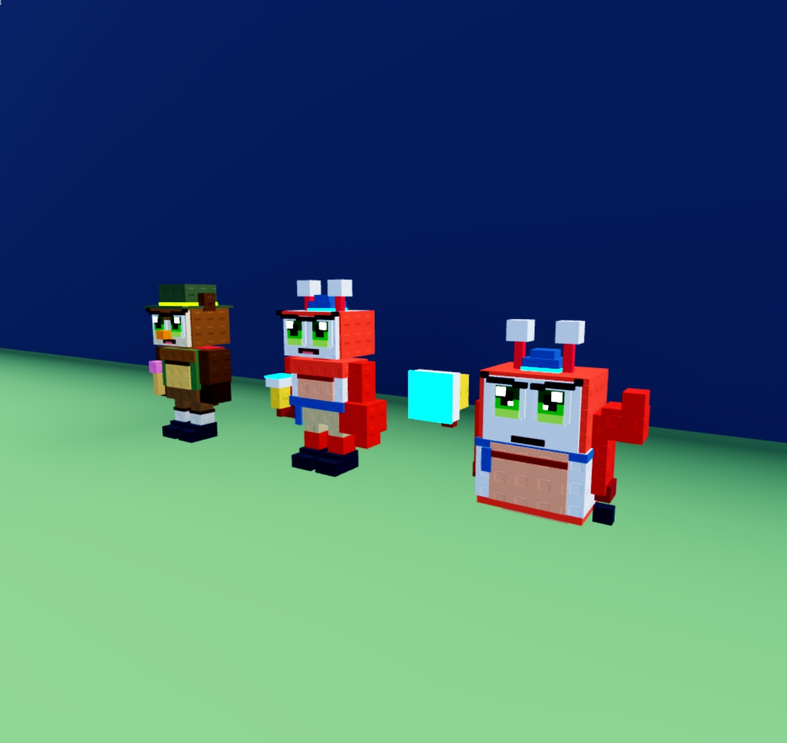
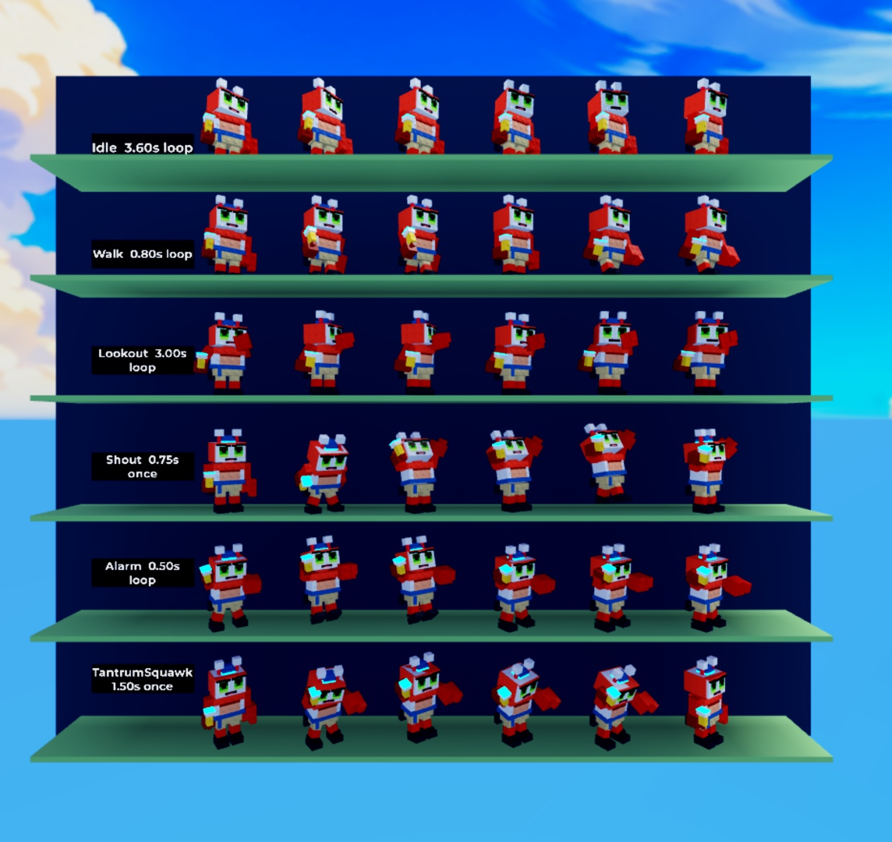

# Review package: Granchio Megafono as a skin on the villager body (round 1)

13 November 2026. Draft only: not approved, not live, not committed. `VillagerAnimationEnabled` is off and the game still shows the old Shouter template.

Granchio is the third of the five Beach villagers and the Beach region's Shouter. A skin adds no joints and no animations: he uses the 17 joints and 24 animations approved for the body.

## The skin

Left to right: Gufo Gelato (approved skin, for scale), **new Granchio**, old Granchio (the current Shouter Crab template in the Beach outfit).

- **File:** `Shared.Config.VillagerSkins.Beach_GranchioMegafono`, 60 boxes (limit 80). Colours come from his existing palette row; nothing in `Villagers/Beach.lua` changed.
- **Same body:** a scripted check confirms his joint names, parents and positions are identical to the bare body.
- **Identity kept:** red crab shell, white face with big lime eyes, two eye stalks with a small blue knitted cap between them, one big claw, peach belly panel with its dark band, white work vest, blue waist sash, canvas shorts, dark boots, a stub crab leg behind each hip, and the yellow megaphone with its white bell and glowing rim.
- **How he is made a crab:** shell boxes cover the body's bare head sides, back and crown, the neck, the upper chest, both arms and the lower legs. His left hand is the big claw with a pincer; his right hand is a small dark claw that holds the megaphone.
- **Two glow parts:** the cap band and the megaphone rim, the same two as the old model.
- **Cap:** the three cap boxes are on the Hat bone at or above the head top. The eye stalks are on the head, so they stay if the cap is thrown.
- **Height:** 6.0 studs to the top of the eye stalks. The old Granchio is 5.42.

## What changed from the old Granchio

1. **He is no longer a round mascot.** Like Gufo, the old Shouter is an egg-shaped body with the face on its front and stub legs. The new one is a person-shaped crab with a separate head, arms and full legs.
2. **The big claw hangs at his side.** On the old model it is fixed in front of his left side at chest height. On the shared body it is his left hand, so it hangs when his arm hangs and lifts when the arm lifts.
3. **The megaphone stands upright in his right claw.** On the old model it is held up and out, pointing forward. I chose upright for a reason: at the moment he shouts, the body turns his hand so that "up out of the fist" points forward and upward, which aims the megaphone the way he is shouting. Measured at the peak of Shout it points 0.81 forward and 0.56 up.
4. **The megaphone is smaller**, about 0.6 studs across its bell against 1.1.
5. **The stub crab legs moved behind his hips.** At his sides they sat in the path of his swinging hands.
6. **He is taller** (6.0 against 5.42), because the body's legs are longer than his old stubs.

## Animations on him

Six of the 24: Idle, Walk, his activity (Lookout), and the Shouter's own three (Shout, Alarm, TantrumSquawk).

## Review pen

Set `AnimationReviewPen = true` on `ReplicatedStorage` and press Play. The back row of the 24 plinths is now Granchio.

Checked in Play: 24 Granchio figures, a track playing on each, the sign reads "back row Granchio Megafono", no errors. None of them is marked for the upright-prop rule, which is correct: his megaphone is meant to turn with his hand. I did not watch each animation play.

## Self-check

| Check | Result |
|---|---|
| Same joints as the body | Pass |
| Box count | 60 of 80 |
| Glow parts | 2 (cap band, megaphone rim), as on the old model |
| Hat-bone boxes at or above the head top | Pass |
| Nothing under the floor, all 24 animations | 23 pass. Skate dips 0.05 studs at the body's own right foot, the body fault already reported. He never plays Skate. |
| Megaphone against his body, all 24 animations | Clear in 18 (no more than 0.05 studs of overlap). Overlaps: **TantrumSquawk, 0.16 studs into his head**; Chop 0.27 into his head; Fiddle 0.13; Knead 0.11, Sweep 0.08 and Stir 0.08 into the sash. |
| Other clipping | Not checked: the big claw against his leg when the left arm swings, and the eye stalks against the cap. |

## Concerns

1. **The megaphone touches his head in his own tantrum.** TantrumSquawk is the Shouter's tantrum, and for a moment the bell sits 0.16 studs inside his head. The other overlaps are in animations he does not use.
2. **The megaphone is upright, not held out in front** as on the old model. Held out in front it would point at the ground when he shouts.
3. **The big claw is not raised.** If the raised claw matters to you, that is a pose for his left arm, which the body animations own.
4. **The round silhouette is lost**, as with Gufo and Pepe.
5. **One activity.** His old idle was "Bob", which the body does not have. I gave him Lookout.
6. **Rojo is still disconnected.** I put the skin file and the pen change into Studio by hand and confirmed both are byte-identical to disk.
