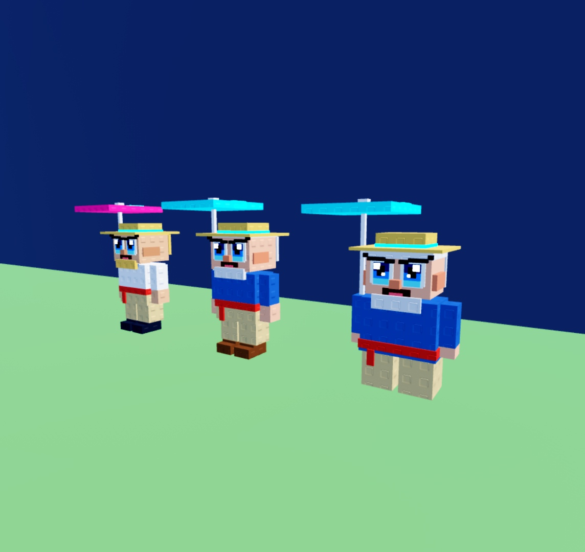

# Review package: Nonno Conchiglia as a skin on the villager body (round 1)

13 November 2026. Draft only: not approved, not live, not committed. `VillagerAnimationEnabled` is off and the game still shows the old Plodder template.

Nonno Conchiglia is the last of the five Beach villagers.

## The skin

Left to right: Zio Sabbia (approved skin), **new Nonno Conchiglia**, old Nonno Conchiglia (the current Plodder Umbrella template in the Beach outfit).

- **He is Zio Sabbia's boxes with his own colours.** In the game today Nonno Conchiglia is the same Plodder Umbrella kit as Zio Sabbia with a different palette, so his skin reuses Zio Sabbia's 50 boxes unchanged and takes its colours from his existing palette row. Nothing in `Villagers/Beach.lua` changed.
- **File:** `Shared.Config.VillagerSkins.Beach_NonnoConchiglia`. It points at Zio Sabbia's box list, so a later fix to that shape reaches him too.
- **What tells him from Zio Sabbia:** blue shirt with a white collar, white beard and hair, brown boots and a cyan umbrella. Zio Sabbia has a white shirt with a blue collar, a sandy beard, dark boots and a pink umbrella. Both wear the straw hat with the Beach glow band and the red waist sash.
- **Umbrella in his hand, kept upright:** his skin sets `uprightProp = true`, so the same rule you approved for Zio Sabbia holds his umbrella vertical.
- **Same body:** a scripted check confirms his joints are identical to the bare body.
- **Two glow parts:** the hat band and the umbrella stripe, as on the old model.

## What changed from the old Nonno Conchiglia

The same things as Zio Sabbia, which you approved: he is narrower on the shared body, the trousers are split so they move with the legs, the pole sits 0.15 studs further out in his grip, and the umbrella rises and falls with his hand without ever tilting.

## Animations

I did not make a new animation sheet. His boxes are identical to Zio Sabbia's, so that sheet (`review/Beach_ZioSabbia/`) shows exactly how he moves. His activity is Lookout.

## Review pen

Set `AnimationReviewPen = true` on `ReplicatedStorage` and press Play. The back row of the 24 plinths is now Nonno Conchiglia, with the upright rule running live.

Checked in Play: 24 figures, all marked for the upright rule, a track playing on each, the sign reads "back row Nonno Conchiglia", no errors. Measured live over 1.6 seconds: his hand tilted up to 168 degrees while the pole stayed within 0.03 degrees of upright, and the umbrella's lowest point stayed 1.10 studs above the floor. I did not watch each animation play.

## Self-check

| Check | Result |
|---|---|
| Same joints as the body | Pass |
| Box count | 50 of 80 (Zio Sabbia's list) |
| Glow parts | 2 (hat band, umbrella stripe), as on the old model |
| Umbrella stays upright and off the floor | Pass, measured live (above) |
| Umbrella against his head and hat | Not measured again; it is Zio Sabbia's result (clear in 20 of 24; the pole touches the hat brim in Wave and Fiddle). |
| Body under the floor | Not measured again; it is Zio Sabbia's result (Skate dips 0.05 studs at the body's own right foot). |

## Concerns

1. **His umbrella's stripe does not show.** The canopy and the stripe are the same cyan in his palette (`prop` and `glow` are both `#2EE9FF`), so the stripe is invisible except that it glows. The old model has the same problem. A different canopy colour would fix it, but that is a palette change in `Villagers/Beach.lua`, which I have not touched.
2. **Nothing about him says "shell" or "sandcastle".** His name means Grandpa Shell and his shout is "MY SANDCASTLE!", but the old model is Zio Sabbia's kit in different colours. A bucket and spade, or a shell on his hat, would make him his own character. That would be a new design, so I have not done it.
3. **Two villagers who differ only by colour**, as today.
4. **Rojo is still disconnected.** I put the skin file and the pen change into Studio by hand and confirmed both are byte-identical to disk.
