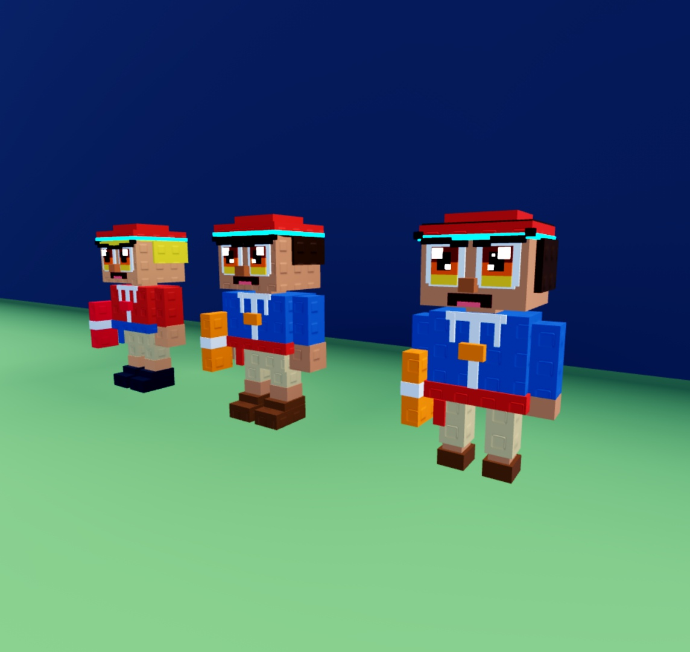

# Review package: Surfista Sara as a skin on the villager body (round 1)

13 November 2026. Draft only: not approved, not live, not committed. `VillagerAnimationEnabled` is off and the game still shows the old Sprinter template.

## The skin

Left to right: Bagnino Bruno (approved skin), **new Surfista Sara**, old Surfista Sara (the current Sprinter Lifeguard template in the Beach outfit).

- **She is Bruno's boxes with her own colours.** In the game today Sara is the same Sprinter Lifeguard kit as Bruno with a different palette, so her skin reuses Bruno's 51 boxes unchanged and takes its colours from her existing palette row. Nothing in `Villagers/Beach.lua` changed.
- **File:** `Shared.Config.VillagerSkins.Beach_SurfistaSara`. It points at Bruno's box list, so a later fix to Bruno's shape reaches her too.
- **What tells her from Bruno:** blue work blouse, red waist sash, dark brown hair, darker skin, brown boots, and an orange whistle and rescue tube. Bruno has a red blouse, blue sash, blond hair, dark boots and a red whistle and tube. Both wear the red knitted cap with the Beach glow band.
- **Same body:** a scripted check confirms her joints are identical to the bare body.
- **One glow line:** the cap band is the only Neon part.
- **Height:** 5.58 studs, the same as Bruno. The old Sara is 5.85.

## What changed from the old Sara

The same things as Bruno, which you approved: she is shorter and stockier on the shared body, the rescue tube is held in front of her fist and is half as deep, and the sash tail hangs from the hips.

One thing is better on her than on Bruno: **her whistle shows.** It is orange on a blue blouse, where his is red on red.

## Animations

I did not make a new animation sheet. Her boxes are identical to Bruno's, so Bruno's sheet (`review/Beach_BagninoBruno/`) shows exactly how she moves. Her activities are Lookout and Sweep, as his are.

## Review pen

Set `AnimationReviewPen = true` on `ReplicatedStorage` and press Play. The back row of the 24 plinths is now Sara.

Checked in Play: 24 Sara figures, the sign reads "back row Surfista Sara", her blouse is the palette's SailorBlue, no errors. 23 of the 24 had a track playing when sampled, and 27 of the 28 neutral figures: the same one-shot animation was between repeats in both rows. I did not watch each animation play.

## Self-check

| Check | Result |
|---|---|
| Same joints as the body | Pass |
| Box count | 51 of 80 (Bruno's list) |
| Exactly one glow part | Pass (cap band) |
| Nothing under the floor, all 24 animations | 23 pass. Skate dips 0.05 studs at the body's own right foot, the body fault already reported. She never plays Skate. |
| Rescue tube against her body | Not measured again; it is Bruno's result (0.13 studs into the sash in Sweep, clear in the other five measured). |

## Concerns

1. **Nothing about her says "surfer".** Her name is Surfista and her shout is "HANG ON, DUDE!", but the old model is Bruno's lifeguard kit in different colours, with the same rescue tube and no surfboard. A surfboard in place of the tube would make her her own character. That would be a new design, so I have not done it; say if you want it.
2. **She has Bruno's face and build.** The shared body has no separate female shape; Nonna Pina and Zia Castagna read as women through their dress and headscarves, and Sara has neither.
3. **Two villagers who differ only by colour**, as today.
4. **Studio restarted during this item.** It reconnected to the DEV place with everything from before intact; I re-ran the one step that had not landed.
5. **Rojo is still disconnected.** I put the skin file and the pen change into Studio by hand and confirmed both are byte-identical to disk.
