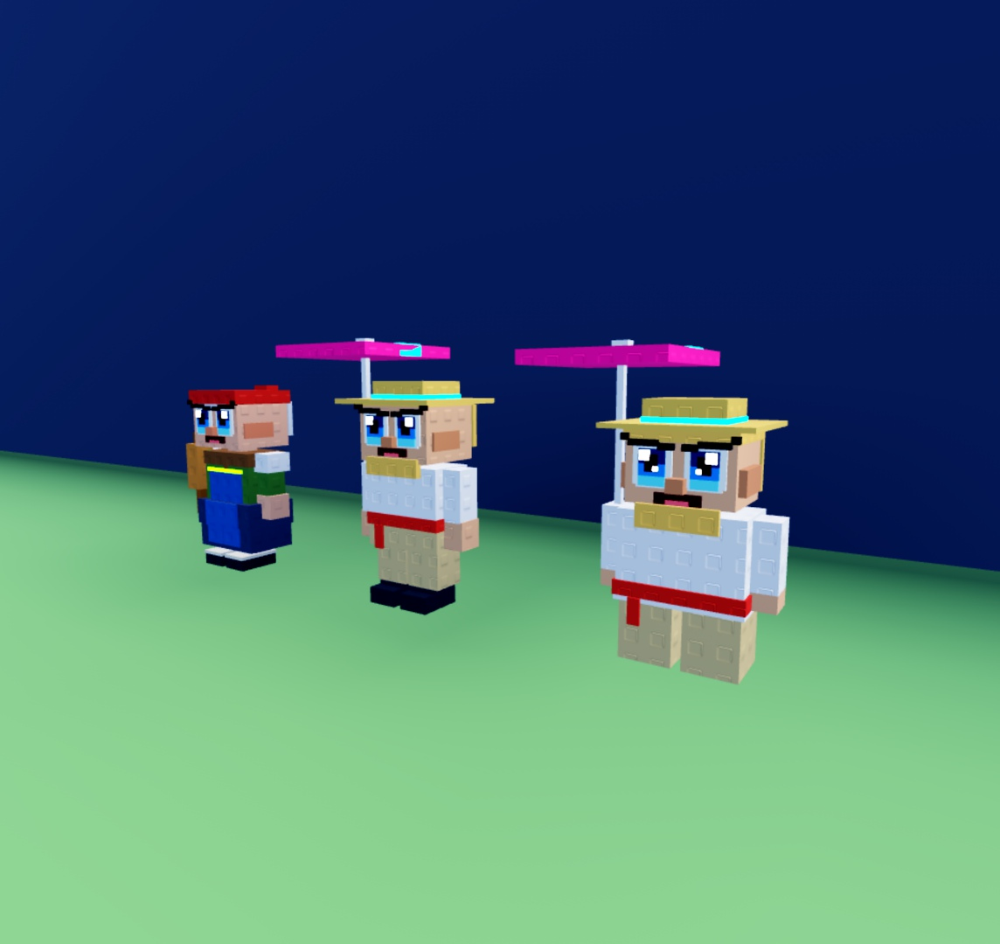
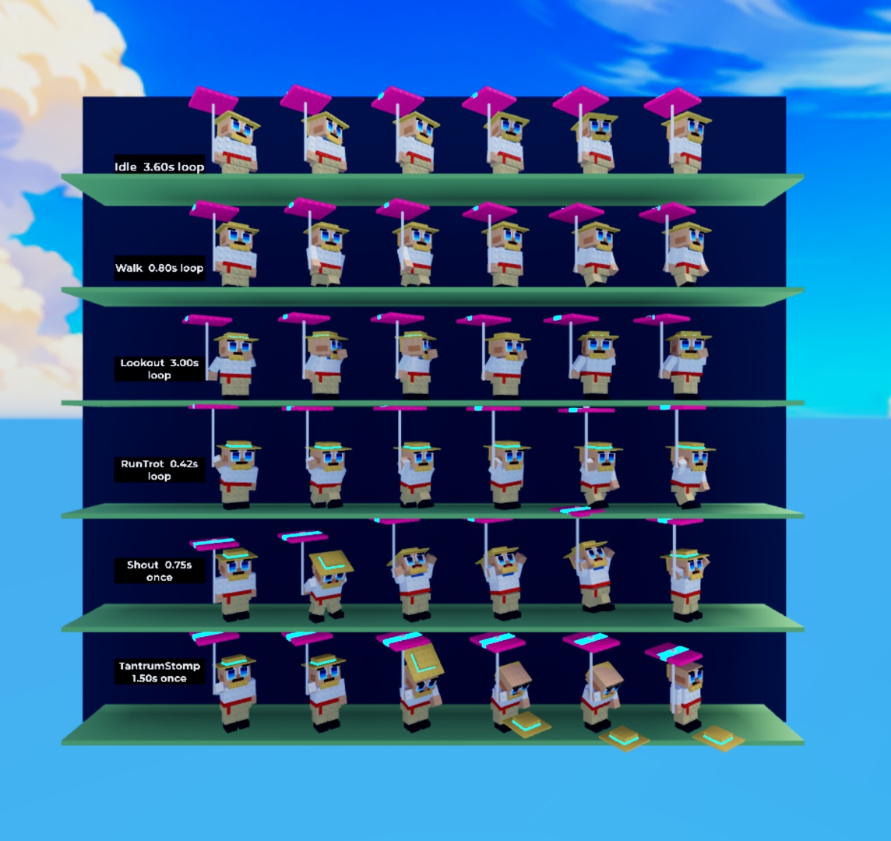

# Review package: Zio Sabbia as a skin on the villager body (round 2)

13 November 2026. Draft only: not approved, not live, not committed. `VillagerAnimationEnabled` is off and the game still shows the old Plodder template.

Round 1 (umbrella on his back) is kept in `round1/`. The owner asked for the umbrella to stay in his hand. This round does that, with a small new rule that keeps the umbrella upright while his hand moves.

## The skin

Left to right: Nonna Pina (approved skin, for scale), **new Zio Sabbia**, old Zio Sabbia (the current Plodder Umbrella template in the Beach outfit).

- **File:** `Shared.Config.VillagerSkins.Beach_ZioSabbia`, 50 boxes (limit 80). Colours come from his existing palette row; nothing in `Villagers/Beach.lua` changed.
- **Same body:** a scripted check confirms his joint names, parents and positions are identical to the bare body.
- **Identity kept:** wide straw hat with the Beach glow band, sandy beard and hair, loose white shirt with a blue collar, red waist sash with a tail, wide canvas trousers, dark boots, and the pink beach umbrella with its glowing stripe **held in his right hand**, pole beside his hat brim and canopy overhead, as on the old model.
- **Two glow parts:** the hat band and the umbrella stripe, the same two as the old model.
- **Height:** 5.6 studs to the top of the hat, 6.7 to the top of the umbrella. The old one is 6.9 with its umbrella.

## How the umbrella stays in his hand

The problem from round 1: nine body animations turn the hand right over, and the umbrella swung through the floor with it.

The fix does not touch those animations. It is one new rule, `Shared.Utility.VillagerUprightProp`:

- A skin opts in with `uprightProp = true`. Zio Sabbia's does.
- The body builder marks that villager's model, and the client then adjusts one joint every frame, the one between the hand and the prop, so that it cancels whatever the hand is doing. The umbrella follows the hand's position but always stands vertical and faces the way he faces.
- It runs on the client only, after the animation has been applied, and changes nothing else on the model. Skins without the flag are untouched.

Measured, all 24 animations:

| Check | Result |
|---|---|
| Umbrella under the floor | None. Live in the pen its lowest point stayed 1.04 studs above the floor. |
| Pole stays vertical | Yes. Live in the pen his hand tilted up to 162 degrees while the pole stayed within 0.03 degrees of upright. |
| Umbrella clear of his head, hat and body | Clear in 20 |
| Pole touches the hat brim | Wave and Fiddle |
| Pole close to the hat brim | RunSprint (0.03 studs) and Chop (0.08). He uses neither: his run is RunTrot. |

## What changed from the old Zio Sabbia

1. **He is narrower.** The old Plodder is a wide, squat block; on the shared body he has a waist and separate arms and legs, the same change as Nonna Pina.
2. **The trousers are split** into a seat and one wide leg each, so they move with the legs.
3. **The pole sits 0.15 studs further out in his grip** than on the old model. At the old position it grazed the hat brim in eleven animations.
4. **The umbrella rises and falls with his hand.** When he throws both arms up to shout, the umbrella goes up with them. It never tilts.

## Animations on him

Six of the 24: Idle, Walk, his activity (Lookout), the Plodder's chase run (RunTrot), Shout, and TantrumStomp with the hat throw. The upright rule is applied to every figure on this sheet. In the Shout row you can see the umbrella lifted high as his arms go up; in the last row the hat lands on the ground.

## Review pen

Set `AnimationReviewPen = true` on `ReplicatedStorage` and press Play. The back row of the 24 plinths is Zio Sabbia, with the upright rule running live.

Checked in Play: 24 Zio Sabbia figures, all marked for the upright rule, no errors, and the two live measurements in the table above. 23 of the 24 had a track playing when sampled; the other is a one-shot waiting to replay. I did not watch each animation play.

## Self-check

| Check | Result |
|---|---|
| Same joints as the body | Pass |
| Box count | 50 of 80 |
| Glow parts | 2 (hat band, umbrella stripe), as on the old model |
| Hat-bone boxes at or above the head top | Pass |
| Body under the floor, all 24 animations | 23 pass. Skate dips 0.05 studs at the body's own right foot, the body fault already reported. He never plays Skate. |
| Umbrella | Measured, see the table above |
| Other clipping | Not checked: the beard against his chest when the head tips down, the wide trouser legs against each other in Walk, and the canopy against the thrown hat in TantrumStomp. |

## Concerns

1. **This adds code that has to run in the real game too.** The rule is written and working in the pen, but the game's own villager playback (Part D of the brief) is not built yet. When it is, it must call the same rule for marked villagers, or his umbrella will swing again. I have noted that in the rule's file.
2. **The builder changed by two lines**, to mark the model. It is shared by every villager; the mark is only set for skins that ask for it.
3. **Wave and Fiddle bring the pole against his hat brim.** Fiddle is not one of his activities. Wave is used when a player walks up, so that one will show.
4. **One activity.** His old idle was "Knit", which the body does not have. I gave him Lookout.
5. **Nonno Conchiglia shares this kit.** He is the same Plodder Umbrella model in different colours, so he will get the same boxes and the same rule.
6. **Rojo is still disconnected.** I put the four changed files (skin, rule, builder, pen) into Studio by hand and confirmed each is byte-identical to disk.
