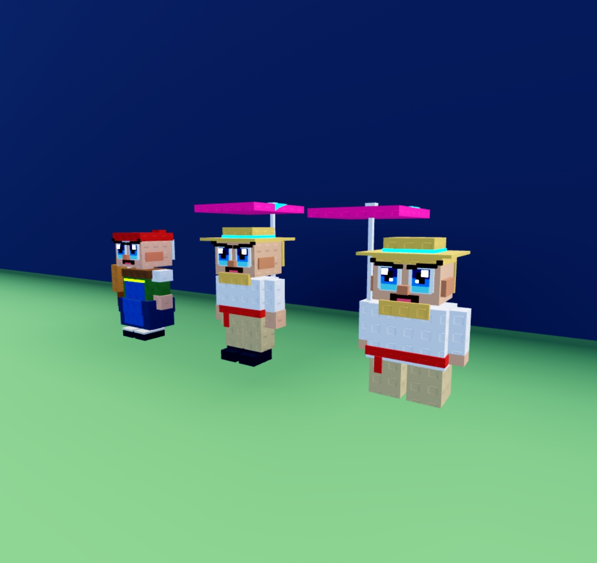
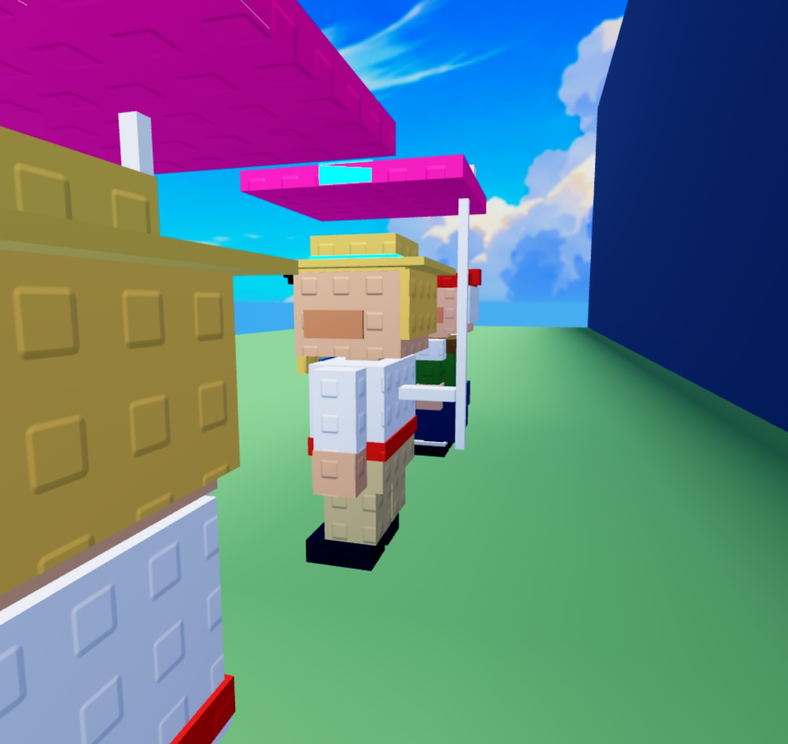
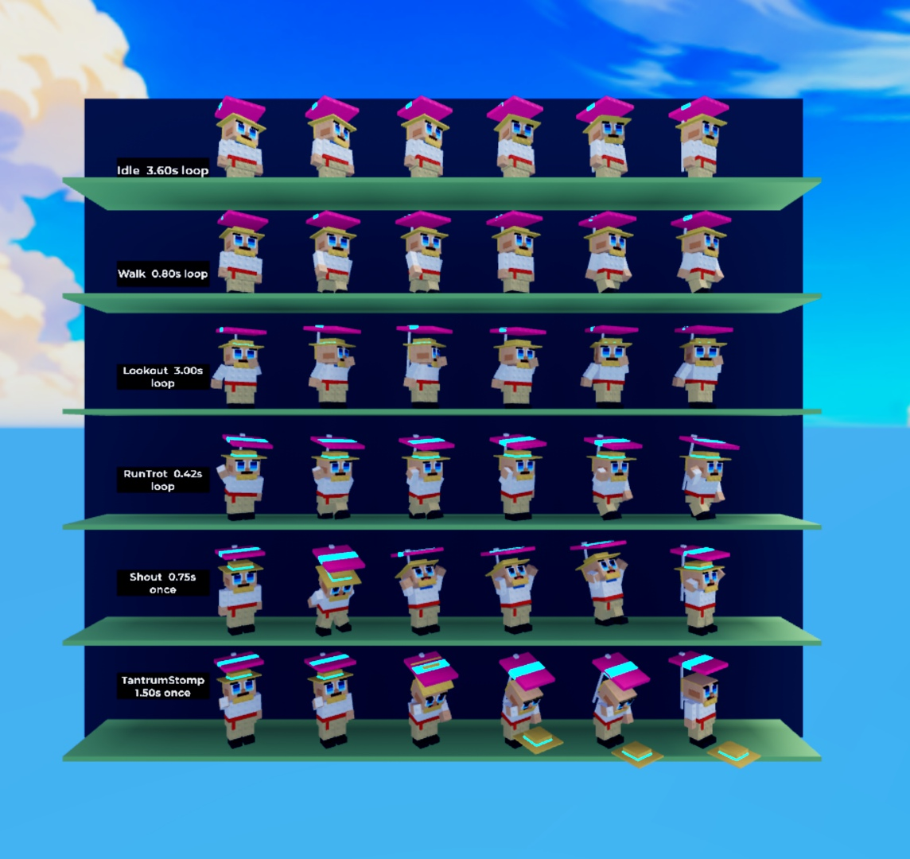

# Review package: Zio Sabbia as a skin on the villager body (round 1)

13 November 2026. Draft only: not approved, not live, not committed. `VillagerAnimationEnabled` is off and the game still shows the old Plodder template.

Zio Sabbia is the second of the five Beach villagers. This one comes with a design decision for you: **the umbrella has moved from his hand to his back.** The reason is below.

## The skin

Left to right: Nonna Pina (approved skin, for scale), **new Zio Sabbia**, old Zio Sabbia (the current Plodder Umbrella template in the Beach outfit).

Side view of the new one (the old model is the blurred shape in the foreground): the bracket on his back, the pole standing behind his hat, the canopy reaching forward over him.

- **File:** `Shared.Config.VillagerSkins.Beach_ZioSabbia`, 51 boxes (limit 80). Colours come from his existing palette row; nothing in `Villagers/Beach.lua` changed.
- **Same body:** a scripted check confirms his joint names, parents and positions are identical to the bare body.
- **Identity kept:** wide straw hat with the Beach glow band, sandy beard and hair, loose white shirt with a blue collar, red waist sash with a tail, wide canvas trousers, dark boots, and the pink beach umbrella with its glowing stripe.
- **Two glow parts:** the hat band and the umbrella stripe. The old model has the same two; the Beach outfit card allows a glowing prop as well as the one glow trim.
- **Hat:** all three hat boxes are on the Hat bone at or above the head top.
- **Height:** 5.6 studs to the top of the hat, 6.7 to the top of the umbrella. The old one is 6.9 with its umbrella.

## Why the umbrella is on his back

On the old model he holds the pole in his right hand with the canopy overhead. I built that first, on the body's hand prop bone, and checked it against all 24 animations:

- **It went through the floor in nine of them**, by up to 2.9 studs. Shout, Tag, all three tantrums, Chop, Sweep, Knead and Stir turn the hand right over, and a 4.7-stud pole with a 3-stud canopy on the end swings down with it.
- **The pole also cut through his head** in several more (Idle, Tired, Wave, Fiddle).

Shout, Tag and the tantrums are not optional for a villager, so a hand-held umbrella cannot work on this body. On his back it is fixed to his torso and stays upright whatever his arms do. Checked the same way:

| Check, all 24 animations | Result |
|---|---|
| Umbrella under the floor | None |
| Umbrella clear of his head, hat and arms | Clear in 18 |
| Hat brim touches the pole | Shout and RunSprint (his head tips back). Close in Chat (0.03 studs), Chop (0.06) and TantrumFlail (0.08). |
| Thrown hat passes through the canopy | TantrumStomp: the hat is thrown up and has to come back down through the umbrella. |

His right hand is now empty.

## What else changed from the old Zio Sabbia

1. **He is narrower.** The old Plodder is a wide, squat block; on the shared body he has a waist and separate arms and legs, the same change as Nonna Pina.
2. **The trousers are split** into a seat and one wide leg each, so they move with the legs.
3. **The umbrella canopy is offset from its pole.** The pole stands 1.7 studs behind him to clear his hat brim, and the canopy reaches forward from it to cover him. On the old model the pole is in the middle of the canopy.

## Animations on him

Six of the 24: Idle, Walk, his activity (Lookout), the Plodder's chase run (RunTrot), Shout, and TantrumStomp with the hat throw. The umbrella stays upright in all of them; in the last row the hat lands on the ground.

## Review pen

Set `AnimationReviewPen = true` on `ReplicatedStorage` and press Play. The back row of the 24 plinths is now Zio Sabbia.

Checked in Play: 24 Zio Sabbia figures, a track playing on each, the sign reads "back row Zio Sabbia", no errors. I did not watch each animation play.

## Self-check

| Check | Result |
|---|---|
| Same joints as the body | Pass |
| Box count | 51 of 80 |
| Glow parts | 2 (hat band, umbrella stripe), as on the old model |
| Hat-bone boxes at or above the head top | Pass |
| Nothing under the floor, all 24 animations | 23 pass. Skate dips 0.05 studs at the body's own right foot, the body fault already reported. He never plays Skate. |
| Umbrella clearance | Measured, see the table above |
| Other clipping | Not checked: the beard against his chest when the head tips down, and the wide trouser legs against each other in Walk. |

## Concerns

1. **The umbrella on his back is my decision, not the old design.** If you would rather he held it, the animations that turn the hand over would each need a version that keeps the hand upright, which is a change to the approved body set, not to this skin.
2. **The hat throw goes through the canopy.** He is a Plodder, so TantrumStomp is his tantrum. I can drop the canopy lower at the back so the hat clears it, or leave it.
3. **One activity.** His old idle was "Knit", which the body does not have. I gave him Lookout. Fish would suit a fisherman, but he has nothing in his hand to fish with now.
4. **Nonno Conchiglia shares this kit.** He is the same Plodder Umbrella model with different colours, so whatever you decide here I will apply to him.
5. **Rojo is still disconnected.** I put the skin file and the pen change into Studio by hand and confirmed both are byte-identical to disk.
