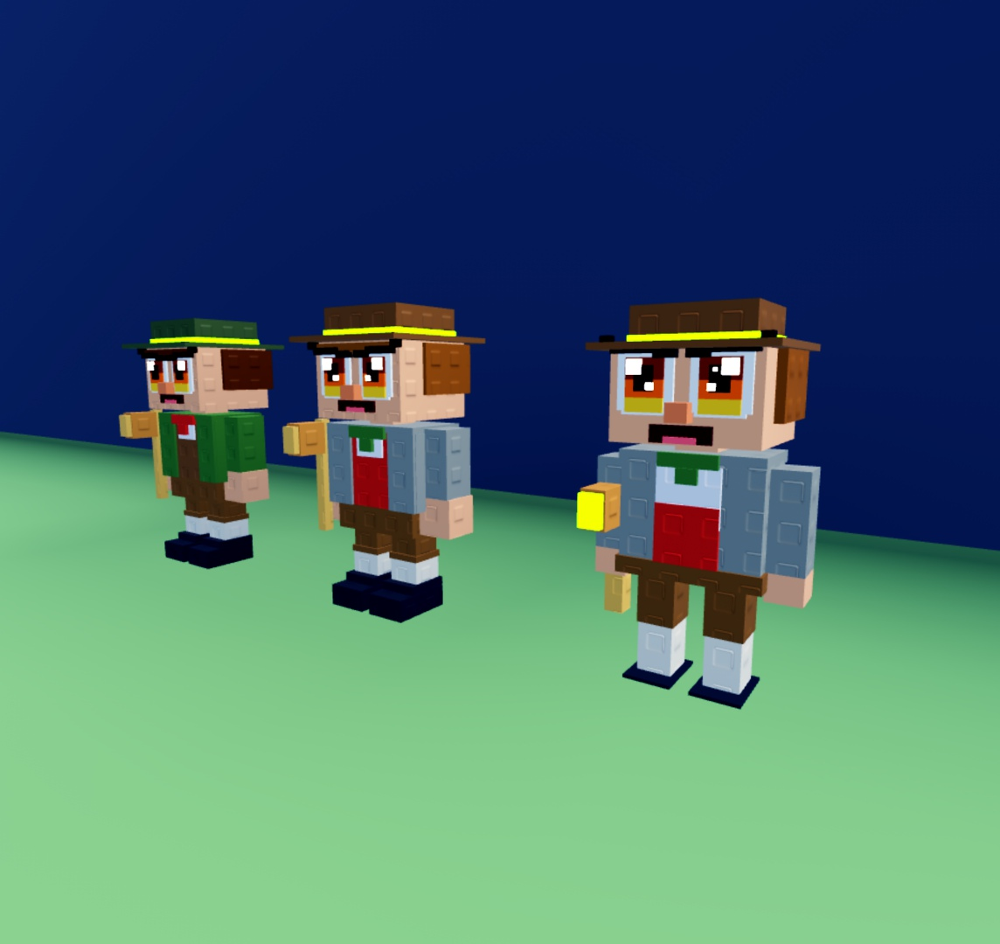

# Review package: Funghetto Franco as a skin on the villager body (round 1)

13 November 2026. Draft only: not approved, not live, not committed. `VillagerAnimationEnabled` is off and the game still shows the old Sprinter template.

## The skin

Left to right: Taglialegna Tito (approved skin), **new Franco**, old Franco (the current Sprinter template).

- **He is Tito's boxes with his own colours.** In the game today Franco is the same Sprinter kit as Tito with a different palette, so his skin reuses Tito's 54 boxes unchanged and takes its colours from his existing palette row. Nothing in `Villagers/Forest.lua` changed.
- **File:** `Shared.Config.VillagerSkins.Forest_FunghettoFranco`. It points at Tito's box list, so a later fix to Tito's shape reaches Franco too.
- **What tells him from Tito:** grey loden jacket, red waistcoat, brown felt hat, green neckerchief and lighter brown hair. Tito has a green jacket, brown waistcoat, green hat, red neckerchief and dark hair.
- **Same body:** a scripted check confirms his joints are identical to the bare body.
- **One glow line:** the hat band is the only Neon part.
- **Height:** 5.68 studs, the same as Tito. The old Franco is 5.90.

## What changed from the old Franco

The same four things as Tito, for the same reasons: he is shorter and stockier on the shared body, the axe edge no longer glows, the axe sits in front of the fist, and less white shirt shows.

## Animations

I did not make a new animation sheet. His boxes are identical to Tito's, so Tito's sheet (`review/Forest_TaglialegnaTito/`) shows exactly how he moves. His activities are Sweep and Chop, as his old idle was Sweep.

## Review pen

Set `AnimationReviewPen = true` on `ReplicatedStorage` and press Play. The back row of the 24 plinths is now Franco.

Checked in Play: 24 Franco figures, a track playing on each, the sign reads "back row Funghetto Franco", no errors. I did not watch each animation play.

## Self-check

| Check | Result |
|---|---|
| Same joints as the body | Pass |
| Box count | 54 of 80 (Tito's list) |
| Exactly one glow part | Pass (hat band) |
| Nothing under the floor, all 24 animations | 23 pass. Skate dips 0.05 studs at the body's own right foot, the body fault already reported. Franco never plays Skate. |
| Clipping | Not checked; same as Tito. |

## Concerns

1. **Nothing about him says "mushrooms".** His name and his shout ("OI! MY MUSHROOMS!") are about mushrooms, but the old model carries the same breadstick axe as Tito and has no mushroom anywhere, so I kept the axe. A mushroom basket in his hand, or a mushroom on his hat, would make him his own character. That would be a new design, so I have not done it; say if you want it.
2. **Two villagers who differ only by colour.** That is how they are today, and this skin keeps it.
3. **Rojo is still disconnected.** I put the skin file and the pen change into Studio by hand and confirmed both are byte-identical to disk.
