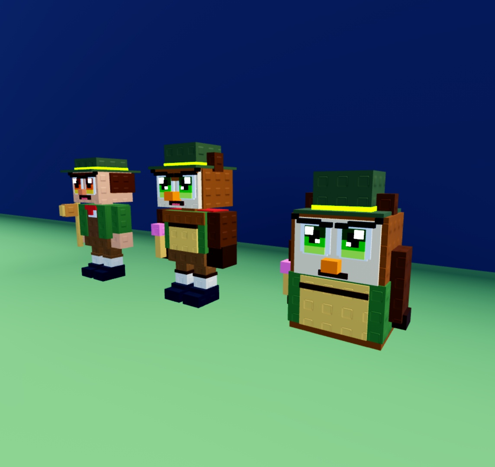
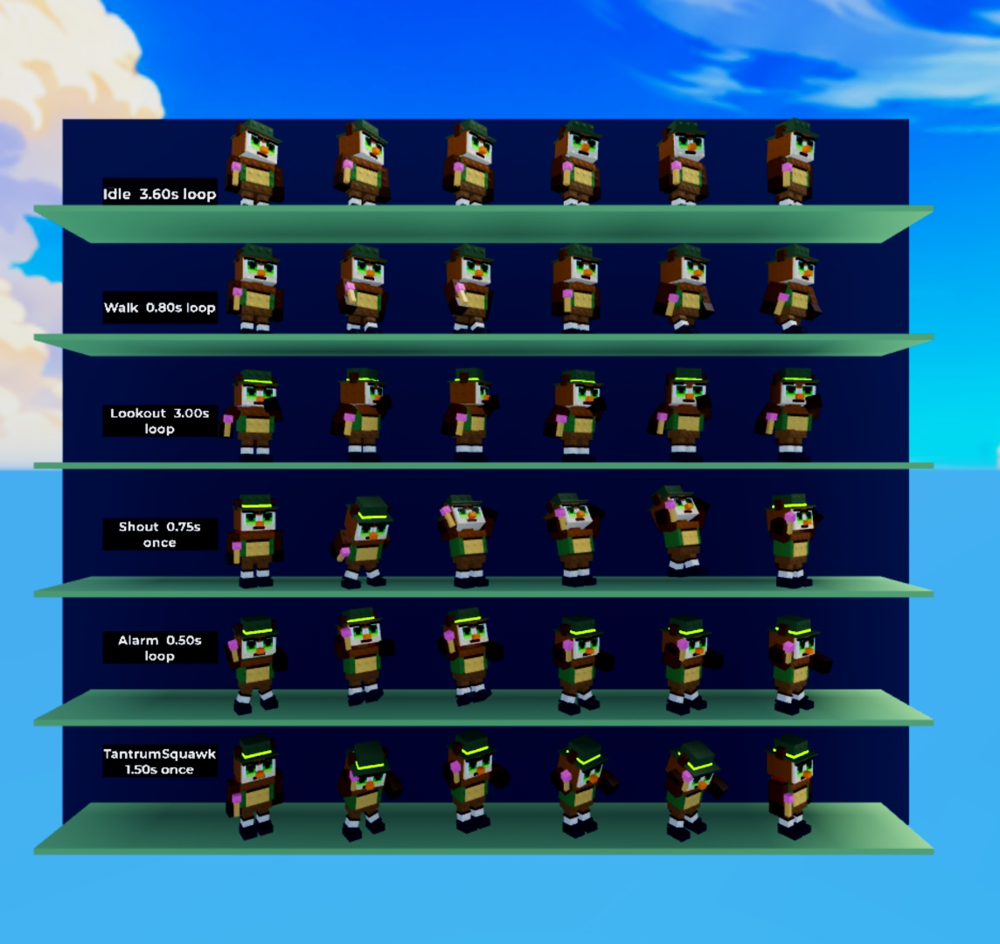

# Review package: Gufo Gelato as a skin on the villager body (round 1)

13 November 2026. Draft only: not approved, not live, not committed. `VillagerAnimationEnabled` is off and the game still shows the old Shouter template.

Gufo is the first animal villager on the shared body. A skin adds no joints and no animations: he uses the 17 joints and 24 animations approved for the body.

## The skin

Left to right: Taglialegna Tito (approved skin, for scale), **new Gufo**, old Gufo (the current Shouter template). The back is in `back_old_gufo_new_gufo.jpg`.

- **File:** `Shared.Config.VillagerSkins.Forest_GufoGelato`, 57 boxes (limit 80). Colours come from his existing palette row; nothing in `Villagers/Forest.lua` changed.
- **Same body:** a scripted check confirms his joint names, parents and positions are identical to the bare body.
- **Identity kept:** cream owl face with big lime eyes and an orange beak, ear tufts poking out past the felt hat, dark wing-arms, cream belly panel with its dark band, green loden waistcoat, red shoulder scarf with a tail down the back, breeches, cream socks, dark boots, and the gelato cone in his right hand.
- **How he is made an owl:** feather boxes cover the body's bare skin (head sides, back and crown, neck, chest), wings cover the arms, and darker wingtips cover the hands. The front of the head stays cream as the face.
- **One glow line:** the hat band is the only Neon part.
- **Hat:** all three hat boxes are on the Hat bone at or above the head top. The ear tufts are on the head, so they stay if the hat is thrown.
- **Height:** 5.95 studs to the top of the hat. The old Gufo is 5.35.

## What changed from the old Gufo

1. **He is no longer a round mascot.** The old Shouter is an egg-shaped body with a face on its front, no neck and stub legs. The new one is a person-shaped owl: a separate head, shoulders, arms and full legs. This is the biggest change of any skin so far, and it is the price of one shared body.
2. **The face is smaller.** The old face plate is 2.3 studs wide on a 2.6-stud body; the new face is the 2.1-stud head.
3. **He is taller** (5.95 against 5.35), because the body's legs are longer than his old stubs.
4. **New: a short fan of tail feathers** on the body's Tail bone. The old model has none. I added it so he reads as a bird from behind; it is one box and easy to remove.
5. **The belly panel is smaller** and sits on the chest of the waistcoat, where the old one covered most of the front.

## Animations on him

Six of the 24: Idle, Walk, his activity (Lookout), and the Shouter's own three (Shout, Alarm, TantrumSquawk).

## Review pen

Set `AnimationReviewPen = true` on `ReplicatedStorage` and press Play. The back row of the 24 plinths is now Gufo; the front row is still the neutral skin.

Checked in Play: 24 Gufo figures, a track playing on each, the sign reads "back row Gufo Gelato", no errors. I did not watch each animation play.

## Self-check

| Check | Result |
|---|---|
| Same joints as the body | Pass |
| Box count | 57 of 80 |
| Exactly one glow part | Pass (hat band) |
| Hat-bone boxes at or above the head top | Pass |
| Nothing under the floor, all 24 animations | 23 pass. Skate dips 0.05 studs at the body's own right foot, the same body fault reported with Tito. Gufo never plays Skate. |
| Clipping | Not checked animation by animation. Watch the points listed under concerns. |

## Concerns

1. **The round silhouette is lost** (see above). If Shouters must stay round, that needs a second body, which the brief rules out.
2. **In Shout the gelato comes up in front of his face.** Shout cups a hand to the mouth, and his right hand holds the cone. It reads as shouting past an ice cream. Moving the cone to the left hand would fix it for Shout but not for the two-handed animations.
3. **The ear tufts pass through the hat brim.** That is how they "poke out"; from some angles the brim cuts across them.
4. **The wings are wider than the arms** (they stick out 0.25 studs behind), so they may brush the scarf and waistcoat when the arms swing.
5. **One activity only.** His old idle was "Bob", which the body does not have. I gave him Lookout. Say if he should have a second one.
6. **The tail feathers are my addition**, not part of his old design.
7. **Rojo is still disconnected.** I put the skin file and the pen change into Studio by hand and confirmed both are byte-identical to disk.
