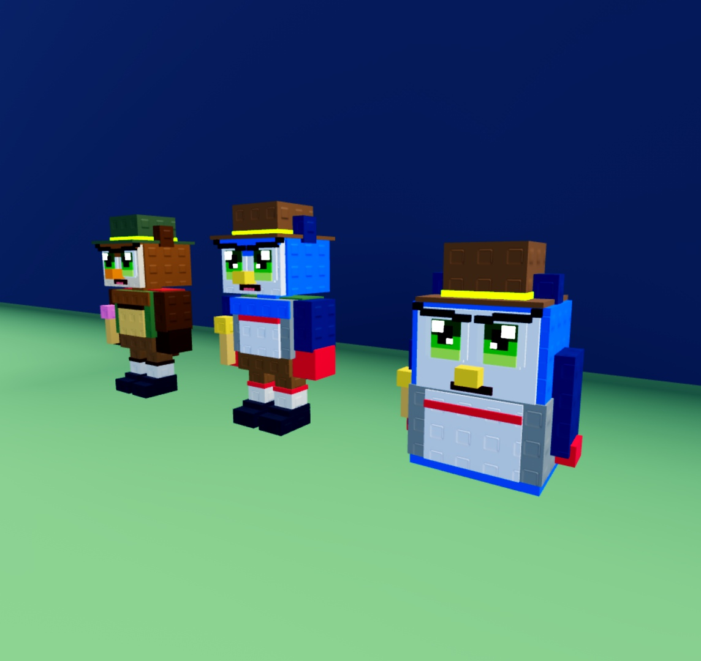

# Review package: Picchio Pepe as a skin on the villager body (round 1)

13 November 2026. Draft only: not approved, not live, not committed. `VillagerAnimationEnabled` is off and the game still shows the old Shouter template.

Pepe is the last of the six Forest villagers.

## The skin

Left to right: Gufo Gelato (approved skin), **new Picchio Pepe**, old Picchio Pepe (the current Shouter template).

- **He is Gufo's boxes with his own colours.** In the game today Pepe is the same Shouter kit as Gufo with a different palette, so his skin reuses Gufo's 57 boxes unchanged and takes its colours from his existing palette row. Nothing in `Villagers/Forest.lua` changed.
- **File:** `Shared.Config.VillagerSkins.Forest_PicchioPepe`. It points at Gufo's box list, so a later fix to Gufo's shape reaches Pepe too.
- **What tells him from Gufo:** blue feathers, white face, yellow beak, red belly band and wingtips, grey waistcoat, brown hat, green scarf and a yellow gelato scoop. Gufo is brown with a cream face, orange beak, green waistcoat, green hat, red scarf and pink scoop.
- **Same body:** a scripted check confirms his joints are identical to the bare body.
- **One glow line:** the hat band is the only Neon part.
- **Height:** 5.95 studs, the same as Gufo. The old Pepe is 5.35.

## What changed from the old Pepe

The same things as Gufo, which you approved: he is a person-shaped bird instead of a round mascot, he is taller with a smaller face, and he has the short fan of tail feathers. One thing is new to him: **the breeches cuffs at his knees are red**, because that box uses the palette's trim colour, which is red for Pepe and dark brown for Gufo.

## Animations

I did not make a new animation sheet. His boxes are identical to Gufo's, so Gufo's sheet (`review/Forest_GufoGelato/`) shows exactly how he moves. His activity is Lookout.

## Review pen

Set `AnimationReviewPen = true` on `ReplicatedStorage` and press Play. The back row of the 24 plinths is now Pepe.

Checked in Play: 24 Pepe figures, the sign reads "back row Picchio Pepe", no errors. 23 of the 24 had a track playing when sampled, and 27 of the 28 neutral figures: one one-shot animation was between repeats in both rows, as seen before with the mole. I did not watch each animation play.

## Self-check

| Check | Result |
|---|---|
| Same joints as the body | Pass |
| Box count | 57 of 80 (Gufo's list) |
| Exactly one glow part | Pass (hat band) |
| Nothing under the floor, all 24 animations | 23 pass. Skate dips 0.05 studs at the body's own right foot, the body fault already reported. Pepe never plays Skate. |
| Clipping | Not checked; same as Gufo. |

## Concerns

1. **He is a woodpecker with an owl's head.** The old model is Gufo's kit recoloured, with the same short beak and two ear tufts, so I kept them. A woodpecker would have a long straight beak and a single red crest. That would be a new design, so I have not done it; say if you want it.
2. **He holds a gelato cone**, as he does today, because the Forest outfit gives every Shouter one. It is Gufo's gag, not his. His shout is "TOK-TOK-TOK! ALARM!".
3. **In Shout the gelato comes up in front of his face**, as with Gufo.
4. **Two villagers who differ only by colour**, as today.
5. **Rojo is still disconnected.** I put the skin file and the pen change into Studio by hand and confirmed both are byte-identical to disk.
