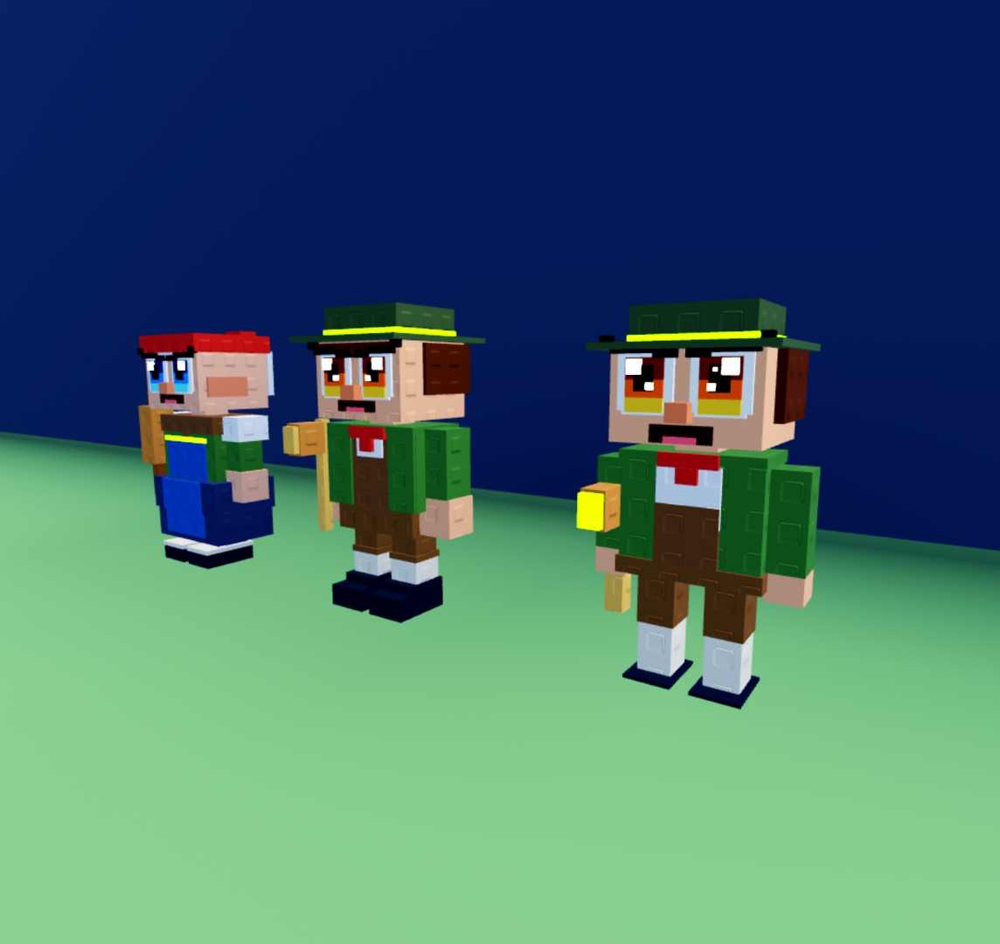
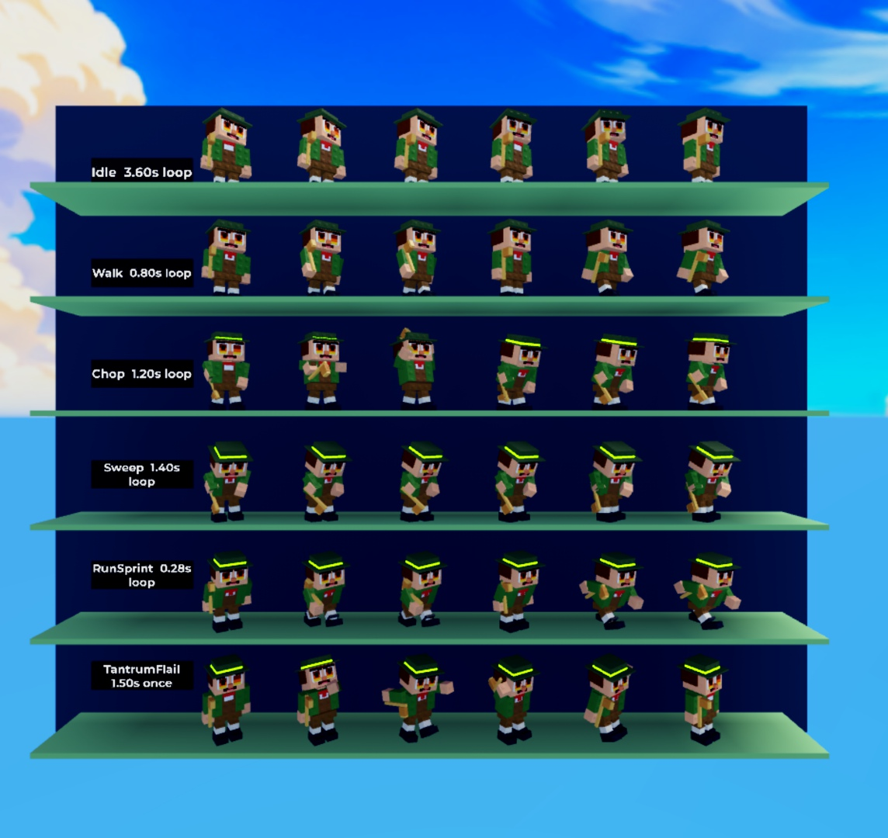

# Review package: Taglialegna Tito as a skin on the villager body (round 1)

13 November 2026. Draft only: not approved, not live, not committed. `VillagerAnimationEnabled` is off and the game still shows the old Sprinter template.

This is the first villager converted after Nonna Pina, and the first on the approved body. A skin adds no joints and no animations: Tito uses the 17 joints and 24 animations you approved for the body.

## The skin

Left to right: Nonna Pina (approved skin, for scale), **new Tito**, old Tito (the current Sprinter template). A straight-on view is in `lineup_front.jpg`.

- **File:** `Shared.Config.VillagerSkins.Forest_TaglialegnaTito`, 54 boxes (limit 80). Colours come from his existing palette row; nothing in `Villagers/Forest.lua` changed.
- **Same body:** a scripted check confirms his joint names, parents and positions are identical to the bare body.
- **Identity kept:** felt hat with the Forest glow cord band, brown hair, green loden jacket open over a brown waistcoat and white shirt, red neckerchief, leather knee breeches, cream knee socks, dark boots, breadstick axe in the right hand.
- **One glow line:** the hat band is the only Neon part, as the Forest outfit card requires.
- **Hat:** all three hat boxes are on the Hat bone and sit at or above the head top, so the hat lands flat if a tantrum throws it.
- **Height:** 5.68 studs to the top of the hat. The old Tito is 5.90.

## What changed from the old Tito

1. **He is shorter and stockier.** The old Sprinter kit was lanky (long legs, 5.9 studs). Everyone now shares one body, so the "lanky runner" silhouette is gone. This is the main loss.
2. **The axe edge no longer glows.** On the old model the blade edge is Neon yellow, which broke the one-glow-line rule. It is now breadstick-coloured.
3. **The axe is held in front of the fist with the blade pointing forward**, where the old one sat beside the hip with the blade forward. This is where the body's Prop bone is, and it is what Chop swings.
4. **The white shirt shows less.** The old model has a wide white shirt panel; the new one shows a narrow shirt front above the waistcoat, with the neckerchief over it.
5. **The belt and glowing buckle are gone.** The Forest outfit already hid the buckle glow; the jacket now covers the waist.

## Animations on him

Six of the 24, chosen because they are the ones he will use most: Idle, Walk, his two activities (Chop and Sweep), his chase run and his tantrum. Sweep uses the axe as the broom, since he has one prop.

## Review pen

Set `AnimationReviewPen = true` on `ReplicatedStorage` and press Play. The back row of the 24 plinths is now Tito (it was Nonna Pina); the front row is still the neutral skin. Nonna Pina stays in the behaviour demo.

Checked in Play: 24 Tito figures, a track playing on each, the sign reads "back row Taglialegna Tito", no errors. I did not watch each animation play.

## Self-check

| Check | Result |
|---|---|
| Same joints as the body | Pass |
| Box count | 54 of 80 |
| Exactly one glow part | Pass (hat band) |
| Hat-bone boxes at or above the head top | Pass |
| Nothing under the floor, all 24 animations | 23 pass. **Skate dips 0.05 studs**, and the part is the body's own right foot, not the skin, so every skin has it. Skate is an Arctic activity Tito never plays. |
| Clipping | Not checked animation by animation. Watch the axe head against the hat brim in Chop, the jacket sleeves against the jacket sides when the arms swing, and the neckerchief against the chin when the head tips down. |

## Concerns

1. **The lanky silhouette is lost** (see above). If Sprinters should still read as taller and thinner, that needs a body change, not a skin change.
2. **Sweep with an axe.** He has no broom. If Chop should be his only activity, say so and I will drop Sweep from his list.
3. **The Skate foot dip is a body-animation fault** I missed when the body was approved. It is small and I have not fixed it, because the body is approved; say if you want it corrected.
4. **Tantrum.** His old tantrum is "WhistleFlail"; the body has TantrumFlail and no whistle. The sheet shows TantrumFlail.
5. **The review pen changed:** its back row now follows the skin under review. That is a small edit to `AnimationReviewPen.lua`, part of this package.
6. **Rojo is still disconnected.** I put the new skin file and the pen change into Studio by hand and confirmed both are byte-identical to disk.
