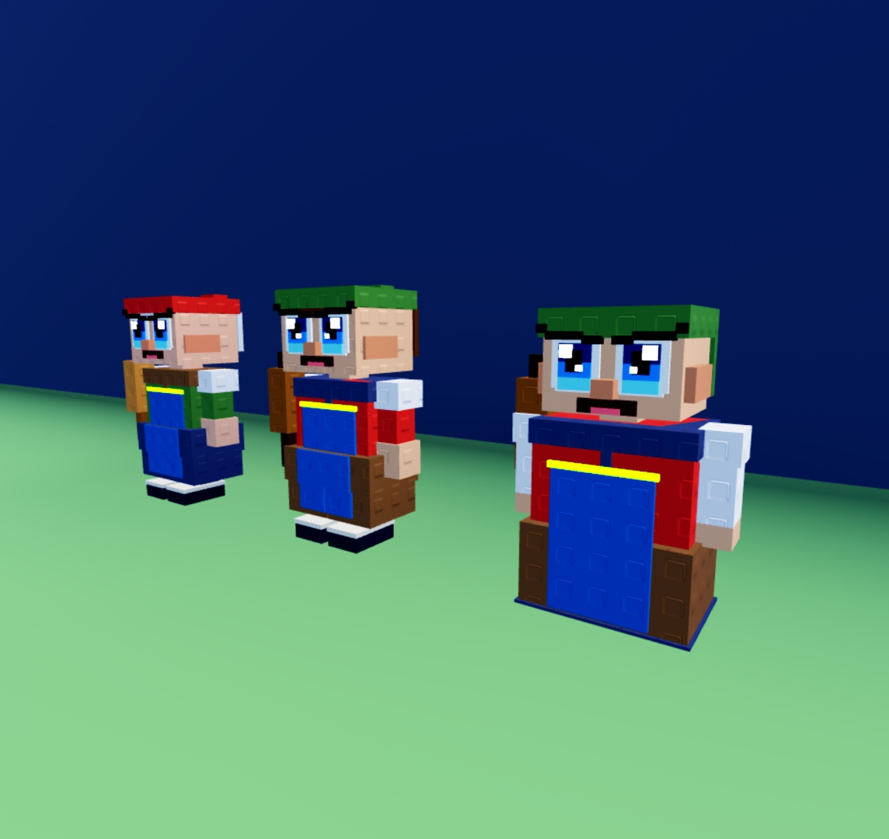

# Review package: Zia Castagna as a skin on the villager body (round 1)

13 November 2026. Draft only: not approved, not live, not committed. `VillagerAnimationEnabled` is off and the game still shows the old Plodder template.

## The skin

Left to right: Nonna Pina (approved with the body), **new Zia Castagna**, old Zia Castagna (the current Plodder template).

- **She is Pina's boxes with her own colours.** In the game today Zia Castagna is the same Plodder kit as Nonna Pina with a different palette, so her skin reuses Pina's 50 boxes unchanged and takes its colours from her existing palette row. Nothing in `Villagers/Forest.lua` changed.
- **File:** `Shared.Config.VillagerSkins.Forest_ZiaCastagna`. It points at Pina's box list, so a later fix to Pina's shape reaches her too.
- **What tells her from Pina:** green headscarf, red bodice, brown wool skirt, navy shawl, dark brown hair and a darker rolling pin. Pina has a red headscarf, green bodice, navy skirt, brown shawl and white hair. Both wear the blue work apron with the Forest glow band.
- **Same body:** a scripted check confirms her joints are identical to the bare body.
- **One glow line:** the apron band is the only Neon part.
- **Height:** 5.5 studs to the top of the scarf knot. The old Zia Castagna is 5.35.

## What changed from the old Zia Castagna

The same things as Pina, which you approved with the body:

1. **She is narrower.** The old Plodder is a wide, squat block with a skirt to the ground. On the shared body she has a waist, separate arms and visible shoes.
2. **The skirt is split** into a hip piece and one panel per leg, so it moves with the legs.
3. **The apron is split the same way**, at the waist and per leg.

## Animations

I did not make a new animation sheet. Her boxes are identical to Pina's, so Pina's rows on the body sheets (`review/VillagerBody/`) show exactly how she moves. Her activities are Sweep and Knead.

## Review pen

Set `AnimationReviewPen = true` on `ReplicatedStorage` and press Play. The back row of the 24 plinths is now Zia Castagna.

Checked in Play: 24 Zia Castagna figures, a track playing on each, the sign reads "back row Zia Castagna", no errors. I did not watch each animation play.

## Self-check

| Check | Result |
|---|---|
| Same joints as the body | Pass |
| Box count | 50 of 80 (Pina's list) |
| Exactly one glow part | Pass (apron band) |
| Nothing under the floor, all 24 animations | 23 pass. Skate dips 0.05 studs at the body's own right foot, the body fault already reported. She never plays Skate. |
| Clipping | Not checked; same as Pina. |

## Concerns

1. **Nothing about her says "chestnut".** Her name means Aunt Chestnut, but the old model is Pina's kit with different colours and has no chestnut anywhere, so I kept the rolling pin. A basket of chestnuts would make her her own character; that would be a new design, so I have not done it.
2. **Her old idle was "Knit".** The body has no knitting animation. I gave her Sweep and Knead, the same pair as Pina in the other order.
3. **Two villagers who differ only by colour**, as today.
4. **Nonna Pina's own skin file still says `approved = false`.** You approved her together with the body on 13 November; I have not flipped the flag because that approval was for the body package. Say if I should mark her approved.
5. **Rojo is still disconnected.** I put the skin file and the pen change into Studio by hand and confirmed both are byte-identical to disk.
