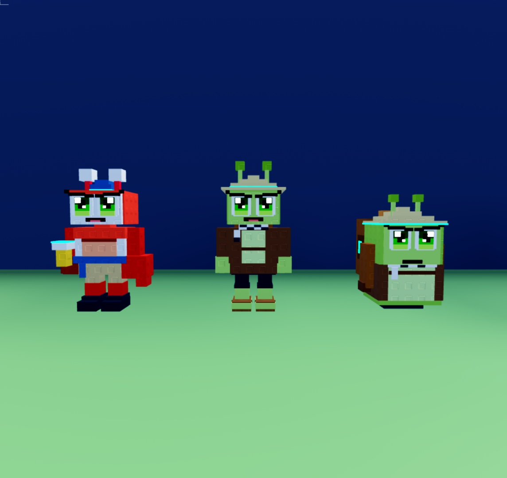
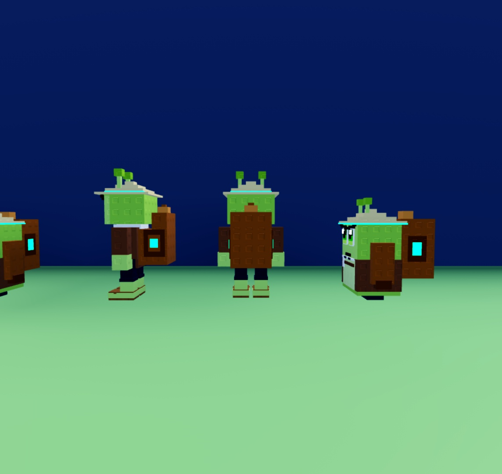
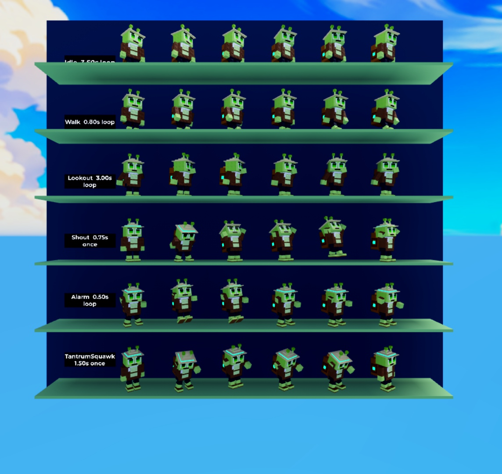

# Review package: Lumaca Lampione as a skin on the villager body (round 1)

13 November 2026. Draft only: not approved, not live, not committed. `VillagerAnimationEnabled` is off and the game still shows the old Shouter template.

Lumaca Lampione is the third of the five Swamp villagers and the Swamp region's Shouter. A skin adds no joints and no animations: he uses the 17 joints and 24 animations approved for the body.

## The skin

Left to right: Granchio Megafono (approved Shouter skin, for scale), **new Lumaca Lampione**, old Lumaca Lampione (the current Shouter Snail template in the Swamp outfit).

From the side, from behind, and the old Lumaca from the same side (right). The shell sits on his back with the glowing lantern window in the middle of its spiral, as on the old model.

- **File:** `Shared.Config.VillagerSkins.Swamp_LumacaLampione`, 69 boxes (limit 80). Colours come from his existing palette row; nothing in `Villagers/Swamp.lua` changed.
- **Outfit:** the Mekong Delta áo bà ba work clothes (snail) from `docs/villagers/Swamp_outfit_reference.md`, in the reference colours only.
- **Same body:** a scripted check confirms his joints are identical to the bare body.
- **Identity kept:**
  - **Head:** a pale mint snail face framed in green, with big green eyes.
  - **Stalks and hat:** two eye stalks poking up through the palm-leaf nón lá.
  - **Scarf:** the checked khăn rằn scarf with a tail.
  - **Clothes:** the brown áo bà ba shirt over a pale belly with a dark band, black trousers rolled to the calf, mint feet on sandals.
  - **Shell:** the big rust snail shell on his back, with a spiral on each side, the glowing lantern window and a little lamp cap on top.
- **Two glow parts:** the hat band and the lantern window, the same two as the old model.
- **Hat:** every hat box is on the Hat joint at or above the head top. The eye stalks are on his head, so they would stay if the hat ever came off; his tantrum (Squawk) does not throw it.
- **Height:** 6.3 studs to the tips of the eye stalks. The old Lumaca is 5.42.

## What changed from the old Lumaca

1. **He is no longer a round mascot.** Like Granchio, the old Shouter is an egg-shaped body with the face on its front. The new one is a person-shaped snail with a separate head, arms and full legs.
2. **The shell is on the body's Back joint.** It is 1.84 studs wide, narrower than the old 2.4, so his arms swing clear of it, and its upper part sits further back so his head can tip back without hitting it.
3. **The shirt is open over his belly.** The old model showed the pale belly too; on the person-shaped body it reads as an open áo bà ba.
4. **Taller**, because the eye stalks stand above the hat on a full-height body.
5. **One activity.** His old idle was Bob, which the body does not have. I gave him Lookout, as I did Granchio.

## Animations on him

Six of the 24: Idle, Walk, his activity (Lookout), and the Shouter's own three (Shout, Alarm, TantrumSquawk).

## Review pen

Set `AnimationReviewPen = true` on `ReplicatedStorage` and press Play. The back row of the 24 plinths is now Lumaca Lampione.

Checked in Play: 24 Lumaca figures, a track playing on each, the sign reads "back row Lumaca Lampione", no errors. I did not watch each animation play.

## Self-check

| Check | Result |
|---|---|
| Same joints as the body | Pass |
| Box count | 69 of 80 |
| Glow parts | 2 (hat band, lantern window), as on the old model |
| Hat-bone boxes at or above the head top | Pass |
| Shell against his arms and legs, all 24 animations | Touches by no more than 0.05 studs except RunSprint, 0.07 |
| Shell against his head, all 24 animations | Clear or under 0.05 except Curious 0.10 and Idle 0.07. My first shell hit his head by up to 0.18 and his arms by 0.15; I narrowed it and moved its top back. |
| Shell against the hat | No more than 0.04 studs |
| Nothing under the floor, all 24 animations | 23 pass. Skate dips 0.05 studs at the body's own right foot, the body fault already reported. |
| Eye stalks through the hat | By design: they pass through the hat's middle rings to stand above it, as on the old model |

## Concerns

1. **The round silhouette is lost**, as with Gufo, Pepe and Granchio.
2. **The eye stalks pass through the hat** rather than through holes in it; at this size it reads as poking out.
3. **One activity**, as on Granchio.
4. **Rojo is still disconnected.** I put the skin file and the pen change into Studio by hand and confirmed both are byte-identical to disk.
