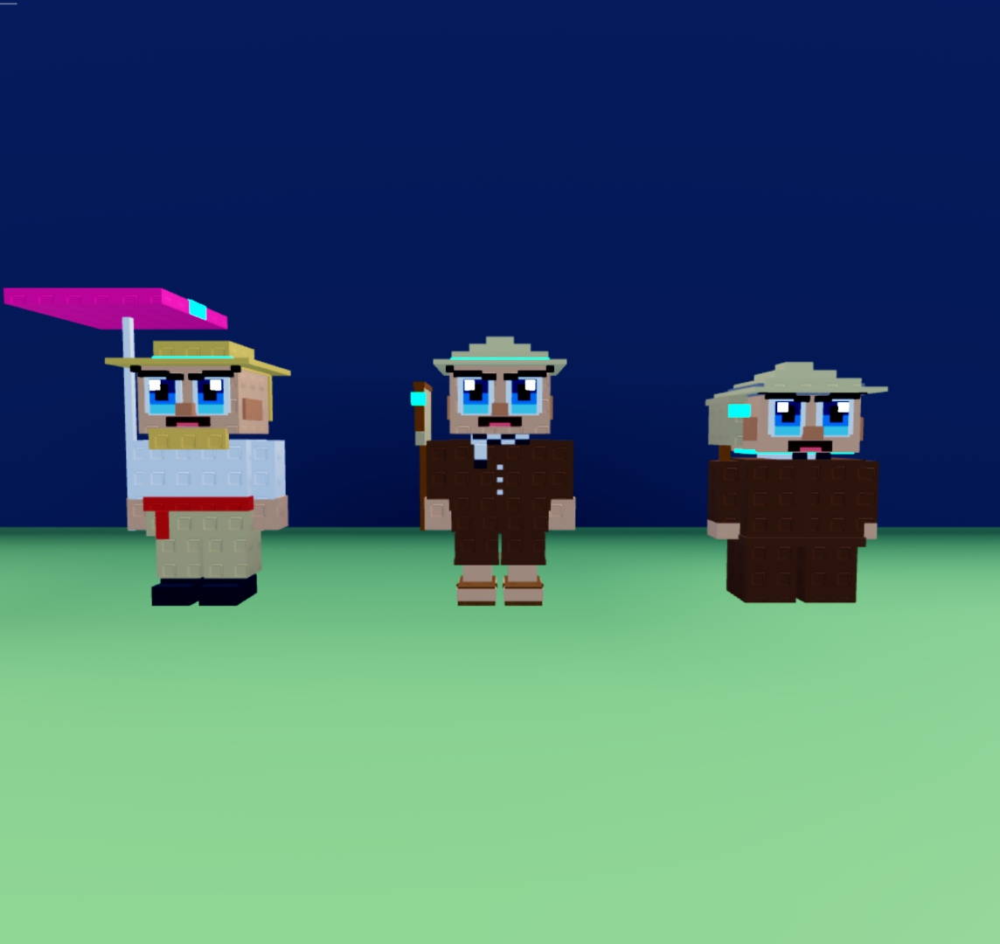
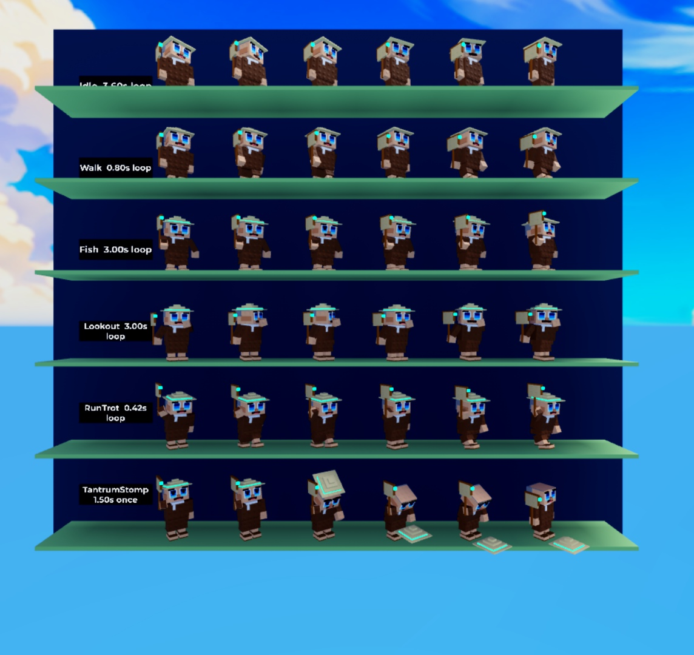

# Review package: Pescatore Pozzo as a skin on the villager body (round 1)

13 November 2026. Draft only: not approved, not live, not committed. `VillagerAnimationEnabled` is off and the game still shows the old Plodder template.

Pescatore Pozzo is the second of the five Swamp villagers and the Swamp region's Plodder. A skin adds no joints and no animations: he uses the 17 joints and 24 animations approved for the body.

## The skin

Left to right: Zio Sabbia (approved skin on the same Plodder kit, for scale), **new Pescatore Pozzo**, old Pescatore Pozzo (the current Plodder Fisher template in the Swamp outfit).

- **File:** `Shared.Config.VillagerSkins.Swamp_PescatorePozzo`, 69 boxes (limit 80). Colours come from his existing palette row; nothing in `Villagers/Swamp.lua` changed.
- **Outfit:** the Mekong Delta áo bà ba work clothes (fisherman) from `docs/villagers/Swamp_outfit_reference.md`, in the reference colours only.
- **Same body:** a scripted check confirms his joints are identical to the bare body.
- **Identity kept:**
  - **Head:** grey hair, full cheeks, a broad nose and blue eyes.
  - **Hat:** the palm-leaf nón lá on his head.
  - **Scarf:** the checked khăn rằn scarf with a tail.
  - **Clothes:** the brown áo bà ba shirt and wide brown trousers rolled to the calf, bare shins, sandals.
  - **Prop:** his fishing net on a pole in the right hand, with a glowing float on the hoop.
- **Two glow parts:** the hat band and the net float, the same two as the old model.
- **Hat:** every hat box is on the Hat joint at or above the head top, so it flies off and lands flat in his hat-throw tantrum. Grey hair shows on top once it is off.
- **Net held upright:** his skin uses the same `uprightProp` rule you approved for Zio Sabbia's umbrella, so the pole stays vertical while his hand moves.
- **Height:** 5.75 studs to the hat tip. The old Pozzo is 5.70.

## What changed from the old Pozzo

1. **The glow line is a band round the hat**, where the strap meets the cone. On the old model the strap was a ring round his neck. A strap below the head cannot be on the Hat joint, which must stay above the head so the hat lands flat when thrown; this way the glow flies off with the hat.
2. **The shirt hangs over the hips, split at the sides**, with three small white buttons. The old shirt's placket was the same brown as the shirt, so it did not show.
3. **His idle is Fish.** The old idle was Knit, which the body does not have; Fish suits a fisherman. I also gave him Lookout.

## Animations on him

Six of the 24: Idle, Walk, his two activities (Fish and Lookout), the Plodder's chase run (RunTrot) and TantrumStomp with the hat throw. The upright rule is applied to every figure on this sheet. In the last row the hat lands on the ground.

## Review pen

Set `AnimationReviewPen = true` on `ReplicatedStorage` and press Play. The back row of the 24 plinths is now Pescatore Pozzo, with the upright rule running live.

Checked in Play: 24 Pozzo figures, all marked for the upright rule, a track playing on each, the sign reads "back row Pescatore Pozzo", no errors. Measured live over 1.5 seconds, the pole stayed within 0.04 degrees of upright. I did not watch each animation play.

## Self-check

| Check | Result |
|---|---|
| Same joints as the body | Pass |
| Box count | 69 of 80 |
| Glow parts | 2 (hat band, net float), as on the old model |
| Hat-bone boxes at or above the head top | Pass |
| Net against his head, hat and body, all 24 animations with the upright rule | Clear in all 24 (no overlap over 0.05 studs) |
| Net above the floor, all 24 animations with the upright rule | Pass: its lowest point is 1.04 studs up |
| Nothing under the floor, all 24 animations | 23 pass. Skate dips 0.05 studs at the body's own right foot, the body fault already reported. The plain floor check, which does not apply the upright rule, also flags the net in Tag, Chop and Sweep; with the rule, as in the game, the net stays 1.04 studs up. |

## Concerns

1. **In Fish the net does not dip.** The upright rule keeps the pole vertical, so while his arm makes the casting and reeling motion the net stays standing beside him. It reads as holding the net up rather than fishing with it.
2. **From the front the net is seen edge-on**, a thin pole with the float, as on the old model.
3. **The glow moved from his neck to his hat** (see above).
4. **Zia Palude is the same kit.** If you approve this, her skin will reuse these boxes with her own colours.
5. **Rojo is still disconnected.** I put the skin file and the pen change into Studio by hand and confirmed both are byte-identical to disk.
