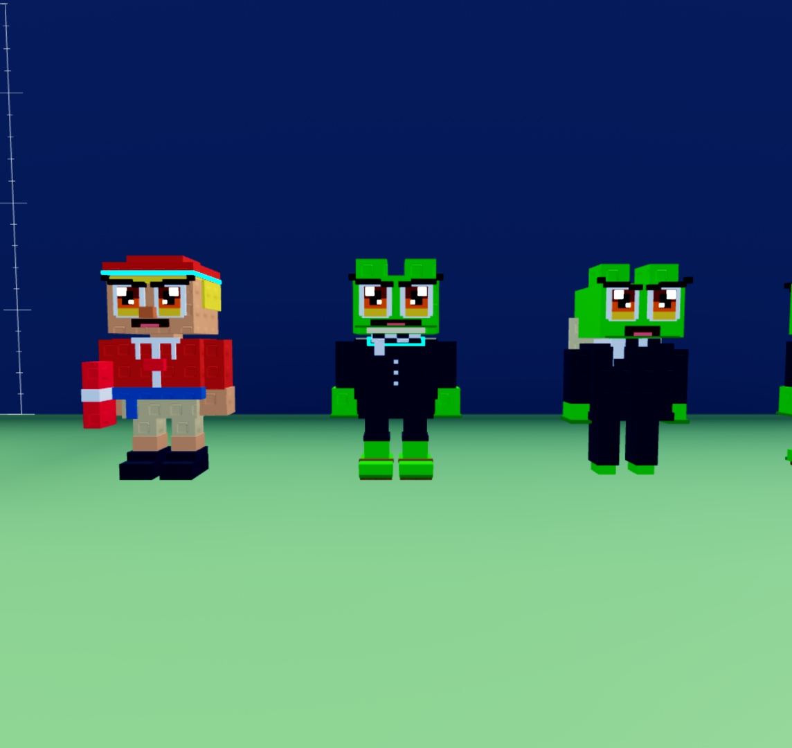
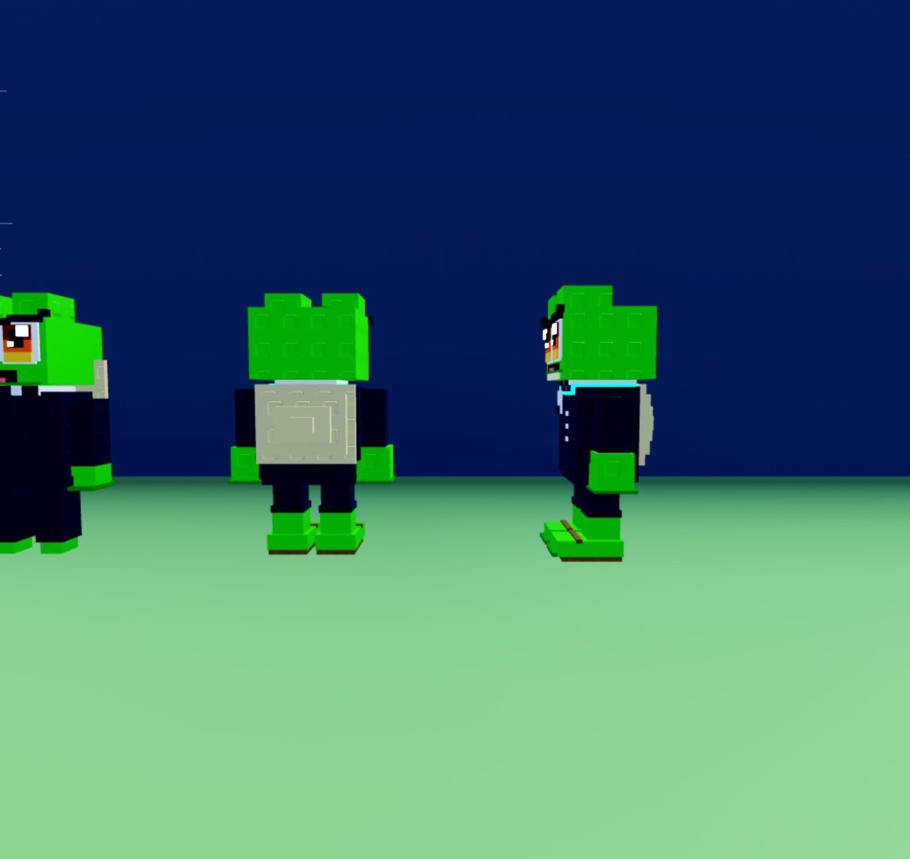
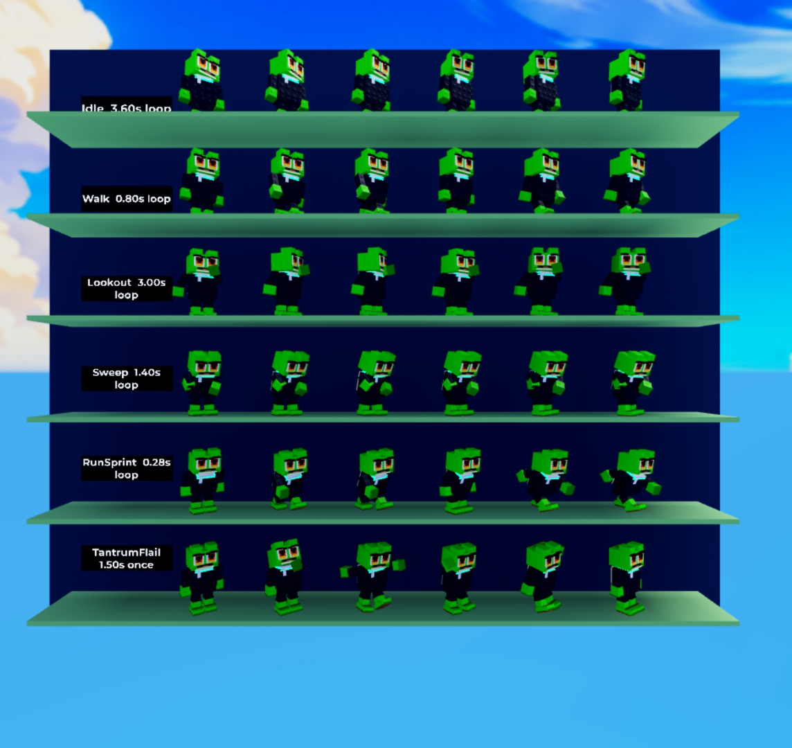

# Review package: Rana Rapida as a skin on the villager body (round 1)

13 November 2026. Draft only: not approved, not live, not committed. `VillagerAnimationEnabled` is off and the game still shows the old Sprinter template.

Rana Rapida is the first of the five Swamp villagers. A skin adds no joints and no animations: he uses the 17 joints and 24 animations approved for the body.

## The skin

Left to right: Bagnino Bruno (approved skin on the same Sprinter kit, for scale), **new Rana Rapida**, old Rana Rapida (the current Sprinter Frog template in the Swamp outfit).

The back and the side: the nón lá hangs on his back, and his webbed feet sit on brown sandals.

- **File:** `Shared.Config.VillagerSkins.Swamp_RanaRapida`, 65 boxes (limit 80). Colours come from his existing palette row; nothing in `Villagers/Swamp.lua` changed.
- **Outfit:** the Mekong Delta áo bà ba work clothes from `docs/villagers/Swamp_outfit_reference.md`, in the reference colours only.
- **Same body:** a scripted check confirms his joints are identical to the bare body.
- **Identity kept:**
  - **Frog:** green skin, two eye bumps on top of the head, big amber eyes, a wide mouth with a dark lip line, webbed hands and webbed feet.
  - **Hat:** the palm-leaf nón lá hung on his back by its strap.
  - **Scarf:** the checked khăn rằn scarf with a tail down the front.
  - **Clothes:** the black áo bà ba shirt and black trousers rolled to the calf, over brown sandals.
- **One glow line:** the hat's chin strap, which runs over both shoulders and round the front of his neck under the scarf. It is five Neon pieces.
- **Height:** 5.45 studs. The old Rana is 5.85.

## What changed from the old Rana

1. **His face is the shared body's head.** It is the same width as before, but the eyes and mouth follow the shared face layout, as on every skin.
2. **Two small additions:** a pale throat under the mouth and two dark spots on top of his head. Both are frog details in his existing palette colours. Say if you want them gone.
3. **The shirt hangs over the hips, split at the sides**, the way an áo bà ba does. Three small white buttons run down the front; the old shirt had a black placket that did not show on black.
4. **The hat is on the body's Back joint.** It moves with his torso, not with his head. Its widest ring is 2.0 studs across, narrower than the old 2.5, so it clears his swinging arms.
5. **The glow strap is a collar band.** My first try ran it in a loop down his chest, which read as a cyan box on his shirt; it is now a band round the front of the neck.

## Animations on him

Six of the 24: Idle, Walk, his two activities (Lookout and Sweep), his chase run and his tantrum. His idle in the game today is Sweep; I gave him Lookout as well, as on Bruno.

## Review pen

Set `AnimationReviewPen = true` on `ReplicatedStorage` and press Play. The back row of the 24 plinths is now Rana Rapida.

Checked in Play: 24 Rana figures, a track playing on each, the sign reads "back row Rana Rapida", no errors. I did not watch each animation play.

## Self-check

| Check | Result |
|---|---|
| Same joints as the body | Pass |
| Box count | 65 of 80 |
| Glow parts | 5 pieces forming one strap line (the old model had one strap piece) |
| Hat on his back against his arms and legs, all 24 animations | Touches by no more than 0.05 studs (Walk, Shout, RunSprint, RunTrot). My first hat was wider and clipped the arms by 0.15. |
| Hat against his head | No more than 0.03 studs |
| Scarf tail against his arms | Clear in the six clips on the sheet |
| Nothing under the floor, all 24 animations | 23 pass. Skate dips 0.05 studs at the body's own right foot, the body fault already reported. He never plays Skate. |

## Concerns

1. **The hat only shows from behind and the side.** From the front you see the strap and scarf; the old model showed a little of the hat's rim past his shoulder.
2. **The scarf sits under the overhang of his head**, so from above it shows as a thin white band. The old model was the same.
3. **Rospo Rocco is the same kit.** If you approve this, his skin will reuse these boxes with his own colours, as Sara did with Bruno.
4. **Rojo is still disconnected.** I put the skin file and the pen change into Studio by hand and confirmed both are byte-identical to disk.
