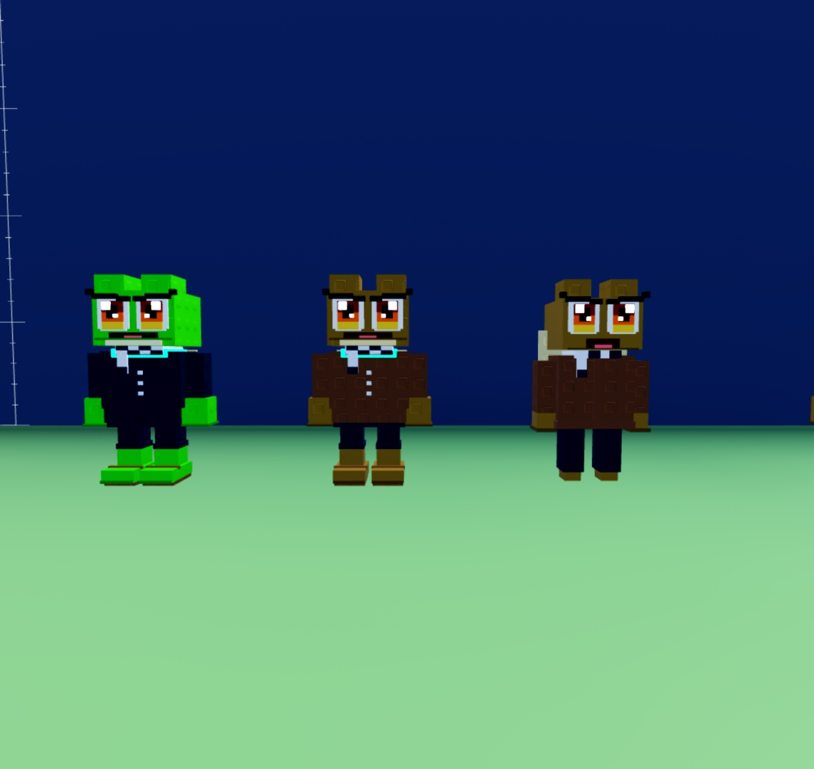

# Review package: Rospo Rocco as a skin on the villager body (round 1)

13 November 2026. Draft only: not approved, not live, not committed. `VillagerAnimationEnabled` is off and the game still shows the old Sprinter template.

Rospo Rocco is the fourth of the five Swamp villagers.

## The skin

Left to right: Rana Rapida (approved skin), **new Rospo Rocco**, old Rospo Rocco (the current Sprinter Frog template in the Swamp outfit).

- **He is Rana's boxes with his own colours.** In the game today Rocco is the same Sprinter Frog kit as Rana with a different palette, so his skin reuses Rana's 65 boxes unchanged and takes its colours from his existing palette row. Nothing in `Villagers/Swamp.lua` changed.
- **File:** `Shared.Config.VillagerSkins.Swamp_RospoRocco`. It points at Rana's box list, so a later fix to that shape reaches him too.
- **What tells him from Rana:** he is a brown toad in a brown áo bà ba shirt with black trousers; Rana is a green frog in black. They share the eye bumps, the nón lá on the back with its glowing strap, the checked scarf, and the webbed hands and feet on sandals.
- **Same body:** a scripted check confirms his joints are identical to the bare body.
- **One glow line:** the hat strap (five pieces), as on Rana.
- **Height:** 5.45 studs, the same as Rana. The old Rocco is 5.85.

## What changed from the old Rocco

The same things as Rana, which you approved: the face follows the shared head, the shirt hangs over the hips with three buttons, the hat on his back is narrower so it clears his arms, and the glow strap is a collar band round his neck.

## Animations

I did not make a new animation sheet. His boxes are identical to Rana's, so that sheet (`review/Swamp_RanaRapida/`) shows exactly how he moves. His activities are Lookout and Sweep, as Rana's are.

## Review pen

Set `AnimationReviewPen = true` on `ReplicatedStorage` and press Play. The back row of the 24 plinths is now Rospo Rocco.

Checked in Play: 24 Rocco figures, a track playing on each, the sign reads "back row Rospo Rocco", no errors. I did not watch each animation play.

## Self-check

| Check | Result |
|---|---|
| Same joints as the body | Pass |
| Box count | 65 of 80 (Rana's list) |
| Glow parts | 5 pieces forming one strap line, as on Rana |
| Hat on his back against his arms and legs | Not measured again; it is Rana's result (no more than 0.05 studs) |
| Body under the floor | Not measured again; it is Rana's result (Skate dips 0.05 studs at the body's own right foot) |

## Concerns

1. **Two villagers who differ only by colour**, as today.
2. **Rojo is still disconnected.** I put the skin file and the pen change into Studio by hand and confirmed both are byte-identical to disk.
