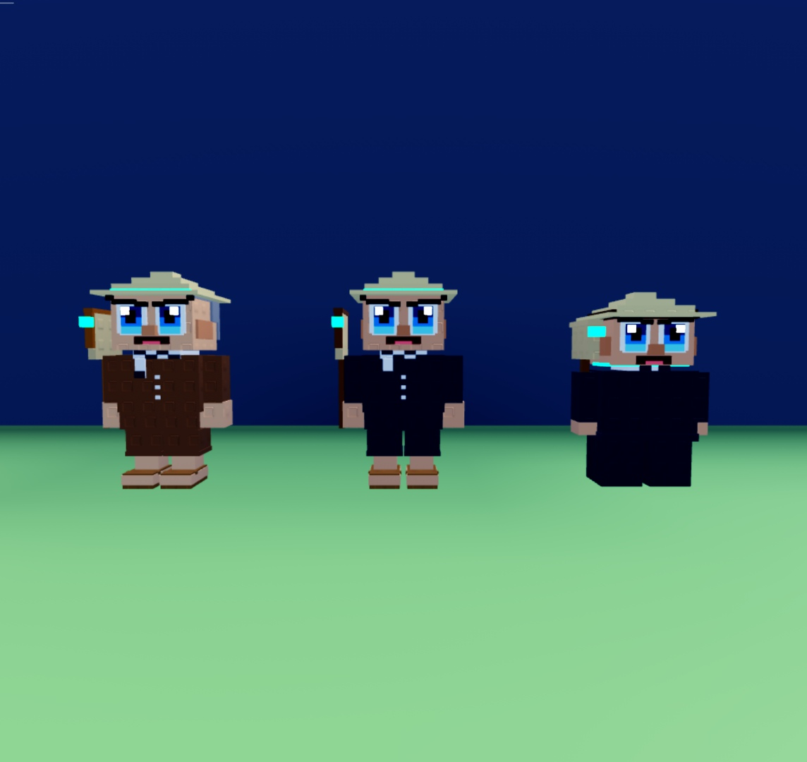

# Review package: Zia Palude as a skin on the villager body (round 1)

13 November 2026. Draft only: not approved, not live, not committed. `VillagerAnimationEnabled` is off and the game still shows the old Plodder template.

Zia Palude is the last of the five Swamp villagers.

## The skin

Left to right: Pescatore Pozzo (approved skin), **new Zia Palude**, old Zia Palude (the current Plodder Fisher template in the Swamp outfit).

- **She is Pozzo's boxes with her own colours.** In the game today Zia Palude is the same Plodder Fisher kit as Pozzo with a different palette, so her skin reuses Pozzo's 69 boxes unchanged and takes its colours from her existing palette row. Nothing in `Villagers/Swamp.lua` changed.
- **File:** `Shared.Config.VillagerSkins.Swamp_ZiaPalude`. It points at Pozzo's box list, so a later fix to that shape reaches her too.
- **What tells her from Pozzo:** a black áo bà ba and trousers, dark brown hair, a darker net pole. Pozzo wears brown and has grey hair. Both wear the nón lá with its glowing band and the checked scarf, and carry the net with its glowing float.
- **Net held upright:** her skin sets `uprightProp = true`, so the same rule you approved for Pozzo and Zio Sabbia holds her net vertical.
- **Same body:** a scripted check confirms her joints are identical to the bare body.
- **Two glow parts:** the hat band and the net float, as on the old model.
- **Height:** 5.75 studs to the hat tip, the same as Pozzo. The old Zia Palude is 5.70.

## What changed from the old Zia Palude

The same things as Pozzo, which you approved: the glow band is on the hat rather than round the neck, so it flies off with the hat in her tantrum; the shirt hangs over the hips with three buttons; and her idle is Fish, with Lookout as well.

## Animations

I did not make a new animation sheet. Her boxes are identical to Pozzo's, so that sheet (`review/Swamp_PescatorePozzo/`) shows exactly how she moves.

## Review pen

Set `AnimationReviewPen = true` on `ReplicatedStorage` and press Play. The back row of the 24 plinths is now Zia Palude, with the upright rule running live.

Checked in Play: 24 Zia Palude figures, all marked for the upright rule, a track playing on each, the sign reads "back row Zia Palude", no errors. Measured live over 1.5 seconds, the pole stayed within 0.04 degrees of upright. I did not watch each animation play.

## Self-check

| Check | Result |
|---|---|
| Same joints as the body | Pass |
| Box count | 69 of 80 (Pozzo's list) |
| Glow parts | 2 (hat band, net float), as on the old model |
| Net against her head, hat and body; net above the floor | Not measured again; it is Pozzo's result (clear in all 24 animations, net at least 1.04 studs up) |
| Body under the floor | Not measured again; it is Pozzo's result (Skate dips 0.05 studs at the body's own right foot) |

## Concerns

1. **Two villagers who differ only by colour**, as today.
2. **She has Pozzo's face and build.** The shared body has no separate female shape, and her dark hair only shows at the back and sides under the hat. Her name means Aunt Marsh; nothing about the old model said "aunt" either.
3. **Rojo is still disconnected.** I put the skin file and the pen change into Studio by hand and confirmed both are byte-identical to disk.
