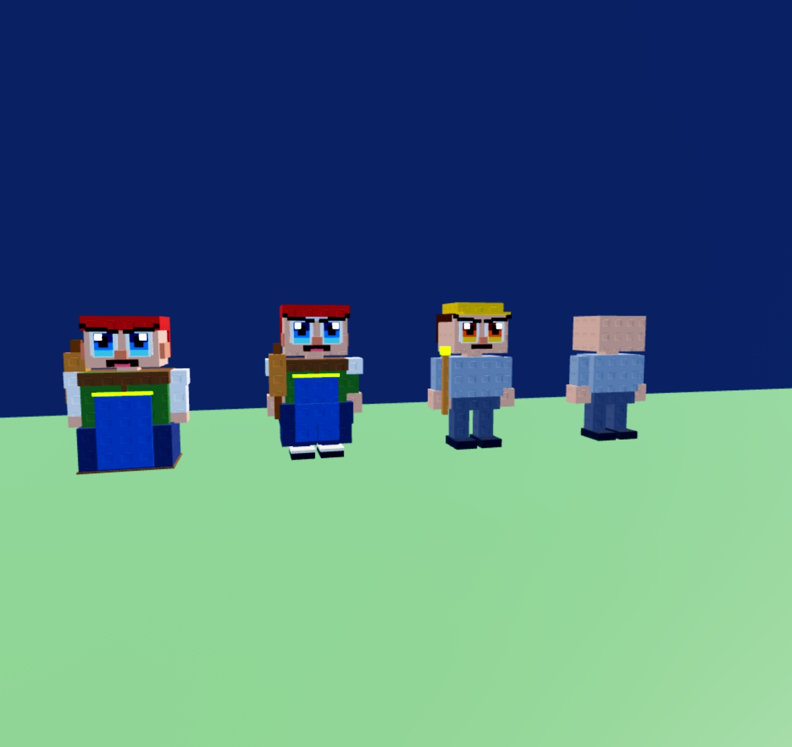
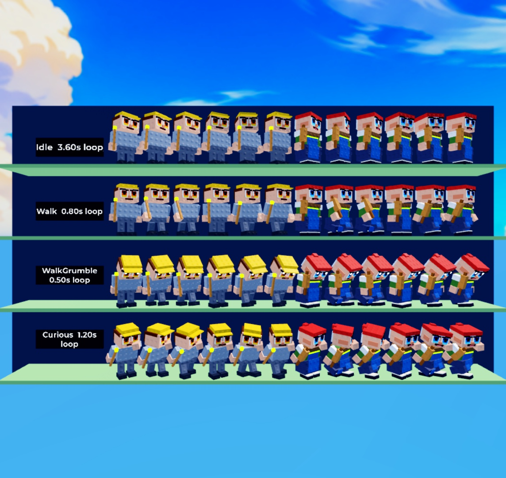
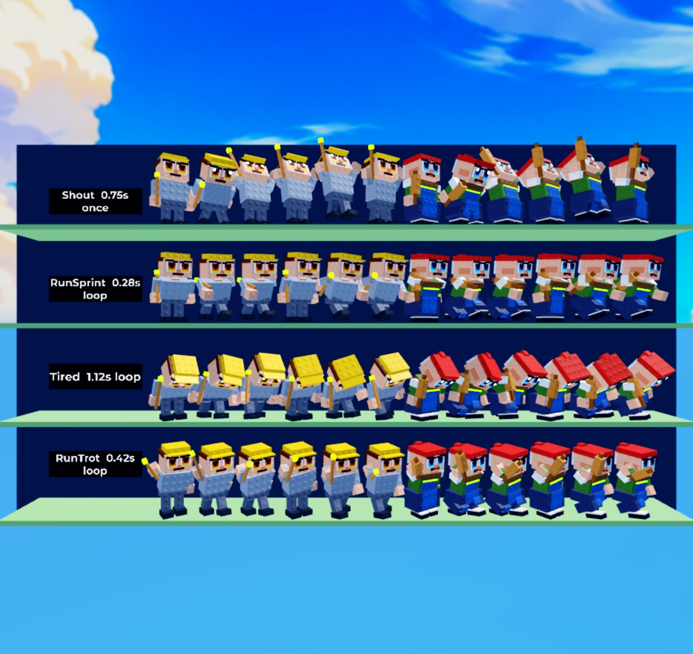
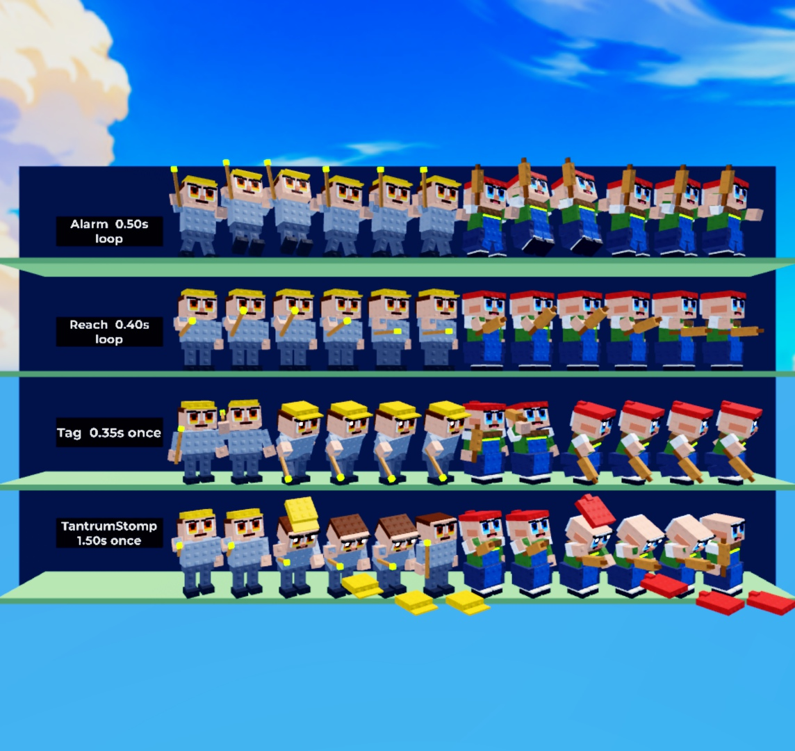
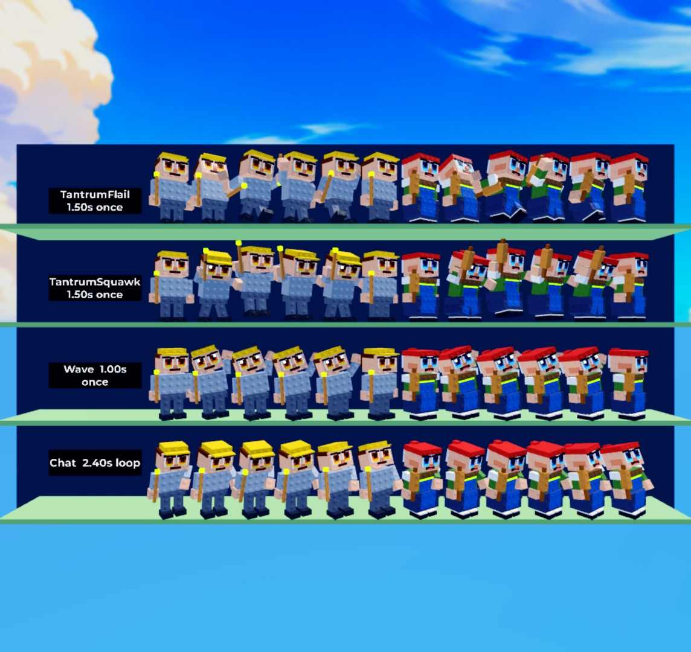
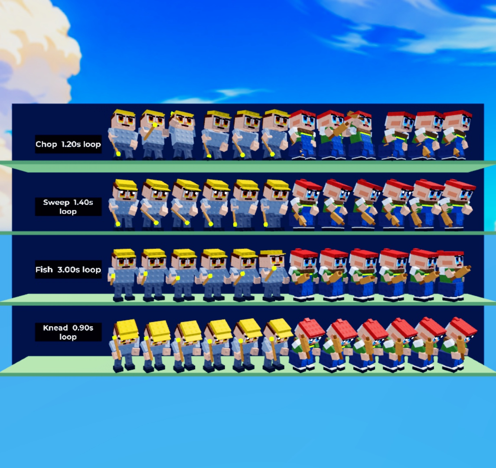
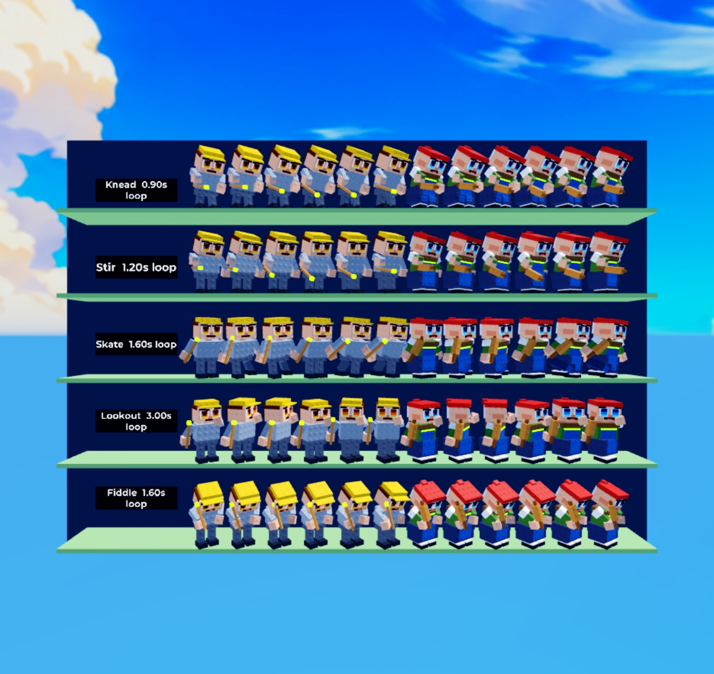

# Review package: the villager body and its 24 animations (round 1)

13 November 2026. Drafts only: nothing uploaded, nothing live, nothing committed. `VillagerAnimationEnabled` is off and the game still shows the old templates.

## The body

- One rig for every villager: `Shared.Config.VillagerBody` (data) built by `Shared.Utility.VillagerBodyBuilder`.
- 17 Motor6D joints: Root→Hips→Torso→Neck→Head, Torso→UpperArmL/R→HandL/R, Hips→LegL/R→FootL/R, plus attachment bones Head→Hat, HandR→Prop, HandL→PropL, Torso→Back, Hips→Tail.
- Proportions: 5.05 studs to the top of the head (5.35 with Nonna Pina's scarf), head 2.1 wide and 1.4 tall, legs 1.5 long, oversized hands and feet. Head plus hat is 32% of the height on Pina and 34% on the neutral skin, a little under the 35% asked for (see concerns).
- Only `Root` is anchored. Bone parts are invisible. `AnimationController` + `Animator` are in the model.
- A scripted check confirms the bare body, the neutral skin and Nonna Pina have identical joint names, parents and C0/C1.
- Skins: `Shared.Config.VillagerSkins.Neutral` (32 boxes) and `Forest_NonnaPina` (50 boxes; limit 80).

Nonna Pina's identity hooks kept: red headscarf (the part she throws), white hair, blue work apron with the single Forest glow band, shawl, wool skirt, rolling pin. Her silhouette is narrower than before because everyone now shares one body.

## Contact sheets

Six frames per animation, three-quarter view, neutral skin on the left and Nonna Pina on the right.

| Sheet | Animations |
|---|---|
|  | Idle, Walk, WalkGrumble, Curious |
|  | Shout, RunSprint, Tired, RunTrot |
|  | Alarm, Reach, Tag, TantrumStomp |
|  | TantrumFlail, TantrumSquawk, Wave, Chat |
|  | Chop, Sweep, Fish (the Knead row here is the older version) |
|  | Knead, Stir, Skate, Lookout, Fiddle |

## The review pen (animations playing live)

1. In Studio, select `ReplicatedStorage` and add a boolean attribute `AnimationReviewPen` = `true`.
2. Press Play. After about two seconds you are moved onto a platform above the Camp.
3. In front of you: 24 labelled plinths, neutral skin in the front row and Nonna Pina behind. Loops loop; one-shots replay every 2 seconds.
4. Behind you: the behaviour demo. A dummy cart drives past on an 18 s loop while a Sprinter, a Plodder (Nonna Pina) and a Shouter play Activity → "?" Curious → "!" Shout → RunSprint then Tired / RunTrot / Alarm → Reach → Tag → tantrum → WalkGrumble home.
5. Back right: a chatting pair, and a villager who waves when you walk within 15 studs.
6. Remove the attribute when you are done.

Checked in Play: 54 figures, all tracks load through an `Animator` from Studio-local ids, `Shout` is exactly 0.75 s, no errors. I did not watch the demo loop end to end; the sign orientation fix made afterwards is untested.

## Self-check

| Check | Result |
|---|---|
| Loops are seamless (first and last pose match) | Pass after fixing Tired, Chat and Chop |
| Nothing goes under the floor (both skins, every animation) | Pass, worst 0.07 stud (Chat) |
| `Shout` is exactly 0.75 s | Pass |
| Hat throw lands flat on the ground and stays | Pass. The landing is solved against the body's own motion. |
| Face stays rigid | Pass: every face box is welded to Head |
| Clipping | Not fully checked by eye. One case fixed (rolling pin across Pina's face in Knead). See concerns. |
| Foot sliding | Not solvable at chase speed. See concerns. |

## Concerns for the owner

1. **Chase speeds and foot sliding.** Chasers move at about 38 to 50 studs/s on 1.5-stud legs. No stride can cover that, so RunSprint, Tired and RunTrot are fast "cartoon legs" cycles and the feet will slide. Walk is authored for 3 studs/s and fits.
2. **No elbows or knees.** The joint list in the brief has one arm segment and one leg segment per side. Crouches are faked by splaying the legs; hands reach the brow but cannot fold. Adding forearms and shins would cost four joints and make every pose read better. Say if you want that before skins are built on this body.
3. **Hat pick-up.** The tantrum leaves the hat on the ground. Getting it back on Return will be a short client blend in Part D (the hat hops back to the head as the villager turns for home), not a separate bend-down clip.
4. **Skin rule added:** boxes on the Hat bone must sit at or above the head top so a thrown hat lands flat. Pina's scarf flap became white hair for this reason.
5. **Tongue out in Tired** needs a tongue box in each skin's face; the body cannot show it.
6. **Head + hat share** is 32 to 34% depending on the hat, against the 35% asked for. A taller head (about 1.6 studs) would meet it.
7. **Sheets are 1144x1080 Studio captures**, not 844x390, and there are no GIFs (no ffmpeg or ImageMagick on this Mac).
8. **Review depth.** These are first drafts authored as code and checked mostly by measurement. Expect to send notes per animation.
